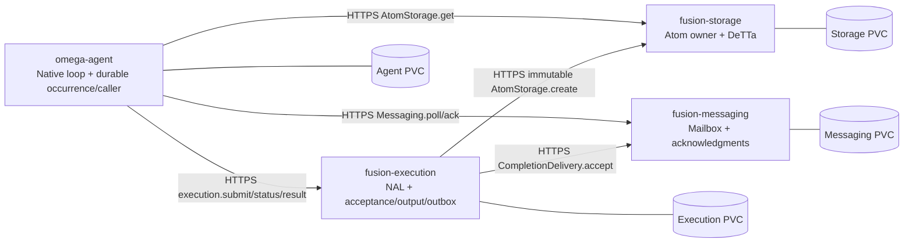

# Single-node Omega/Fusion services

This chart deploys the existing S01 deterministic native operation as four independently managed services. It is a controlled native Omega session, with the existing authored model responses and unused channel/memory fixtures. Native MeTTaClaw, its parser and skill, the original NAL function, DeTTa, Kubernetes networking and HTTPS are real. No generative runtime is required or contacted.

The executed result and source identities are in [the deployment evidence report](../../docs/deployment/single-node.md). This deployment adds placement evidence for an existing operation; it does not add a module family or adopted command.



All four pods run on one node. Each connection uses a ClusterIP Service, full Kubernetes DNS name, verified server certificate and a distinct service credential. The chart creates no public ingress, NodePort, external model connection or shared journal mount. The shared image contains versioned code and pinned build products; it never mounts a developer checkout.

## Ownership and bounded API changes

| Workload | Own mutable state | Allowed outgoing calls |
|---|---|---|
| omega-agent | Application turns/occurrences, caller requests/budgets/receipts, native context observations | Execution submit/status/result, AtomStorage get, Messaging poll/ack |
| fusion-execution | Acceptance, attempt reservations, captured numerical output, result and completion outbox | Private immutable AtomStorage create; trusted CompletionDelivery accept |
| fusion-storage | Atom metadata and DeTTa opaque bytes/shares | None |
| fusion-messaging | Mailbox acceptance, poll state, acknowledgments | None |

`NalService` accepts injected existing AtomStorage/CompletionDelivery ports. Separated execution cannot expose storage/mailbox dispatch or open their databases. Two small authenticated wire adapters expose the existing private owner ports. The caller's `service-network` composition routes its existing S01 envelopes by interface; numerical profiles, descriptors, native commands, logical ownership and caller business logic remain unchanged. Historical local and loopback compositions remain supported. Service DNS requires the explicit new deployment composition and is not accepted by historical loopback configuration.

Commit order remains: application occurrence and original deadline → caller request → caller call reservation → execution acceptance → numerical attempt reservation → numerical output capture → AtomStorage acceptance → execution result/outbox → mailbox acceptance → outbox delivery observation → caller result receipt → mailbox acknowledgment → caller acknowledgment → native result projection. There is no cross-owner transaction. Lost replies may cause safe replay; captured numerical output is reused without another attempt. Outages can exhaust the original 30-second deadline or 64-call budget. Recovery does not renew either, refund attempts, or fall back locally. Work already captured may finish storage/delivery closure after the computation deadline under the existing S01 semantics.

## Prerequisites

Tested platform: Linux x86-64, Docker 28.1.1, Helm 4.3.1, kubectl, OpenSSL, k3s `v1.34.1+k3s1`, local-path storage. The chart requires Kubernetes >=1.32 for the explicit PVC retention policy. Allocate roughly 2 GiB available memory plus image/build disk space for the isolated node and four demo pods. Docker access is equivalent to host administration; the optional isolated k3s container needs `--privileged`. The default kubeconfig is never used by these commands.

Build tools for fresh native products: Git, Python 3.12, uv, C/C++ toolchain, CMake, Ninja, SWI build dependencies including GMP, SSL, zlib and Python development libraries; Rust/Cargo and the locked crate cache for DeTTa. See the existing [S01 builder](../../scripts/build_s01.py), [source pins](../../integration/neoclaw/sources.json), and [DeTTa builder](../../scripts/build_detta.py). Neither builder changes upstream source. Missing build dependencies/cache are prerequisites, not permission to substitute fixtures.

The supported native pins are MeTTaClaw `2af37c3fec18613de54ca42fde2382a9087d4524`, PeTTa `fea83178af3722666d2948d074591d10a3134f56`, SWI `e58621a91ab7dd530e1e8185ed518f63d851c414` (10.0.1), Python 3.12.12 and secured-contract-spaces `272888f264dd2dde18b574cabb53c266b0dac2ec`. Use a clean pinned dependency checkout, not a possibly modified sibling repository.

```bash
# Optional fresh builds; use an empty destination and Python 3.12.
python3.12 scripts/build_s01.py artifacts/single-node/native
git clone https://github.com/machieke/secured-contract-spaces.git artifacts/single-node/detta-source
git -C artifacts/single-node/detta-source checkout --detach 272888f264dd2dde18b574cabb53c266b0dac2ec
DETTA_REPO="$PWD/artifacts/single-node/detta-source" python3.12 scripts/build_detta.py

# Or package the already validated existing products used for this delivery.
python3.12 deploy/single-node/package_image.py artifacts/single-node/image \
  --runtime artifacts/s01/native-02/runtime.json \
  --detta artifacts/detta-build/target/debug/fusion-detta-adapter
docker build -t fusion-single-node:single-node-v1 artifacts/single-node/image
docker save fusion-single-node:single-node-v1 > artifacts/single-node/image.tar
```

For a fresh native build, change `--runtime` to its generated `runtime.json`. Packaging verifies the original source/binary pins, relocates only paths, and records source hashes and the shared-library closure in `package.json`. The pinned Debian base supplies glibc. This is a reproducible source/build recipe with recorded products, not a bit-for-bit compiler reproducibility claim. Four roles intentionally use the same image; Kubernetes manages them independently. New build bytes need their own image digest; do not reuse the evidence digest for a rebuilt artifact.

## Isolated single-node cluster and image import

Use a new Docker container/volume name if these names already exist. Never reuse an unrelated cluster or delete an existing volume to make this command succeed.

```bash
mkdir -p artifacts/single-node
chmod 700 artifacts/single-node
docker volume create omega-fusion-k3s-data
docker run -d --name omega-fusion-k3s --hostname omega-fusion-k3s \
  --privileged --cgroupns=host --tmpfs /run --tmpfs /var/run \
  -v omega-fusion-k3s-data:/var/lib/rancher/k3s \
  -p 127.0.0.1:16443:6443 \
  rancher/k3s@sha256:5e0707cfd1239b358ef73f3254bc3eadc027dd30cd5ec6ca41e29e47652a1b8c \
  server --disable traefik --disable servicelb --disable metrics-server \
  --tls-san 127.0.0.1 --node-name omega-fusion-k3s

# After k3s has written its kubeconfig:
umask 077
docker exec omega-fusion-k3s cat /etc/rancher/k3s/k3s.yaml \
  | sed 's/127.0.0.1:6443/127.0.0.1:16443/' > artifacts/single-node/kubeconfig
export KUBECONFIG="$PWD/artifacts/single-node/kubeconfig"
kubectl wait --for=condition=Ready node/omega-fusion-k3s --timeout=60s
docker exec -i omega-fusion-k3s ctr --address /run/k3s/containerd/containerd.sock \
  --namespace k8s.io images import - < artifacts/single-node/image.tar
# Explicit digest alias for the delivered image in the offline containerd store:
docker exec omega-fusion-k3s ctr --address /run/k3s/containerd/containerd.sock \
  --namespace k8s.io images tag docker.io/library/fusion-single-node:single-node-v1 \
  docker.io/library/fusion-single-node@sha256:e248411f55865b65525eabf788c322756719fbcaac3b42903d3da004d015029c
```

`deploy/single-node/values.yaml` pins that delivered manifest digest. For a fresh rebuild, read its actual digest from `ctr images ls`, create the matching alias, and select it in your values; never label different bytes with this evidence identity. The Docker image configuration ID and the OCI manifest digest are different hashes, both recorded in the evidence.

On an already provisioned dedicated k3s node, import the same archive into that node's containerd and use its explicitly selected kubeconfig. The Docker-hosted node is the executed single-node recipe; no multi-node claim follows from it. [k3s documents image import](https://docs.k3s.io/installation/airgap).

## Existing Secrets, installation and inspection

Each component's ConfigMap holds only non-secret configuration. `existingSecret` must refer to a separately created Secret with `tls.crt`, `tls.key`, and `ca.crt`. Leaf certificates must cover `<component>.<namespace>.svc.cluster.local`. Each receiving service has `caller-token` and `worker-token`; the agent carries `<service>-token` for its three peers, and execution carries storage/messaging worker tokens. Tokens are distinct for caller and worker across services. The agent's leaf certificate serves only its health endpoint. Authentication uses bearer credentials inside verified TLS, not mutual TLS.

The following helper creates **new synthetic demo credentials and a seven-day local CA**, verifies each chain, and creates four Secrets independently of Helm. Keep its private directory and kubeconfig out of publication. Production PKI/credential rotation are separate work.

```bash
kubectl create namespace omega-demo
python3.12 deploy/single-node/create_secrets.py \
  --kubeconfig "$KUBECONFIG" --namespace omega-demo \
  --directory artifacts/single-node/demo-private
helm lint deploy/helm/omega-fusion
helm upgrade --install omega deploy/helm/omega-fusion --namespace omega-demo \
  -f deploy/single-node/values.yaml --wait --timeout 120s
kubectl -n omega-demo get pods,services,pvc
kubectl -n omega-demo exec omega-agent-0 -- \
  /opt/native/python/bin/python3.12 -m integration.single_node.observe
```

The default chart runs one bounded, two-turn synthetic native session. The only admitted command is `metta (Truth_Deduction (stv 0.8 0.9) (stv 0.7 0.8))`. A second authored response consumes the actual returned value `(stv 0.5599999999999999 0.4032)` in the native loop context. Historical broad skill descriptions remain visible in that native prompt; they do not grant command authority. The operation is accepted by the existing closed S01 parser/whole-batch policy.

To inspect another owner, exec the observer in **that owner's pod**. It reads only that pod's local synthetic journal. Observers are diagnostics, never runtime inputs. Do not mount someone else's PVC. `BOUNDED_STOP` plus the caller receipt, one numerical attempt, acknowledged completion and observed next context establishes workflow success; HTTP readiness alone does not.

## Rollout, health and persistence

The chart fixes every StatefulSet at one replica. Ordinal names other than `<role>-0` are rejected by the process, and a lifetime PVC `flock` prevents two processes from writing the same owner. The service checks a role/scope/composition seal before opening journals. StatefulSet RollingUpdate terminates the previous ordinal before replacing it; there is no Deployment surge. Do not force-delete a pod on an unreachable node or bypass these guards. [StatefulSet identity and storage behavior](https://kubernetes.io/docs/concepts/workloads/controllers/statefulset/) are part of this deployment assumption.

Each owner has its own RWO local-path PVC. The PVC retention policy is `Retain` on scale-down and StatefulSet deletion. Helm uninstall preserves claims. Deleting a claim or the isolated node's Docker data volume can destroy local data; local-path allocation is not HA or a hard disk quota. Backup/restore, disk loss, fencing across nodes and populated-state migration are untested.

Startup, readiness and liveness perform only HTTPS GETs against in-memory owner/process health. They do not submit, calculate, reserve calls, poll a mailbox or acknowledge anything. Kubernetes' HTTPS probes do not verify the server certificate; application-to-application HTTPS does. Agent startup makes a bounded, read-only dependency-health check before beginning a new native invocation. A failed native workflow remains observable and is not automatically resubmitted by the service host. [Probe semantics](https://kubernetes.io/docs/tasks/configure-pod-container/configure-liveness-readiness-startup-probes/) are deliberately separate from task success.

SIGTERM stops acceptance and the execution pump, signals the native child, and waits within the 30-second pod grace period. An interrupted independent commit is recovered through the existing owner protocol. ConfigMap checksums trigger only the affected service's rollout. Secret data is resolved into a mode-0600 tmpfs configuration at startup, so credential changes require an explicit corresponding pod rollout; there is no claim of instantaneous Secret rotation.

```bash
# Non-secret configuration change: restart this component with the retained PVC.
helm upgrade omega deploy/helm/omega-fusion --namespace omega-demo \
  -f deploy/single-node/values.yaml \
  --set components.omega-agent.config.revision=review-2 --wait --timeout 120s

# After deliberately updating an existing Secret, restart its consumers/owner.
kubectl -n omega-demo rollout restart statefulset/fusion-messaging
kubectl -n omega-demo rollout status statefulset/fusion-messaging --timeout=60s
```

Completed sessions stay completed on replacement. A new occurrence requires new deliberate application input; this chart's fixed demonstration does not manufacture a new session. Use a new synthetic namespace/PVC set to repeat the demonstration. Never delete a journal merely to refund a failed request's budget.

## Fault integration tests

This operator test driver creates fresh namespaces, certificates and journals. It does not run any generative model. Test faults are disabled by default and require explicit `testFaultsEnabled`. Pause markers and one-time response drops apply only to fresh test state. Native command processing remains the existing implementation.

```bash
python3.12 -m unittest tests.test_single_node tests.test_single_node_chart \
  tests.test_neoclaw tests.test_neoclaw_application tests.test_responses \
  tests.test_m11 tests.test_neoclaw_search -v
python3.12 -m integration.single_node.test_cluster \
  --kubeconfig "$KUBECONFIG" --prefix omega-test \
  --output artifacts/single-node/tests --image-tag single-node-v1 \
  baseline health lost-submit lost-storage lost-completion caller-replacement \
  provider-replacement storage-outage service-outage wrong-credential config-restart
```

The outage case intentionally retains a terminal deadline/budget outcome. That is not a successful numerical workflow and is reported separately. A response-loss success proves duplicate-safe owner commits, not exactly-once TCP transmission or exactly-once uncommitted computation.

## Cleanup

First save the sanitized observations you need. Uninstall removes workloads, ConfigMaps and Services; it does not delete existing Secrets or PVCs.

```bash
helm uninstall omega --namespace omega-demo
kubectl -n omega-demo get pvc
# Only for this disposable synthetic demo, when its state is no longer needed:
kubectl delete namespace omega-demo
# Stop this task-owned isolated node while retaining its backing data:
docker stop omega-fusion-k3s
# Optional final destruction, after all intended evidence/state is preserved:
docker rm omega-fusion-k3s
docker volume rm omega-fusion-k3s-data
```

Apply equivalent cleanup explicitly to each test namespace listed in its report; never wildcard unrelated namespaces. Keep artifact directories containing credentials private, or delete those specific directories after cluster destruction. Images are delivered locally with content identities; no public registry upload or production deployment is implied.

## Optional memory-service qualification

The S03.2 memory composition adds separate E5 and vector Search workloads with
an authenticated authoritative-storage feed. Use fresh state and the separate
[memory deployment runbook](../../docs/deployment/single-node-memory.md).
**Do not apply the memory overlay to the retained `omega-demo` S01 PVCs.**
The historical S01 values, numerical profile and evidence above remain intact.
