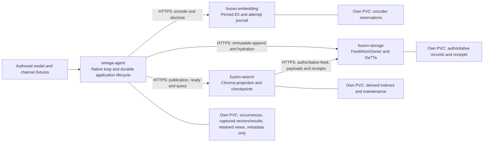

# Native memory across single-node services

This increment packages the existing S03–S03.2 memory operations. It adds deployment evidence, not a module family, command, numerical profile, or live-model campaign. The starting checkout is `369483360b51baf968ad41b19d6776ac66fe085f`; the retained `omega-demo` belongs to the earlier S01 deployment and must not be modified.

## Ownership and placement



The caller selects three endpoints independently. Candidate hydration goes directly to storage. Neither encoding nor synchronous reads are routed through execution or a mailbox. The original execution and messaging workloads remain available in the chart; their S01 configuration is tested separately.

Search receives only authenticated source/read ports. `SearchPorts` refuses a configuration containing a DeTTa binary selection; injected `RemoteSource` has no create method, local backend, or foreign journal access. Search's service credential is distinct from the initiating application credential. Storage permits its receipt observation only for the operator-bound application, session and scope, after checking current indexer permission and current initiating-application permission. A wire `principal` never grants delegation. Only storage opens the authoritative feed and DeTTa files.

The historical descriptors and numerical profiles remain unchanged. `neoclaw-memory-services/1` explicitly selects DNS placement; it does not silently broaden the historical loopback transport. Requests and replies retain their selected descriptors, request hashes, scope and principal checks. New source ports are closed and read-only; append creates still validate the complete bound intent, allowed role, immutable bytes and enrollment dependencies.

## Application semantics

The demonstration starts from an empty, ready source view, then native `remember` creates a declared distractor. Native `query` observes that the target is absent. A later native `remember` creates the synthetic target, and a later `query` finds it without configuration edits or caller-supplied answer references. Another intentional identical-text remember has a new occurrence/UUID; prior query occurrences retain their old snapshots and captured results. Clocks used for comparison are explicitly declared fixtures; native sampling and the original preprocessing, ranking, STV, promotion, linked-label, uniqueness and presentation paths remain in use.

Storage acceptance, named Search publication, local metadata readiness, application view selection and native success are separate commits/observations. Failed receipt observation is not absence. Accepted deadlines, physical encoding attempts, call/build budgets and completed captures survive replacement; no fallback or refunded reservation is introduced.

The agent image contains the pinned Chroma metadata SDK but no torch, transformers, sentence_transformers or E5 weights. Its metadata collections contain only one-dimensional placeholder embeddings and permitted enrichment metadata, with payload/candidate access forbidden by the existing facade. Query vectors and immutable payloads captured by the application are legitimate receipts, not a fallback index.

## Operational scope

Use `deploy/single-node/memory-values.yaml` with the same chart and explicit task kubeconfig. All services are ClusterIP-only, with Kubernetes DNS and verified TLS plus per-service bearer credentials. Each mutable owner is a one-replica StatefulSet with a lifetime PVC lock, owner seal, ordered replacement and retained RWO PVC. No working-tree or cross-owner volume is mounted. Rollouts do not delete PVCs or reset journals. Secrets are generated separately and referenced by name; secret rotation requires an explicit rollout. Do not change a semantic binding on an accepted session: the application refuses it.

Images carry verified, relocated pinned assets. No query installs packages or downloads models. The encoder validates and loads its existing CPU model before readiness; health GETs do not encode, accept occurrences, write records or consume budgets. The first empty projection is a separately journalled setup operation, before native occurrences exist. Original operation deadlines begin only at native acceptance.

The memory caller mounts only CA trust and scoped client tokens: no TLS private key. Its outbound module calls use authenticated HTTPS; its separate, inert kubelet probe listener uses HTTP and accepts no module work. Provider pods host the HTTPS listeners and hold their own TLS keys. The pod remains the trust boundary; this is not hostile-code isolation within a pod. No ServiceAccount token is mounted. NetworkPolicy, multi-node operation, node-loss recovery, HA and production readiness are not claimed.

Results, commands, image digests and the gate-by-gate report are recorded in the [evidence packet](../../evidence/single-node-memory/README.md). Historical live-model and chain evidence remains separate; neither runs in this memory qualification.

## Executed result and limits

**The single-node memory integration passes its bounded gates.** In the final-image baseline, the actual native loop completed three remembers and three queries, captured six real E5 evaluations, and consumed their results in seven successive fixture-model contexts. The queries retained source positions **4, 8 and 12**, with four published generations including the initial empty view. The target was absent on the first query and present after native remember. The intentional second remember of identical text created a distinct UUID. Replay tests preserved the original occurrence and UUID.

The [final native comparison](../../evidence/single-node-memory/native-comparison-final.json) matches the pinned original seven-turn execution exactly for feedback, vectors, distances and candidate order. Only the three random UUIDs are mapped by write order; no float tolerance or repaired result is used. The historical adapted local/loopback-HTTPS comparison also passed on the final runtime source. These are controlled native-loop integrations with explicit external fixtures, not default full Omega or real-model workflows.

| Required gate | Result | Executed evidence / qualification |
|---|---|---|
| BASELINE | PASS with known regression exception | Exact starting HEAD; original S01 values and new base image both exercised. One unrelated M5 Python 3.12 protocol/fixture failure reproduced at the unchanged starting commit. |
| CHART_IMAGES | PASS | Six independently managed roles, own ConfigMap/Secret/PVC; original four-role values still work. Final digest-pinned images were used in pods. |
| OWNER_SPLIT | PASS | Search uses authenticated `RemoteSource` feed, receipt and payload reads; no storage PVC, DeTTa construction or foreign SQL. |
| NATIVE_WRITE_READ | PASS | Actual native remember/query and next-context consumption; target inserted only by native remember. |
| REAL_PROVIDERS | PASS | Pinned MeTTaClaw/PeTTa/SWI, E5 CPU, Chroma, DeTTa, k3s and HTTPS. |
| CALLER_NO_E5 | PASS | Native in-pod probes find no torch/transformers/sentence_transformers, model weights or TLS private key. Legacy retrieval is not a fallback. |
| VIEWS_FRESHNESS | PASS | Distinct accepted/publication/metadata/view observations; old query captures and views retained; rebuild uses the authoritative HTTPS feed. |
| POD_RECOVERY | PASS within original bounds | Actual pod UID replacement at caller, storage, Search and encoder boundaries. Expired/exhausted work remains partial; see failures below. |
| AUTH_CONFIG | PASS | Wrong credentials, current revocation, source delegation, scope/descriptor and malformed input rejection; configuration checksum rolls all selected owners without resetting state. |
| COMPAT_SCOPE | PASS with explicit test limitations | Selected historical native methods and S01 pass on recheck; no numerical/profile changes, migration, generation or denominator increase. |

The final-image qualification comprises **21 distinct cluster scenarios in 24 executions**: 21 passing executions and three unsuccessful executions retained verbatim. `final-a/enrollment` and `final-b/storage-outage` exceeded the original 30-second occurrence deadline after storage acceptance and publication, before metadata readiness. They reported no native success. Fresh, isolated rechecks passed without changing that deadline. `final-b/budget-outage` failed in the operator probe because it selected nonexistent turn zero; the corrected probe selects the actual persisted occurrence. It then proved that all 96 spent calls remain spent after restoration. The deliberate `expired-enrollment`, budget exhaustion, wrong-credential and revocation scenarios pass safety assertions, **not successful workflow assertions**. All development failures and the interrupted development scenario remain in the [run index](../../evidence/single-node-memory/runs.json).

Selected unit/contract/chart tests: **31/31 pass**. Selected owner regressions: **46/47 pass**, with `test_lookup_has_no_cognitive_runtime_dependency_or_mutation` failing the same `AtomStorage` runtime protocol check under Python 3.12 at the untouched starting commit. Historical native tests: **42 unique methods**, initially 40 pass and two fail because their ten-second failpoint observer expired while the process was still running. Both failed methods passed unchanged in isolation; two overlapping append/embedding methods also passed on final source. Those four method reruns are not four new methods. The 16 append and 13 embedding methods use real E5; the 13 earlier vector-memory methods explicitly use vector fixtures with real native/Chroma/DeTTa/TLS. The [test ledger](../../evidence/single-node-memory/tests.json) records commands, source epochs and original failures. No all-tests-pass claim is made.

Final baseline measurements: E5 CPU readiness **25.40 s**, six encoder evaluations **315.75–766.95 ms**. The node has eight logical CPUs; resource limits and the simultaneous qualification load affect timing. These are single-session observations, not throughput, speedup or latency guarantees. Readiness occurs before native occurrence deadlines. Parallel fault qualification demonstrated that recovery need not finish within 30 seconds under load.

All new qualification namespaces/PVCs and their E5 processes were removed after evidence capture. The original `omega-demo` has the same twelve Pod/PVC/StatefulSet UIDs and specifications; all four original pods remain ready with zero restarts. The task k3s substrate, verified image archive and local build/evidence artifacts remain. [Cleanup evidence](../../evidence/single-node-memory/cleanup.json) records the comparison.

The caller retains Chroma, numpy, onnxruntime and other SDK dependencies for its metadata facade; it is not a dependency-minimal image. Search shares the native base image, so unused DeTTa/SWI binaries exist in its image; it neither constructs DeTTa nor accesses storage state. A deleted old Search generation is explicitly unavailable. Rebuilding a logically equivalent new generation does not migrate or rebind retained application views. Existing Secret rotation requires owner restart, and no production PKI, network isolation, tenant security, HA, node-loss recovery or live workload claim is made. S04/S05 cognition, real IRC, ModelInference and chain are not deployed by this increment. Historical fifteen-family and adopted-command counts remain unchanged.

```text
SINGLE_NODE_MEMORY_SERVICE_INTEGRATION=PASS
PREVIOUS_S01_SERVICE_INTEGRATION=PASS
E5_EXECUTION=REAL_PINNED_CPU
MODEL_RESPONSES=FIXTURE
ADDITIONAL_LIVE_GENERATIONS=0
LIVE_MEMORY_MODEL_WORKFLOW_IN_K3S=NOT_RUN
MULTI_NODE=NOT_RUN
CHAIN_IN_K3S=NOT_RUN
PRODUCTION_READINESS=NOT_ESTABLISHED
```

## Source and image identity

The exact starting/current HEAD is `369483360b51baf968ad41b19d6776ac66fe085f` plus the [listed working-tree changes](../../evidence/single-node-memory/changes.json). The preceding `d39d0aa87dd793196afe10daa4288aa6d6a5015c` supplied the S01 runtime/image implementation. Between those publications, the relevant deployment changes are report/runbook, selected image digest and the certificate helper; the module runtime is unchanged. Historical S01 totals and reports are not relabelled.

Pinned sources: MeTTaClaw `2af37c3fec18613de54ca42fde2382a9087d4524`, PeTTa `fea83178af3722666d2948d074591d10a3134f56`, SWI `e58621a91ab7dd530e1e8185ed518f63d851c414`, DeTTa source `272888f264dd2dde18b574cabb53c266b0dac2ec`, Chroma helper `218484875d5d1bfb217a9a03d3983dc1ed9d406c`, Chroma SDK 1.5.5 and E5-large-v2 `f169b11e22de13617baa190a028a32f3493550b6`. The [source ledger](../../evidence/single-node-memory/sources.json) records full binary/model/lock hashes and relocation manifests. E5 preprocessing, normalization and float semantics are unchanged.

| Image (Linux amd64) | Qualified OCI manifest digest | Role |
|---|---|---|
| `fusion-single-node:memory-base-v6` | `sha256:0fabdea2eb745bca5ee5e737bf453ea9980d5dfb40896f37ded3db45b703cb48` | Storage, execution, messaging |
| `fusion-memory-caller:memory-v6` | `sha256:abf2891c238c948207bbc31857c902a40a20c2bec434c57bfd98a2b74fd8768f` | Omega, Search |
| `fusion-memory-embedding:memory-v6` | `sha256:dad26194616f6607ab38eb8fc5c7c011775bd88d50b4193edfb7c613f082939d` | E5 |

All served owner/native implementation files in these images match final working-tree hashes. Two operator-only files, `memory_probe.py` and `test_memory_cluster.py`, changed after packaging; the qualification driver executes frozen host-side observer/probe bytes. Those older, unused image copies are explicitly identified in [image/source reconciliation](../../evidence/single-node-memory/image-source-reconciliation.json). Frozen per-batch chart, values and source manifests identify actual tests. There is no bit-identical container/compiler rebuild claim.

## Reproduction commands

Prerequisites are the task-owned single-node k3s substrate and tools documented in [the original runbook](../../deploy/single-node/README.md), plus the existing pinned S03 SDK/model and S03.1 caller SDK. The source recipes and lockfiles remain authoritative. A host Python 3.12 is required. The system Python 3.8 is unsuitable. The encoder requests 3 GiB and two CPU cores, with limits of 5 GiB and three cores. Check allocatable resources and disk before installing; run this qualification sequentially.

The qualified archive is `artifacts/single-node-memory/images-v6.tar`, SHA-256 `ecd4aa618f81697c8cc8184ee0ac3a101455eeccd9b1cd71a70549a393bb7c61`. It remains local, rather than being committed or uploaded to a registry. Import it and create the selected digest aliases:

```bash
# All commands run at the repository root. Never use the default kubeconfig.
PY=artifacts/s03/venv/bin/python
KUBE=artifacts/single-node/kubeconfig
NS=omega-memory-qualification

sha256sum -c artifacts/single-node-memory/images-v6.sha256
docker exec -i omega-fusion-k3s ctr --address /run/k3s/containerd/containerd.sock \
  --namespace k8s.io images import - < artifacts/single-node-memory/images-v6.tar
$PY - <<'PY'
import json, subprocess
images = json.load(open('evidence/single-node-memory/images.json'))
for name, image in images.items():
    subprocess.run(['docker', 'exec', 'omega-fusion-k3s', 'ctr',
        '--address', '/run/k3s/containerd/containerd.sock', '--namespace', 'k8s.io',
        'images', 'tag', '--force', 'docker.io/library/'+name+':'+image['tag'],
        'docker.io/library/'+name+'@'+image['manifest']], check=True)
PY

kubectl --kubeconfig "$KUBE" create namespace "$NS"
$PY deploy/single-node/create_secrets.py --memory --kubeconfig "$KUBE" \
  --namespace "$NS" --directory "artifacts/memory-build/$NS-private-secrets"
helm upgrade --install omega deploy/helm/omega-fusion --kubeconfig "$KUBE" \
  --namespace "$NS" -f deploy/single-node/memory-values.yaml
kubectl --kubeconfig "$KUBE" -n "$NS" get pods,pvc
kubectl --kubeconfig "$KUBE" -n "$NS" exec omega-agent-0 -- \
  /opt/native/python/bin/python3.12 -m integration.single_node.memory_observe
```

The Secret helper creates separate named Secrets with provider TLS keys, scoped caller tokens and a distinct storage-source credential. The chart stores only references. Use a fresh directory for private material. Never commit the helper output, kubeconfig, Secret objects or raw journals.

For fresh builds, first follow the original native/DeTTa recipe, then use the SDK builders and packaging commands below. Builders require obtainable pinned source/model assets and locked packages; missing assets are prerequisites, not permission to substitute a fixture. Reuse the qualified inputs where available. A rebuilt image gets its **actual new digest**, selected in a fresh values file before accepting the new session; never apply the evidence digest to different bytes.

```bash
# Optional SDK builds into fresh directories; these do not generate text.
$PY -m integration.neoclaw.memory_build artifacts/memory-sdk-new
$PY -m integration.neoclaw.embedding_caller_build artifacts/memory-caller-new \
  --helper artifacts/omega-mapping-source/petta_lib_chromadb/lib_chromadb.py

# The qualified packaging used these existing validated runtimes.
$PY deploy/single-node/package_image.py artifacts/memory-build/base \
  --runtime artifacts/s01/native-02/runtime.json \
  --detta artifacts/detta-build/target/debug/fusion-detta-adapter
docker build -t fusion-single-node:memory-base-rebuild artifacts/memory-build/base
$PY deploy/single-node/package_memory.py artifacts/memory-build/caller \
  --base fusion-single-node:memory-base-rebuild --kind caller \
  --runtime artifacts/s03_1/caller/caller-runtime.json
$PY deploy/single-node/package_memory.py artifacts/memory-build/embedding \
  --base fusion-single-node:memory-base-rebuild --kind embedding \
  --runtime artifacts/s03/memory-runtime.json
docker build -t fusion-memory-caller:memory-rebuild artifacts/memory-build/caller
docker build -t fusion-memory-embedding:memory-rebuild artifacts/memory-build/embedding
docker save fusion-single-node:memory-base-rebuild fusion-memory-caller:memory-rebuild \
  fusion-memory-embedding:memory-rebuild > artifacts/memory-build/images.tar
docker exec -i omega-fusion-k3s ctr --address /run/k3s/containerd/containerd.sock \
  --namespace k8s.io images import - < artifacts/memory-build/images.tar
docker exec omega-fusion-k3s ctr --address /run/k3s/containerd/containerd.sock \
  --namespace k8s.io images list
# Record the actual imported digests and aliases in your fresh values overlay.
```

For an intentional configuration-only restart, use the same values/PVCs and change a component's `config.revision`. Accepted semantic selections must remain unchanged. After rotating an existing Secret, explicitly restart the affected StatefulSet; credentials are resolved into process-local tmpfs configuration at startup. A Secret update alone is not a completed rotation. Never edit mounted owner journals.

```bash
helm upgrade omega deploy/helm/omega-fusion --kubeconfig "$KUBE" \
  --namespace "$NS" -f deploy/single-node/memory-values.yaml \
  --set components.fusion-search.config.revision=operator-restart-1
# Uninstall stops the workloads; PVCs are retained by the StatefulSets.
helm uninstall omega --kubeconfig "$KUBE" --namespace "$NS"
kubectl --kubeconfig "$KUBE" -n "$NS" get pvc
# Only after retaining the approved evidence, delete this disposable namespace.
kubectl --kubeconfig "$KUBE" delete namespace "$NS"
```

Never substitute `omega-demo` for the qualification namespace. Deleting the qualification namespace removes its PVCs and local-path data. Do not leave a second E5 deployment running after qualification. Secrets/private journals stay under ignored `artifacts/`; sanitized reports, selected manifests and logs are the publishable evidence.

## Qualification entrypoints

The cluster driver freezes chart/values/operator-source manifests, creates fresh namespaces, injects declared faults and collects each owner's observations through operator exec in that owner's pod. The native application does not use those observation paths. The driver never inserts a memory. Use a new output directory and namespace prefix; all scenarios run sequentially. Tests themselves do not extend occurrence deadlines.

```bash
PYTHONPATH=. $PY -m unittest -v tests.test_memory_services \
  tests.test_append_contracts tests.test_embedding_contracts tests.test_vector_contracts \
  tests.test_single_node tests.test_single_node_chart
PYTHONPATH=. $PY -m integration.single_node.test_memory_cluster \
  --kubeconfig "$KUBE" --prefix omem-check --output artifacts/memory-check --cleanup \
  baseline health lost-storage lost-publication caller-vector caller-publication caller-result \
  enrollment expired-enrollment storage-acceptance search-before-publication \
  search-after-publication encoder-capture storage-outage search-outage budget-outage \
  wrong-credential revocation auth rebuild config-restart
```

These are reproduction commands, not a claim that a fresh run must reproduce timing. The [test ledger](../../evidence/single-node-memory/tests.json) lists the actual separately executed batches, selected historical methods, failures, source limitations and rechecks. Cleanup after evidence capture is enabled explicitly; interruption may require deleting only that driver's new namespaces.
