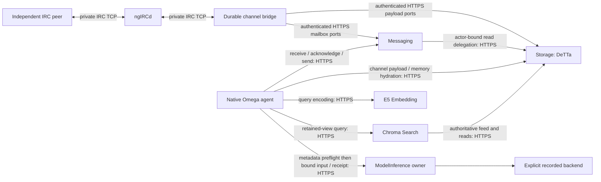

# Model and channel services on one k3s node

This increment continues completed memory publication `1af14c48d33a2976d954fa715bb5c2e1bdcf9483`. It composes existing operations and owners; it adds no module family, adopted command, cognition or chain operation. Qualification selects **recorded model responses**, with no generative runtime. Historical live campaigns remain spent and unchanged.

## Boundaries



Each workload has one StatefulSet ordinal, its own retained PVC, a process-lifetime exclusive writer lock, non-root execution, bounded resources and inert probes. Updates replace an ordinal; there is no horizontal scaling. ConfigMaps contain non-secret configuration and explicitly synthetic policies. Pre-created Secrets supply scoped credentials and CA trust; module server keys stay with those servers. No workload mounts another owner's state, the developer checkout or a receipt directory. The agent has no E5 inference SDK/weights and cannot connect directly to IRC or a generative endpoint in the selected native composition.

Storage owns two **distinct, freshly sealed** record spaces on its own PVC: the existing authoritative memory/feed space and the existing channel AtomOwner space. This avoids journal migration or combining incompatible source-feed profiles. Messaging constructs only MessageOwner and a read-only payload port. Its storage credentials are bound in storage configuration to a specific initiating actor; a wire principal alone cannot choose an actor or grant access. Both the delegation and current actor permissions are checked. The bridge retains socket epochs, capture identities, bounded relay attempts and uncertain-send records. It is not another storage or mailbox owner.

Private IRC TCP on a ClusterIP is intentional channel transport; selected module calls are authenticated HTTPS. This is an isolated same-node test, without public ingress, organizational channels, a mesh or multi-node claims.

## Explicit composition and disclosure

`controlled-native-loop/11` composes the existing native loop, S03.2 memory, durable channel and X01 lifecycle. It retains the original parser and exact whole-batch admission. Its measured session is read-only: exactly one approved query, then one send from an equally eligible finite output domain. Native setup uses the existing append composition and a different session/journal. Metadata remains application-owned. Empty history and promoted context, recorded model responses, and declared metadata clocks are explicit fixtures. S04/S05 private cognitive owners are not initialized by this composition; their historical integrations are not claimed as combined here.

The new selected placement policies are `neoclaw-model-channel-services/1`, `neoclaw-channel-services/1`, and `synthetic-retrieval-service-disclosure/1`. Historical descriptors, numerical profiles, loopback contracts and shared-host `/10` evidence stay unchanged.

The model pod never reads caller policy or receipts from disk. The caller validates its own consent, complete retained view, committed query capture and exact native presentation before creating an immutable `trusted-native-retrieval-receipt/1`. A bounded metadata-only HTTPS preflight checks the provider's current issuer and execution permissions before prompt bytes are sent. The subsequent request binds issuer, recipient, principal, scope, session, occurrence, source message, slot, model profile/selection, consent/view hashes, deadline, prompt hash, transformed messages hash and actual captured query projection. The provider checks these bindings and current authority at each acceptance/release boundary.

This is a **trusted issuer contract**, not cryptographic proof that an untrusted caller retrieved truth. Provider execution authority and caller disclosure consent remain separate. No authoritative corpus, evaluator or foreign journal is given to the model owner. Recorded responses are fixtures supplied to the real ModelService: acceptance, reservation, evaluation, capture and caller admission are distinct commits. No alternate canned-response HTTP service is used.

## Identity and recovery

A new measured application selects the setup application's committed ready view from its own PVC. It does not replay setup history into its first model prompt. Query occurrences retain their view and captured vector/result. The second model input must contain the actual committed projection; output permission is independent of factual evaluation. The evaluator reads committed synthetic setup records and compares the actual admitted send body and independent peer receipt. It neither generates nor repairs a command.

Existing original deadlines and durable attempt/RPC budgets apply. Missing or failed observations do not prove absence. A reserved model evaluation without capture is unknown/spent; captured results can be observed without re-evaluation. Input acknowledgment follows application-owned durable assignment. An outbound socket reservation commits before write; an ambiguous effect remains unknown and is never automatically resent. Namespace recreation is a fresh test, not recovery.

## Installation and operations

Use an explicit kubeconfig for the isolated existing k3s substrate. Preserve `omega-demo`. The test runner requires a namespace prefix beginning `omega-mc-` and creates fresh state. Python 3.12 and the pinned preparation SDK are used for operator commands. No command below contacts a generative runtime.

```bash
artifacts/s03/venv/bin/python -m unittest -v tests.test_model_channel_services
helm lint deploy/helm/omega-fusion -f deploy/single-node/workflow-values.yaml
artifacts/s03/venv/bin/python -m integration.single_node.test_workflow_cluster \
  --kubeconfig artifacts/single-node/kubeconfig \
  --prefix omega-mc-example --output artifacts/single-node-model-channel/example \
  --cases correct wrong-permitted rejected
```

For image packaging, verify the three memory-v6 parent configuration digests in `deploy/single-node/package_workflow.py`. Package each kind (`base`, `caller`, `embedding`) into a new directory, build a distinct tag, and import the OCI images into k3s. The qualification evidence records exact resulting image/source identities. Do not overwrite a tested tag. The current values select the tested artifacts; local tags alone are not portable publication.

```bash
artifacts/s03/venv/bin/python deploy/single-node/package_workflow.py artifacts/new-base --kind base
docker build -t fusion-single-node:NEW artifacts/new-base
# Repeat for caller and embedding, preserving their distinct pinned parents.
# For the delivered, already built workflow-v5 artifacts:
artifacts/s03/venv/bin/python deploy/single-node/import_workflow_images.py \
  --container omega-fusion-k3s \
  --manifest evidence/single-node-model-channel/images.json \
  --archive artifacts/single-node-model-channel/images-v5.tar
```

The delivered archive is local (`artifacts/single-node-model-channel/images-v5.tar`,
SHA-256 `8358d890d7f1ee0b48f865ccb66dbc485f4b66483c2a72a965ff4c0c249f51b6`);
images were not published to a registry. The import helper verifies the archive,
tag-to-manifest and configuration identities and registers digest references.
An import containing only tags is insufficient for these digest-pinned `Never`
pods: two such startup failures are preserved in the ledger. A new build needs
its own measured image manifest and values; bit-identical rebuilds are not claimed.
The [memory image recipe](../../deploy/single-node/README.md) and inherited pinned
native/E5 assets are prerequisites. Three exact final image digests and the source
inventories for every development image are in the evidence packet.

The operator setup is native `remember`; it does not insert targets through an admin port. A ConfigMap-driven agent replacement then starts a **new** measured session from its own committed setup view. No configuration edits occur between the measured query and reply. The operator only drives the separate peer and reads owner-authoritative diagnostics. Peer instructions go to its own FIFO; provider subprocesses are not started on the host.

For manual installation, create a fresh namespace and run `deploy/single-node/create_secrets.py --workflow --kubeconfig ... --namespace ... --directory ...` before `helm upgrade --install omega deploy/helm/omega-fusion -n ... --kubeconfig ... -f deploy/single-node/workflow-values.yaml`. Secret generation is test PKI (seven-day certificates), not a production credential lifecycle. Set `workflow.phase=measured` only after `/state/setup-view.json` is committed in the agent. The runner automates this sequencing and peer timing within original input waits.

`helm uninstall` retains owner PVCs. To destroy **only fresh qualification state**, delete the named task namespace after collecting sanitized observations. Never delete the retained cluster volume or `omega-demo`. Graceful shutdown stops native children; a forced interruption relies on durable journal recovery. Image and E5 assets remain cached after namespace cleanup.

## Future live connection

`integration.single_node.future_live.Backend/connect` is an offline, unselected connection to the existing pinned Ollama adapter. Separate, exact campaign approval is required before backend construction or evaluation. The recorded chart rejects live mode. The proposed new experiment has one two-stage session and at most two named slots, with zero current allowance and no approval field. The historical four-slot host campaign schema and spent ledgers are untouched.

Future campaign claims live on the model owner's PVC beside its own accounting, never on the caller. ModelService reservation commits first; a write-once campaign claim precedes the backend call. A crash in between remains spent/unknown. Read-only reconciliation takes provider reservations as authoritative, checks claim identity and reports reservation-without-claim; it cannot refund or regenerate. Claim counts are not asserted to equal actual backend calls.

The disabled plan is intentionally incomplete until fresh live corpus/view, TLS/configuration, exact images and complete runtime/model/projector assets are frozen and a new approval binds them. Runtime availability remains `NOT_CHECKED`. Recorded success does not establish live readiness, multi-node behavior, production readiness or chain deployment.

## Results

Start review at [report.json](../../evidence/single-node-model-channel/report.json),
then [the test ledger](../../evidence/single-node-model-channel/tests.json),
[one same-workflow trace](../../evidence/single-node-model-channel/same-workflow-trace.json)
and [source/image reconciliation](../../evidence/single-node-model-channel/sources.json).
Raw synthetic observation reports and unsuccessful runs remain under `runs/`;
these are bounded read-only owner exports, not database files or private journals.

| Gate | Result and evidence |
|---|---|
| Completed memory baseline | PASS: `1af14c48d33a2976d954fa715bb5c2e1bdcf9483`, 319 source entries and 29 changed-file entries checked; the two historical operator/image differences match their ledger |
| Images/chart/owner separation | PASS: three final digest-pinned images, nine independently managed workloads; old S01 and memory configurations still run |
| Model owner | PASS with **recorded backend**: independent acceptance/reservation/capture and caller admission |
| Cross-pod disclosure | PASS: trusted receipt plus provider preflight/current authority; no foreign policy or receipt mounts |
| Channel split | PASS: real ngIRCd/peer/bridge; payload and mailbox ownership remain separate |
| Native retrieval/reply | PASS with **recorded responses**: native remember setup, real query, exact next-context binding, actual admitted send and peer frame |
| Independent evaluator | PASS: wrong eligible replies remain authorized but fail correctness; altered and absent corpora preserve actual feedback |
| Recovery | PASS: eight requested interruption/rollout boundaries, outage/lost reply, retained views and spent/unknown semantics |
| Authorization | PASS: eleven deployed HTTPS negative probes plus wrong-credential and revocation scenarios |
| Zero live generation | PASS: denial tested before qualification; real runtime absent, all live counters zero |
| Compatibility | Impact-selected methods and S01/memory cluster checks pass, **one historical launcher method skipped and known M5 regression OPEN** |
| Cleanup | PASS: protected demo identities/specs unchanged and four pods Ready; all task namespaces/PVC claims removed |
| Future live freeze | INCOMPLETE, disabled; generative image not verified and availability not checked |

The final selected unittest invocation ran **85 methods: 84 passed, one skipped**.
The skip is the old preparation-launcher isolation test; it requires its explicit
launcher. It is not counted as passing. The new generation-denial test and deployed
recorded mode are separately exercised. The known
`tests.test_m5_boundaries.Boundaries.test_lookup_has_no_cognitive_runtime_dependency_or_mutation`
was run separately and still errors with Python 3.12 `UNSUPPORTED_PROFILE` at the
`AtomStorage` protocol check. Its ownership check is unchanged. This blocks a claim
of a fully green baseline, not the separately exercised real DeTTa service path.

Cluster evidence comprises **18 distinct workflow scenarios in 25 executions**:
20 assertion passes (12 completed correct recorded workflows and eight negative
safety results), and five retained unsuccessful executions. These are not unittest
method counts. Final-image S01 baseline/health and memory baseline/health add **four
separate passing regression executions**. Earlier runs used v1–v4 images; final v5
runs check authorization, captured-result recovery, configuration restart and both
old deployment compositions. Every image's packaged source hashes are retained.
Only q07/q08 and the final memory regression self-captured full operator source/chart
inventories; earlier operator snapshots are incomplete and are not reconstructed as
historical facts. The q06 driver is retained separately.

The development failures were measured-session promotion metadata mismatch (q01),
a missing read-only `search.ready` grant (q02), an IRC startup race (q03), and two
missing immutable image registrations before workload startup (q07). Corrections
and subsequent runs do not erase them. Initial Python import/indentation failures
also remain in the log ledger. Successful final runs have original accepted
lifetimes; no retry refund or deadline extension was used to turn a failure green.

Observed recorded-model accounting across all workflow runs is **37 reservations,
36 recorded backend evaluations, 36 provider captures and 35 caller captures**.
The reserved-before-evaluation case remains spent/unknown; the revocation case
retains the provider capture without releasing it to the caller. These are fixture
owner operations, not live generations. Usage remains null where the fixture does
not report it. Resource requests/limits and readiness are recorded; `kubectl top`
failed because the Metrics API is unavailable, so no measured CPU/memory peak is
claimed. No NetworkPolicy security experiment was performed; ClusterIP/private IRC
and trusted test pods are not hostile-code isolation.

For a fresh bounded requalification, use the runner above with selected cases, or
run the full sequential suite (resource-heavy cases must not run in parallel):

```bash
artifacts/s03/venv/bin/python -m integration.single_node.test_workflow_cluster \
  --kubeconfig artifacts/single-node/kubeconfig \
  --prefix omega-mc-recheck --output artifacts/single-node-model-channel/recheck \
  --cases correct wrong-permitted altered-corpus absent-corpus rejected \
  bridge-capture input-acceptance model-unknown model-capture query-capture \
  send-accepted uncertain-send config-restart lost-model wrong-credential \
  revocation service-outage auth-probes
```

The runner removes its namespaces by default after evidence collection. Manual
upgrade of an existing fresh release uses the same values and retained PVCs:

```bash
helm upgrade omega deploy/helm/omega-fusion \
  --kubeconfig artifacts/single-node/kubeconfig -n omega-mc-example \
  -f deploy/single-node/workflow-values.yaml --set workflow.phase=measured
# Only after collecting observations, remove this explicitly task-owned state:
helm uninstall omega --kubeconfig artifacts/single-node/kubeconfig -n omega-mc-example
kubectl --kubeconfig artifacts/single-node/kubeconfig delete namespace omega-mc-example
```

Use the exact accepted configuration and session IDs on recovery; changing identity
creates another occurrence, not a retry. A configuration rollout is explicit;
there is no automatic Secret reload controller. TLS certificates generated for
qualification expire after seven days. Do not reuse qualification credentials or
PVCs as a live campaign.

This is controlled native startup, not full-default Omega or live-model testing.
Cognitive state remains local and the empty promoted/history context is explicit.
IRC events before durable capture or during disconnection can be lost; uncertain
socket effects are not automatically resent. Single-node local PVCs do not provide
HA, cross-node failover or distributed durability. Historical fifteen-family/X01/X02
and adopted-command counts are unchanged. Previously demonstrated chain and
outside-k3s real-model workflows remain independent evidence.

```text
SINGLE_NODE_MODEL_CHANNEL_PREPARATION=PASS
RECORDED_RETRIEVAL_WORKFLOW_IN_K3S=PASS
MODEL_RESPONSES=RECORDED_FIXTURE
GENERATION_DENIAL_TESTED=PASS
AUTHORIZED_LIVE_GENERATIONS=0
RESERVED_LIVE_GENERATIONS=0
OBSERVED_GENERATIVE_BACKEND_CALLS=0
CAPTURED_LIVE_RESPONSES=0
ADDITIONAL_LIVE_GENERATIONS=0
GENERATIVE_RUNTIME_IMAGE=NOT_VERIFIED
GENERATIVE_RUNTIME_AVAILABILITY=NOT_CHECKED
K3S_LIVE_CAMPAIGN_FREEZE=INCOMPLETE
CAMPAIGN_STATE=DISABLED_PENDING_NEW_AUTHORIZATION
LIVE_MEMORY_MODEL_WORKFLOW_IN_K3S=NOT_RUN
MULTI_NODE=NOT_RUN
CHAIN_IN_K3S=NOT_RUN
PRODUCTION_READINESS=NOT_ESTABLISHED
```
