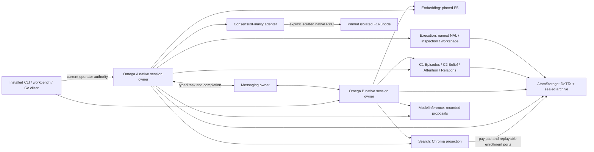

# Integrated single-node release — qualification report

**Status: READY_WITH_EXPLICIT_LIMITS.** Q01–Q30 are implemented and qualified within
the bounded single-node profile. This report continues the verified
baseline `bf8e87d7416cab6954a702d64d12cdfcf7b976d1`; it does not restart Phase 2/3.
The [acceptance matrix](../../evidence/integrated-service/gates.json),
[Q01–Q30 ledger](../../evidence/integrated-service/progress.json),
[contracts](contracts.md) and [operator runbook](runbook.md) are the review entry
points. Every result below is bounded to its actual source/image epoch.

## What the release adds

The existing native Omega loop now has an opt-in session-bound resident worker,
verified immutable startup preparation, bounded HTTPS reuse and declared bulk
hydration. Durable owner records remain authoritative; a process or cache is
never a completion receipt. New inputs select current views while old captures
keep their exact selected views and original bounds.

Executable placement plans pin components, profiles, TLS and owner volumes.
Trusted operators admit/probe/enable providers; sessions keep their admitted
selection. The optional registry has finite retained capacity and does not act
as a discovery-driven failover system. Versioned archive capabilities coexist
with the previous storage contract; unsafe reopening and unsupported downgrade
refuse. The independent Go client and atomic-file example provider exercise the
published contracts without importing caller business logic.

Existing execution and application owners carry closed data-only envelopes,
durable completion, fixed saved inspection/commitment continuations and bounded
commit-event catch-up. This is application continuation, not arbitrary process
migration. The named native NAL operation still executes the pinned original
truth function. Neither mathematical profiles nor cognitive responsibilities
were merged or replaced.

AtomStorage owns sealed archival and read continuity. Search rebuilds derived
indexes through authenticated payload/enrollment ports. Coherent retained views,
owner-local headroom and integrity reports expose missing data and partial work.
The observation-only restore checks dependency seals before disclosing retained
records and cannot execute old model/tool/socket/chain effects. The workbench
and installed CLI expose current capabilities, typed controls and maintenance.



Module edges use authenticated HTTPS in the pod composition. Each owner retains
its own PVC and one writer; consumers do not mount provider journals. Registry,
continuation, diagnostics and lifecycle facets reuse existing owners. They do
not increase the historical fifteen-family denominator or adopted-command
count. X01 remains recorded in this programme; X02 E5 inference is real.

## Exact candidate and distribution

The final runtime source manifest is
`3227e2070e7c7a2f94a362a03b6ef5f80addcb80bb8e802bff1ab38388fa1d9d`
(388 packaged files). Runtime image identities, qualification helper revisions,
client wheels and detached final distribution binding are recorded separately.
Helper/document updates after an execution are never backdated into its source
manifest. The distribution contains the chart, role-specific images, verified
OCI delta/base pair, eight offline wheels, extracted Go binary/source package,
explicit public recipes and actual dependency inventories. The [exact runtime/source map](../../evidence/integrated-service/sources-final.json)
contains every packaged runtime file and the reused native/asset pins; the
detached [artifact binding](../../evidence/integrated-service/artifact-final.json)
names the assembled packet and its verification result.

Native sources, numerical libraries, DeTTa, E5 assets and existing profiles keep
their pins. The source-to-capability map identifies reused Phase 2/3 features,
new optional contracts and the tests exercising their integrated use. No live
runtime availability probe, model startup, generation or live-slot reservation
is required or performed. **ADDITIONAL_LIVE_GENERATIONS=0.**

## Measured native work

The final sustained installation completed **80/80 operator inputs** over
1,357.322 seconds without reset, including both handoff directions, private and
shared scopes, memory, evidence/priority, retained views and archive continuity.
Its heterogeneous workload median was 14.316 seconds and nearest-rank p95 was
23.474 seconds. Those numbers are not an equal-workload comparison.

Four separate fresh installations executed the same fourteen operator inputs
(sixteen native inputs including internal task/result handling), using the same
profiles, resources and tools. Only cold/per-input versus prepared resident
execution changed. Heavy tests ran serially.

| Run | Completed operator inputs | Native inputs / interpreters | Median seconds | p95 seconds |
|---|---:|---:|---:|---:|
| rc18-cold01 | 14/14 | 16 / 16 | 20.676 | 25.111 |
| rc18-warm01 | 14/14 | 16 / 4 | 15.954 | 19.782 |
| rc18-cold02 | 14/14 | 16 / 16 | 19.706 | 24.921 |
| rc18-warm02 | 14/14 | 16 / 4 | 16.841 | 21.353 |

[Machine measurements](../../evidence/integrated-service/performance-final.json)
include operation sample sizes, provider timings, requests/bytes, connections,
physical state and process RSS/HWM snapshots. All twelve exercised roles supplied
untruncated timing in these four runs. Cold means a fresh native interpreter;
OS/image/model caches were warm. Observed completion includes polling overhead.
Two repetitions and small per-operation samples do not establish an SLA,
statistical confidence, isolated-factor causality or live-model throughput.

The observed interpreter-to-first-bridge interval was roughly 4.2–4.7 seconds per
start. Reuse removes repeated starts, rather than making each start faster.
History context, memory-view selection and transport remain material costs.
Nested intervals and cross-owner medians are never added into a fabricated
critical path. Pooled connection counters show actual reuse with current policy
checks; they do not prove a connection grants ongoing authority.

The sustained storage and episode traces reached their four-MiB diagnostic caps;
their missing tail is explicit. Its other ten roles were untruncated. RSS/HWM
samples are not a lifetime cluster peak. CPU-quota enforcement remains
**NOT_ESTABLISHED**; no host cgroup setting was changed.
All four comparisons ran with leftover task-browser background activity. That
browser was identified and stopped afterward. Host contention was not isolated;
the measurements remain observations of these runs, not dedicated-node results.

## Recovery, authority and capacity

The same sustained installation passed five native inputs in one observed
interpreter followed by current revocation, three interleaved private/shared
sessions, 23 credential/TLS assertions and ten commit-notification assertions.
Notification catch-up used three real events over two pages, including duplicate,
gap, wrong-principal, restart, rotation and unsubscribe cases. These checks
created no substitute completion and did not re-execute the native operation.

Its fenced restore retained twenty sessions and 97 accepted inputs, including
five private sessions and an unresolved input. The count comprises the core
workload, security follow-ups, four internal task/result inputs and the failed
repair-test input; it is not 97 successful operator commands. Early archived
payloads, captures and a saved inspection continuation remained exact. Old
approval was not execution authority; mutations and continuation advancement
refused. Original and restored workloads were stopped after observation.

The Registry later exhausted its **one-MiB metadata limit** before a lifecycle
test could accept any new input. Existing reads and captures remained available.
The test is recorded as a capacity refusal, not a completed lifecycle scenario.
No records were deleted, quota silently raised or old state migrated to obtain
progress. The final lifecycle qualifier uses a separately retained comparison
installation and keeps that distinction explicit.

At the end of the core run, storage reported 1,208 shared source records and
275 records across two synthetic private partitions: **1,483 aggregate**. Each
feed retained its own 2,048-record and 32-MiB bound. The shared archive had one
segment charged at 528,384 bytes against a 16-MiB archive bound. Agent A/B retained
nine/six sessions against sixteen each; active admission remained two per owner.
These are owner observations, not a global transaction or capacity reservation.
Lifetime headroom for owners without an implemented report remains explicitly
`NOT_OBSERVED`. Archive does not refund total retention.

The first concurrent-rebuild qualifier held Search before native view selection,
causing a transport timeout before model/tool admission. Its input remains
uncertain and its repair reservation spent. The corrected test orders a native
vector-capture barrier after view selection, then observes actual enrollment
while old-head repair is reserved. A separate explicit maintenance identity can
repair a derived index after the old deadline; it cannot retry or complete the
old reservation by inference. The final concurrent test passed four inputs,
including a previously completed seed whose capture was verified rather than
repeated. Both old and newly published facts were retrieved through real ports.
The sustained installation's separate maintenance repair also passed, preserving
all 97 inputs and the original failed repair's spent reservation.

The final lifecycle check retained three original terminal inputs and added
three intentional inputs. Undispatched expiry and cancellation allowed later
work; cancellation after dispatch and actual pod replacement left the uncertain
effect fenced while the other agent made progress. One fully completed session
was closed through the API to free an active slot. No retention or effect budget
was refunded. Fourteen original comparison captures remained exact.

Accepted-caller interruption and lost-acceptance-reply recovery both passed
with real caller/executor replacements. Saved graph steps and model captures
remained exact, duplicate submission returned the existing completion, and no
deadline or attempt budget was reset. The first combined two-fault scenario
passed the first case but exhausted the earlier parent task deadline during the
second. That occurrence remains pending and unsuccessful. A separate fresh
four-input scenario armed the lost-reply fault before accepting its own parent
task and completed within the unchanged bounds. These are distinct scenarios,
not a retry or repaired history.

## Same-workflow chain and restore

The final native A-to-B retrieval and saved inspection workflow completed four
operator inputs and two internal task/result inputs. Its generated shareable
result was then approved by exact artifact and inspection reference. This was
a separate bounded chain action; the original native deadline was preserved.

One submit reservation survived an acceptance interruption, a lost adapter
reply, and replacement of the caller, commitment adapter and isolated F1R3node.
Three bounded observations reached matching deploy-effect finality. An
independent reader fetched the artifact/result and chain value without owner
journals, signing or submission. The [same-artifact trace](../../evidence/integrated-service/chain-final.json)
records the exact source, images, approval, deploy and read name. Only synthetic
shareable identities are published; finality is not proof of off-chain truth.

The [fenced chain restore](../../evidence/integrated-service/chain-fenced-restore-final.json)
retained two sessions, six inputs and the exact finalized continuation, including
the one spent submit reservation. Old approval did not authorize new work;
admit/advance routes refused. No node cryptographic state or executor was
restored. The initial restore harness failed because its source pods were already
stopped. Restarting only the service readers allowed a fresh backup of the same
state; the source node remained stopped and no native or chain work was repeated.

## Test lanes and classification

| Executed lane | Result | Scope |
|---|---|---|
| Integrated fast contracts | 188 methods passed | Owner state, wire, bounds and fixture negative cases |
| Phase 3 regression | 106 methods passed | Existing sustained/session/privacy contracts |
| Phase 2 regression | 540 methods passed after a fixture repair | Initial run's one fixture schema error retained; ownership guard preserved |
| Extracted native package | 7 methods passed in 66.899 seconds | Real native original/local/HTTPS NAL, reuse, kill recovery, readonly preparation, compact history; independent provider remains a contract fixture |
| Independent E5 placement | All four combinations passed | Real E5/Chroma/DeTTa/native/TLS; exact vectors and feedback, caller assets/libraries absent under remote encoder selection |
| Old/current wire | 2 methods passed | Actual old server export and old wheel against current real DeTTa/TLS; unsupported capabilities refuse |
| Go | 8 methods and isolated build passed; deployed workflow passed | Independent static client, two native inputs, exact storage bytes/replay and current authority |
| Integrity | 4 cases passed | Disposable copies of real backups; authoritative corruption diagnosed, derived repair bounded |

These counts overlap and are not summed as unique coverage. Historical failing
executions remain in the ledger. In one early failed native packaging attempt,
a supplementary child JSON file claimed a pass despite unittest failures; that
claim was rejected. The final wrapper requires the primary seven-method lane to
pass. Installed/extracted recipes and exact helper identities are linked in the
[qualification guide](qualification.md).

## Operator walkthrough and retained review state

The final installed workbench executed three additional native inputs in the
existing Go-client session: remember, query and episode navigation. The query
returned the new authoritative payload, the two old Go captures stayed exact,
and all five inputs completed. Current capability inspection displayed twenty
permitted tools; a typed query preflight reported admission without reserving
work or claiming remote permission. The twenty tools are the existing catalogue,
not twenty new adopted commands. No operator configuration changed between calls.

[UI evidence](../../evidence/integrated-service/workbench-final.json) includes
two inspected screenshots. ProofShot observed zero console/server errors. Its
first browser attempt stalled before accepting any input, and the first stop
looked in the default output directory; both harness failures are recorded.
The custom-output session was subsequently bundled and its task browser/server
stopped. Raw recording/access material remains private.

The [cleanup inventory](../../evidence/integrated-service/cleanup-final.json)
lists stopped task workloads and retained PVCs. Failed/uncertain occurrences,
spent reservations and forensic state were not deleted. In particular, the
earlier warm01 comparison fault copy retains a deliberately missing derived
index and its uncertain input; it is not an immediately usable demo. The final
successful rebuild is evidenced separately on cold02 and on the original
sustained03 installation. Use fresh installation commands for a clean review.

The protected-object comparison matched 3,165 object UID/spec/data observations
in 45 historical namespaces, including `omega-demo`; all four protected campaign
files matched. This is a control-plane/file comparison, not a PVC byte audit.
Two initial verifier attempts used different JSON serialization from the
baseline. Correcting the verifier, without changing protected objects, produced
the matching result; those failed checks remain documented.

## Remaining limits

Raw private reports, backups, keys, credentials, kubeconfig and browser access
material stay local. Public evidence includes only inspected synthetic or
metadata summaries. The local image/source distribution is the delivery artifact;
no new public registry, release hosting or signing claim was added.

The original full-file DeTTa source guard still fails at its historical pin;
the assertion remains intact. The actual exercised DeTTa adapter is separately
pinned and tested. This exception is not a new pass. Hosted CI has not been
observed here. No vulnerability scanner was installed; vulnerability scanning
is **NOT_RUN**, and unverified license entries remain `NOASSERTION`.

The independent atomic-file storage provider is a **CONTRACT_FIXTURE**, not a
DeTTa or DA result. Recorded ModelInference proposals are fixtures even when the
actual native loop, deterministic mathematics, E5, Chroma, DeTTa, HTTPS and
isolated chain are real. This release does not claim live model competence,
multi-node/HA operation, malicious-host protection, infinite retention,
writable populated-state migration or production readiness.

```text
PROGRAMME_STATUS=READY_WITH_EXPLICIT_LIMITS
COMPLETED_PACKAGES=Q01–Q30
BLOCKED_PACKAGES=NONE
SINGLE_NODE_SERVICE_INTEGRATION=PASS
NATIVE_WORKER_REUSE=PASS; five inputs in one incarnation; paired runs use 4 versus 16 interpreters
ASYNCHRONOUS_NATIVE_HANDOFF=PASS
BOUNDED_CONTINUATION_RECOVERY=PASS; earlier expired attempt retained separately
COMMIT_NOTIFICATION_CATCHUP=PASS
ARCHIVE_REFERENCE_CONTINUITY=PASS_WITH_FINITE_RETENTION
CURRENT_AUTHORITY_ON_REPLAY=PASS
FENCED_ARCHIVE_RESTORE=PASS
ISOLATED_SAME_WORKFLOW_CHAIN=PASS
END_TO_END_SPEEDUP=MEASURED_WITH_SCOPE; opt-in, small recorded-workload samples
CPU_QUOTA_ENFORCEMENT=NOT_ESTABLISHED
HOSTED_CI=NOT_OBSERVED
MODEL_PROPOSALS=RECORDED_FIXTURE
ADDITIONAL_LIVE_GENERATIONS=0
REAL_MODEL_EXECUTION_FOR_THIS_PROGRAMME=NOT_RUN
OLD_REFERENCE_CAMPAIGN=UNCHANGED
MULTI_NODE=NOT_RUN
PRODUCTION_READINESS=NOT_ESTABLISHED
```
