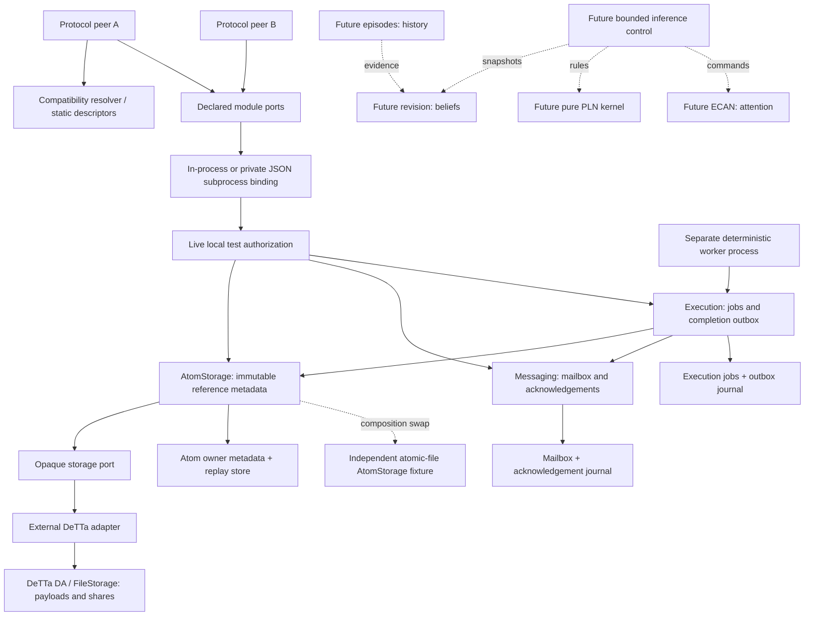

# Architecture and ownership

Module = one responsibility and state owner; it need not be a process. Interface,
implementation, transport and placement are separate. Maintainers/specialists are
**unassigned** for all new contracts; repository authorship is not an assignment.

Foreign module calls from domain code terminate at declared ports; composition
selects concrete implementations. Execution calls only `AtomStorage.get/create`
and the trusted `CompletionDelivery.accept` port. Each owner commits its own
store; no shared transaction spans atoms, jobs and mailbox acceptance. Public dispatch is an
explicit operation allowlist. There are no belief, attention or episode mutation
routes in M1. The worker has a separate trusted entry point, never a client command.

| Module | Responsibility / owned mutable state | Dependencies | Exclusions / profile / obligation |
|---|---|---|---|
| DA storage | Opaque persistence, retrieval, availability; payload/share files | Filesystem in selected adapter | No Omega IDs, cognition, job state; `opaque-local-rs/1`; reconstruction/integrity/restart |
| AtomStorage (C0) | Stable scoped immutable typed envelopes; reference/idempotency metadata | Storage, authorization | No parser/ontology/search/truth; `immutable-bytes/1`; bytes, revision, scope |
| Relations | Explicit ordered roles/hyperedges; immutable relation records | AtomStorage | No authoritative beliefs/attention; `ordered-roles/1`; arity/order/scope validation, specified only |
| Search projection | Query refs + index watermark; rebuildable index | Record/event reads, auth | Not authoritative memory; distinct symbolic/embedding profiles; staleness checks, specified only |
| Episodic memory C1 | Ordered episode events and provenance; episode history | Atoms, optional relations/search | Private client-side, no truth/attention updates; `episode-local-sequence/1`; sequence/CAS/occurrence tests later |
| Belief revision C2 | Evidence aggregation under a declared model; belief/evidence ledger | Evidence/atom snapshots | No search or ECAN mutation; model pending, candidate from reachability; duplicate/contrary/lineage golden tests later |
| PLN kernel C4 | Pure rule on explicit premise snapshots; no mutable domain state | Declared rule implementation | No agenda/episode/attention writes; model pending; golden/ordered-premise tests later |
| Attention C3 | Stimuli, STI allocation/selection/decay; attention balances/logical time | Opaque refs, policy | No PLN/LLM dependency; STI policy pending; independent budget/tie/decay tests later |
| Inference control C4 | Bounded selection and scheduling; step receipts/checkpoint | Search, revision, attention, PLN | No reimplementation of mathematics or owned state; `bounded-step/1`; limits/feedback tests later |
| Messaging | Durable acceptance, poll, acknowledgement; inbox and deduplication | Journal, auth/route policy | Delivery ≠ acceptance; `durable-mailbox/2`; replay, backpressure, recipient isolation |
| Execution | Allowlisted delegation and correlated completion; jobs/results/outbox | Atoms, messaging, journal, auth | Not reasoning/process migration; `inspect-atom/2`; deterministic process/replay/recovery |
| Registry | Describe configured implementations; descriptor list | None | Not capability authority or chain registration; `static/1`; immutable descriptors |
| Resolver | Check version/profile/features/guarantees/budgets; no mutable state | Descriptors | No name-only selection/proof trust; `same-major/1`; positive and negative fixtures |
| Finality | Eligible commitment submission, signed intents, inclusion/effect-finality observations | Chain adapter, signer, intent journal | Not execution success/belief confidence; `asi-deploy-effects/1`; real isolated single-validator gate, no public-network claim |
| Authorization | Authenticated caller, current scope/method/route requirements; policy | Trusted transport context | No sender-field authority/caller bundles; `local-test-policy/1`; revocation and fail-closed fixtures |

Future ports are typed specifications and named test obligations, not empty services.
The M1 consumer only stores, shares a reference, fetches bytes, delegates inspection
and reads a durable result. Motivation is absent. The next bounded increment is
M2 (C1+C2); this run stops before implementing it.

## M1.1 runtime composition

`Service` is the authenticated wire/admission facade. It receives caller-bound
`AtomStorage`, `Messaging`, and `DelegatedExecution` factories; it does not
construct owners. `composition.service` selects a real `AtomOwner` over the opaque
DeTTa storage port, or the independent `FileAtomFixture`. Neither execution nor
`Peer` branches on that choice. The fixture owns atomic JSON records and payload
files and has no AtomOwner superclass, SQLite atom table, or private helper seam.
Its fsync/rename protocol supports bounded same-host process restart, not DA custody.

`AuthorizedAtoms` binds either the authenticated requester or the trusted worker
to live policy. It namespaces mutation keys by principal and scope and checks
provider responses. `MessagingSession` and `ExecutionSession` implement the
published method signatures with a bound requester context. ExecutionSession is
transaction-bound: Service commits its job admission and replay record together
before returning a wire acceptance. It is not an independently callable remote
service. Worker execution and outbox flush are separate trusted operator commands.

State ownership is explicit:

| Owner | Store and commit boundary | Other owners' access |
|---|---|---|
| AtomStorage | Real provider: its own SQLite metadata/replay journal over opaque DeTTa bytes. Fixture: atomic record/payload files. `create` commits before returning. | Typed create/get/getMany/availability only. |
| Messaging | Own SQLite messages and acknowledgement replay journal. `accept` commits before returning. | Public requester facade or trusted CompletionDelivery port. |
| Execution | Jobs and completion outbox in one SQLite transaction. Result atoms commit first through AtomStorage. | Status/result facade; no public worker/setter route. |
| Wire admission | Mutation response/fingerprint table, colocated with execution journal. | Authenticated dispatch only. Cross-owner retries also have owner-local replay records. |
| Authorization | Operator-owned live credential/scope/method/route configuration. | Checks via trusted caller context; injection grants no caller-selected principal. |

Only one bounded worker writer runs at a time. Independent commit/replay is proven;
remote placement, distributed transactions, journal migration and replacement of
an already populated atom namespace are not. The swap chooses a provider for a
fresh store. The C0–C4 catalogue above is unchanged; no cognitive service starts.
