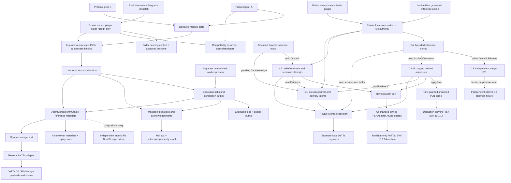
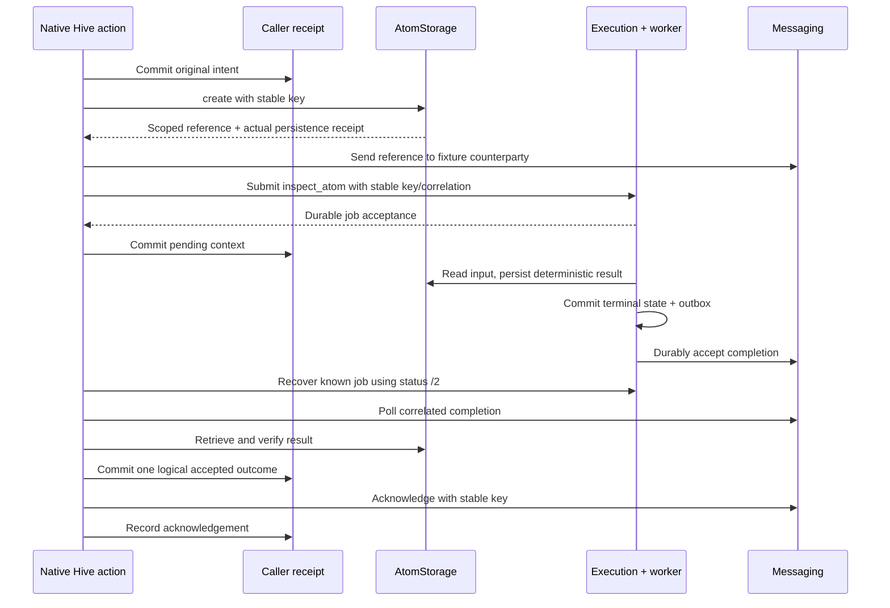
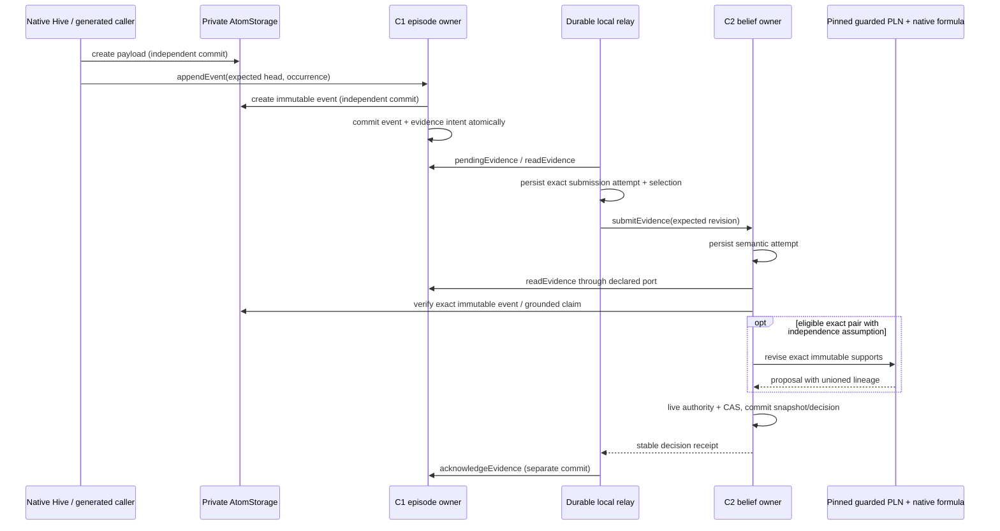
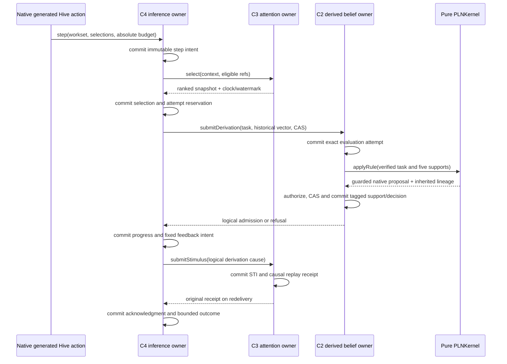
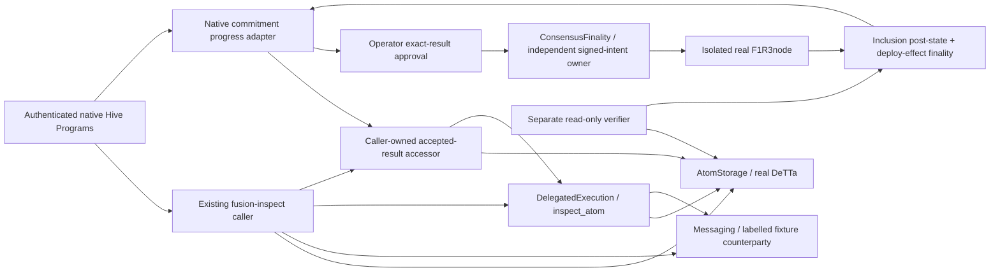

# Architecture and ownership

Module = one responsibility and state owner; it need not be a process. Interface,
implementation, transport and placement are separate. Maintainers/specialists are
**unassigned** for all new contracts; repository authorship is not an assignment.



Foreign module calls from domain code terminate at declared ports; composition
selects concrete implementations. Execution calls only `AtomStorage.get/create`
and the trusted `CompletionDelivery.accept` port. Each owner commits its own
store; no shared transaction spans atoms, jobs and mailbox acceptance. Public dispatch is an
explicit operation allowlist. There are no belief, attention or episode mutation
routes in M1. The worker has a separate trusted entry point, never a client command.

| Module | Responsibility / owned mutable state | Dependencies | Exclusions / profile / obligation |
|---|---|---|---|
| DA storage | Opaque persistence, retrieval, availability; payload/share files | Filesystem in selected adapter | No Omega IDs, cognition, job state; `opaque-local-rs/1`; reconstruction/integrity/restart |
| AtomStorage (C0) | Stable scoped immutable typed envelopes; reference/idempotency metadata | Storage, authorization | No parser/ontology/search/truth; `immutable-bytes/1`; bytes, revision, scope |
| Relations | Explicit ordered roles/hyperedges; immutable relation records | AtomStorage | No authoritative beliefs/attention; `ordered-roles/1`; arity/order/scope validation, specified only |
| Search projection | Query refs + index watermark; rebuildable index | Record/event reads, auth | Not authoritative memory; distinct symbolic/embedding profiles; staleness checks, specified only |
| Episodic memory C1 | Episode identity/head, immutable event ledger, mutation replay and delivery intents | AtomStorage, PrivateAuthority | Private local, no PLN/Hive requirement; `episode-local-sequence/2`; sequence/CAS/occurrence/recovery tested |
| Belief revision C2 | Observation/support ledger, historical snapshots and admission decisions | AtomStorage, EpisodicMemory.readEvidence, PrivateAuthority, RevisionMath; v3 also PLNKernel | M2 `pln-revision-private/1` unchanged; fresh M3 `pln-derived-private/1` adds tagged deduction admission without new observations |
| PLN kernel | Pure guarded five-premise grounded deduction; no mutable domain state | Pinned Reachability guards and native PLN | No agenda or owner writes; `grounded-five-premise-deduction/1`; explicit historical vectors and native goldens |
| Attention C3 | STI, causal/command receipts, logical clock and watermark | PrivateAuthority; syntactic opaque refs | No PLN/DA/Hive or C1/C2 dependency; `sti-additive-linear-decay/1`; standalone and independent provider substitution |
| Inference control C4 | Explicit workset selection, durable attempt reservations and feedback intents | AtomStorage, DerivedBeliefRevision, Attention, PrivateAuthority | No search or PLN arithmetic; `bounded-grounded-inference/1`; persistent attempt/deadline/generation limits |
| Messaging | Durable acceptance, poll, acknowledgement; inbox and deduplication | Journal, auth/route policy | Delivery ≠ acceptance; `durable-mailbox/2`; replay, backpressure, recipient isolation |
| Execution | Allowlisted delegation and correlated completion; jobs/results/outbox | Atoms, messaging, journal, auth | Not reasoning/process migration; `inspect-atom/2`; deterministic process/replay/recovery |
| Registry | Describe configured implementations; descriptor list | None | Not capability authority or chain registration; `static/1`; immutable descriptors |
| Resolver | Check version/profile/features/guarantees/budgets; no mutable state | Descriptors | No name-only selection/proof trust; `same-major/1`; positive and negative fixtures |
| Finality | Eligible commitment submission, signed intents, inclusion/effect-finality observations | Chain adapter, signer, intent journal | Not execution success/belief confidence; `asi-deploy-effects/1`; real isolated single-validator gate, no public-network claim |
| Authorization | Authenticated caller, current scope/method/route requirements; policy | Trusted transport context | No sender-field authority/caller bundles; `local-test-policy/1`; revocation and fail-closed fixtures |

Future ports are typed specifications and named test obligations, not empty services.
The M1 consumer only stores, shares a reference, fetches bytes, delegates inspection
and reads a durable result. M2 adds private C1/C2; M3 adds independent C3 and
bounded C4 plus the required explicit C2 admission extension. Relations/search
remain specifications. Motivation is absent.

## M1.1 runtime composition

`Service` is the authenticated wire/admission facade. It receives caller-bound
`AtomStorage`, `Messaging`, and `DelegatedExecution` factories; it does not
construct owners. `composition.service` selects a real `AtomOwner` over the opaque
DeTTa storage port, or the independent `FileAtomFixture`. Neither execution nor
`Peer` branches on that choice. The fixture owns atomic JSON records and payload
files and has no AtomOwner superclass, SQLite atom table, or private helper seam.
Its fsync/rename protocol supports bounded same-host process restart, not DA custody.

`AuthorizedAtoms` binds either the authenticated requester or the trusted worker
to live policy. It namespaces mutation keys by principal and scope and checks
provider responses. `MessagingSession` and `ExecutionSession` implement the
published method signatures with a bound requester context. ExecutionSession is
transaction-bound: Service commits its job admission and replay record together
before returning a wire acceptance. It is not an independently callable remote
service. Worker execution and outbox flush are separate trusted operator commands.

State ownership is explicit:

| Owner | Store and commit boundary | Other owners' access |
|---|---|---|
| AtomStorage | Real provider: its own SQLite metadata/replay journal over opaque DeTTa bytes. Fixture: atomic record/payload files. `create` commits before returning. | Typed create/get/getMany/availability only. |
| Messaging | Own SQLite messages and acknowledgement replay journal. `accept` commits before returning. | Public requester facade or trusted CompletionDelivery port. |
| Execution | Jobs and completion outbox in one SQLite transaction. Result atoms commit first through AtomStorage. | Status/result facade; no public worker/setter route. |
| Wire admission | Mutation response/fingerprint table, colocated with execution journal. | Authenticated dispatch only. Cross-owner retries also have owner-local replay records. |
| Authorization | Operator-owned live credential/scope/method/route configuration. | Checks via trusted caller context; injection grants no caller-selected principal. |

Only one bounded worker writer runs at a time. Independent commit/replay is proven;
remote placement, distributed transactions, journal migration and replacement of
an already populated atom namespace are not. The swap chooses a provider for a
fresh store. The C0–C4 catalogue above is unchanged; no cognitive service is
implemented or exercised by the Fusion slice.

## M1.2 native caller boundary

The real Hive plugin is loaded by `HIVE_PLUGIN_DIRS` and invoked by native
`ProgramActions.person_act → Programs.act`. Hive authenticates the operator,
checks swarm visibility, refuses identity fields in params, and supplies trusted
`ctx.actor` and `ctx.command`. An operator-owned exact principal/swarm mapping
selects the existing private stdio binding, credential, scope and dedicated
reply route. The plugin does not construct owners, read foreign tables, or add
provider branches. Shared ports, wire version and profiles remain unchanged.

The plugin owns a small SQLite receipt record: request fingerprint, pinned
selection/context, persisted input receipt, shared-reference receipt, job
acceptance, verified outcome and acknowledgement flag. This record is distinct
from every provider's commit. It serializes one local caller journal and admits
one unfinished intent per route; it is not a general runtime or memory store.
Status `/2` plus the persisted job/correlation establishes known-job recovery.
Unknown deliveries are never consumed as this intent's result.



Caller death after any caller commit leaves a recoverable receipt. A lost native
admission response replays the same input and keys. A crash after outcome commit
rechecks current authority and acknowledges redelivery without a second outcome
row. Exactly-once physical execution, power-loss survival and distributed failover
are not inferred. No chain operation or cognitive controller is added.

## M2 private owners and native revision

`open_private` resolves separate private descriptors and constructs local owners.
It uses the existing AtomStorage facade over real DeTTa, with separate payloads
and journals; overlapping configured shared/private roots are rejected. It never
constructs a shared mailbox, execution service or chain adapter. The DA API stays
application-neutral: it receives opaque bytes, not episode IDs or beliefs.

C1 owns `episodes`, `events`, `mutations` and `deliveries` in `episodes.sqlite`.
C2 owns `snapshots` and `attempts` in `beliefs.sqlite`. The relay owns only exact
submission attempts and handoff progress in `relay.sqlite`. C1 cannot mutate
beliefs; C2 cannot write episode state; neither reads foreign SQL. A payload
commit before C1 append can leave an orphan after a crash. Retrying the same
immutable atom request recovers it; no garbage collector is implemented.



The application policy is the bounded generated scenario in
`integration/m2_scenario.py`, invoked by the sibling `fusion-episode` native Hive
plugin. It reads authenticated actor context from the verified native seam;
operator configuration chooses the private scope/credential. It returns only
scenario counts and the public command's receipt ID. Full observations,
lineage and private content hashes remain in the private local composition.
The original M1.2 `fusion-inspect` plugin and its 13 native tests are unchanged.

RevisionMath is a narrow pure proposal dependency, not C4's general PLNKernel.
It loads the unchanged Reachability `PLNAdapter.revise`, injects a revision-only
PeTTa runner and validates the response. No AdmissionService, AtomSpace
projection, `apply_rule`, PLN.Derive or PLN.Query is used. C1 can run with that
entire provider absent. Hostile port-only fixtures enforce these dependencies.

The threat model trusts the host/operator and intact local files. Directory
permissions and routing isolation do not claim encrypted storage, protection
from an administrator, power-loss survival, distributed failover, exactly-once
physical calculation, or the truth of registered origins/independence assertions.


## M3 grounded inference and independent attention

The M3 composition preserves separate owner commits and the application-neutral
DA boundary. A task is an immutable role manifest, and a workset freezes the five
historical support bindings for each eligible task. C4 never discovers new tasks
or reads foreign SQL. C2 invokes the pure kernel itself so a caller cannot inject
a numerical proposal directly into the ledger. C2 final admission checks current
authorization and output CAS after evaluation.



On restart C4 queries the prior C2 attempt before reserving more work. A lost
pending computation keeps its spent slot; a committed decision is recovered
without another evaluation. Logical support identity is independent of step ID.
Feedback uses that identity and the attention target's retained generation, so
neither new ingress nor a new step can reset its limit. The source lineage used
by revision is separate from feedback generation.

SQLite and atomic-file attention providers independently implement the same
integer policy. Both are real persistent implementations of that limited policy;
the second is classified as a fixture, not an alternative research algorithm.
No ECAN/LTI claim is made. Their consumer, worksets, budgets and logical schedule
are unchanged in the substitution experiment. No live migration is attempted.

The native sibling `fusion-inference` projects only generated counts/status.
Its full episode, historical premise vector, proposal/admission and attention
trace stay private. M2 recording and revision remain usable without C3/C4.
The M3 generated episode retains C1 delivery intents because its v3 decision is
not passed to the existing v2 C1 acknowledgment interface. That compatibility
limit is explicit in the contracts and evidence report.

## M3.1 closure ownership

```mermaid
sequenceDiagram
    participant H as Authenticated native Hive action
    participant E as C1 EpisodicMemory
    participant R as Trusted local relay
    participant B as C2 BeliefRevision
    participant I as C4 InferenceControl
    participant A as C3 Attention
    H->>E: append event + delivery (C1 commit)
    H->>R: bounded drain
    R->>B: exact selected evidence request
    B-->>R: durable full decision (C2 commit)
    Note over R: validate profile; commit decision
    R->>E: bound completion via trusted context
    Note over E: validate own delivery; commit acknowledgment
    Note over R: commit acknowledgment observation
    H->>I: bounded step (unchanged native deduction)
    I->>A: original deadline-bound feedback
    Note over I,A: Independent commits; reply can be lost
    H->>I: reconcile original request, bounded limit
    I->>A: resolve original feedback intent
    A-->>I: applied receipt / atomic retirement / pending
    Note over I: commit separate versioned closure observation
    I-->>H: original execution + current closure
```

C1 owns delivery eligibility; C2 owns admission. The relay alone translates a
validated durable C2 decision into the narrow trusted acknowledgment. C3 owns
causal application and retirement; C4 owns only its observations and work budget.
Hive owns public-command translation and privacy-safe projection. Reconciliation
has no edge to PLNKernel or BeliefRevision and cannot select another task. Existing
DA and immutable AtomStorage boundaries are unchanged.

## M4: generated result commitment, with separate owner commits



The approval allowlist admits only the original explicitly shareable generated
workflow. Private Episodes, BeliefRevision, Attention, PLNKernel and
InferenceControl are unchanged regression modules and have no chain export edge.
The native commitment adapter owns progress only; it does not own DA, jobs,
mailboxes or signing replay state. Local result acceptance and acknowledgment
remain durable independently of chain availability. The chain persists one fixed
tuple and provides node-observed evidence; it does not execute off-chain reasoning.
