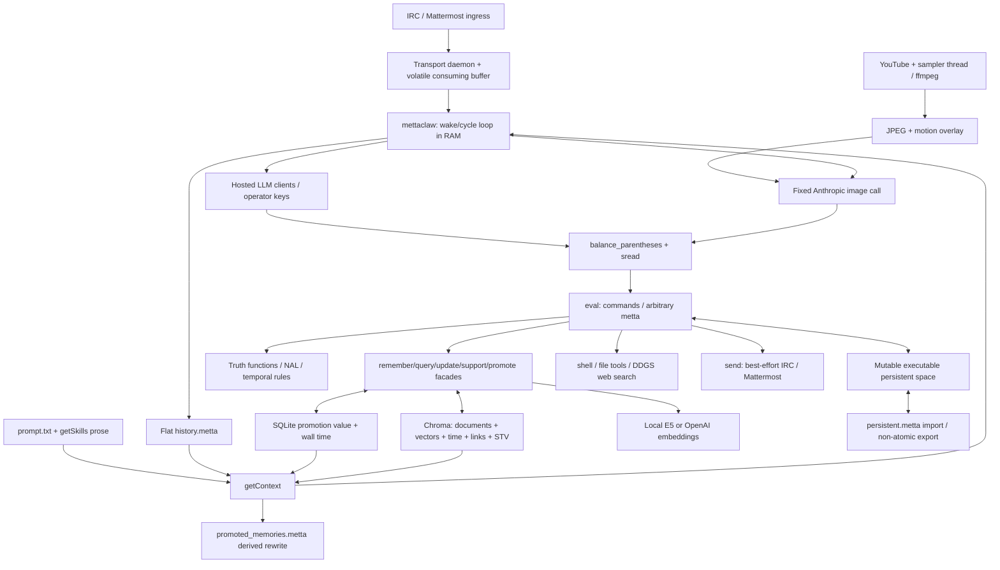
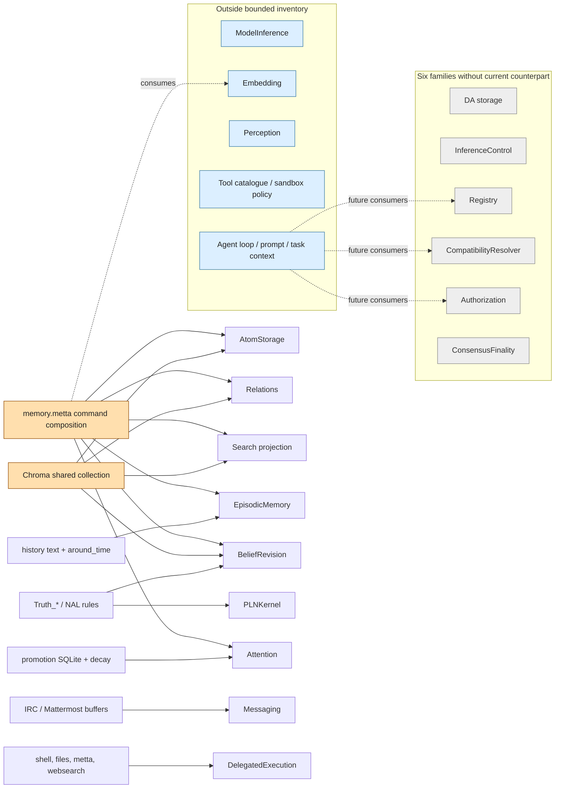
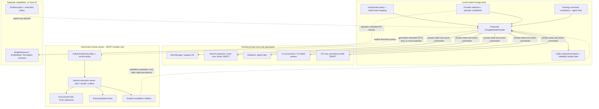
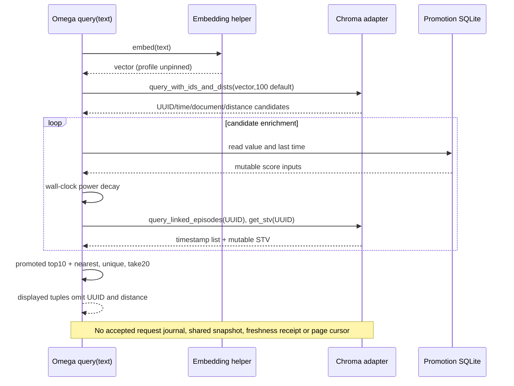
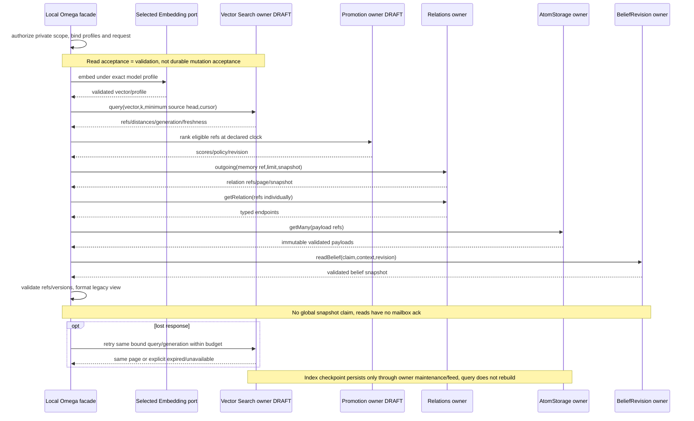
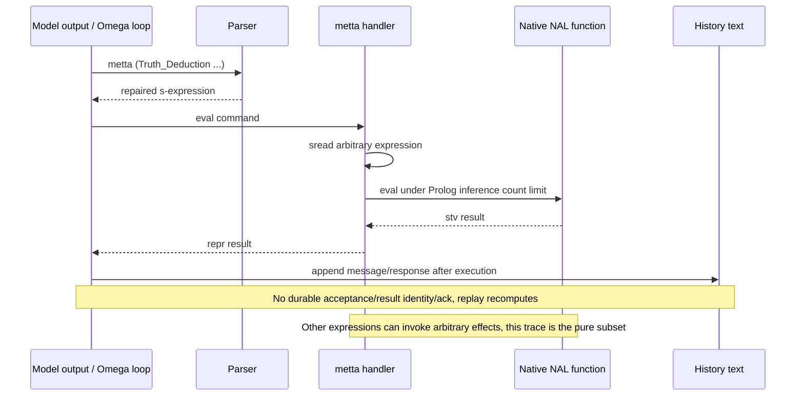
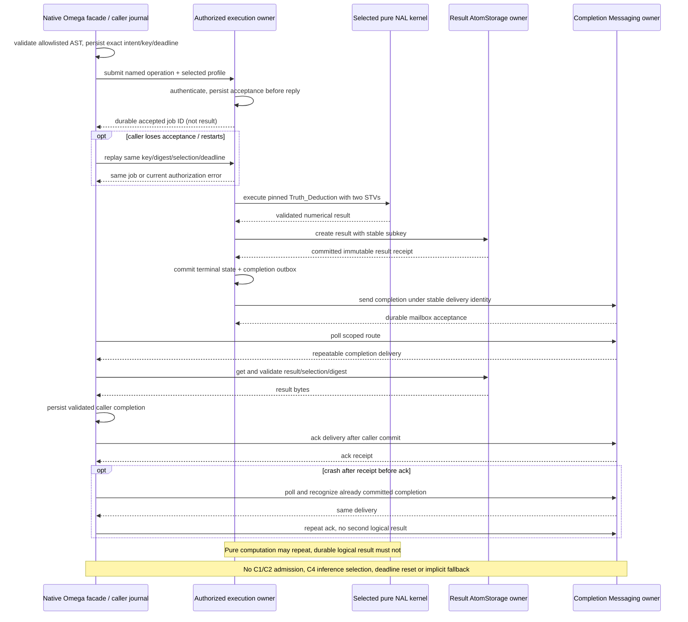

# Runtime, module overlay and proposed placement

Solid arrows in the current diagrams are source-defined calls/data flows, not proof that a live provider was exercised. Dashed edges in the overlay/target identify proposed adoption. All target diagrams are **unimplemented design** and depend on new profiles where marked DRAFT. [Source ledger](mapping-ledger.json), [state owners](state-ownership.md) and [seam contracts](seam-contracts.md) define the details.

## A. Current runtime

## B. Fifteen-family semantic overlay

Orange shared sources deliberately have multiple edges. Gray families have no current counterpart. Blue out-of-inventory boxes do not increase the denominator. Edges mean responsibility resemblance, **zero demonstrated Fusion conformance**.

## C. Target thin-client placement

Current private modules are **not remotely selectable** in this diagram. A later memory cut requires new explicit privacy/profile compatibility. No DA owner receives application semantics, no chain arrow exists.

## D1. Current query

## D2. Target query (new vector/promotion profiles required)

## E1. Current named reasoning through general evaluation

## E2. Target bounded named reasoning with independent owners

