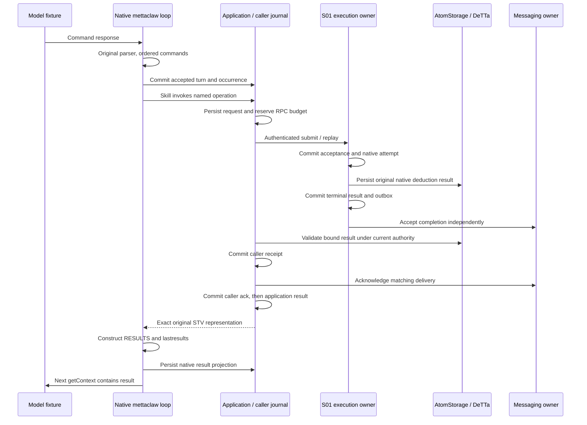

# S01.1 — controlled native-loop adoption

The existing `neoclaw-nal-truth-deduction/1` operation now runs through the pinned MeTTaClaw `mettaclaw` turn loop. The loop constructs `RESULTS` and `&lastresults`; a deterministic external model fixture checks the returned STV in its next received context. Local and authenticated, isolated, same-host HTTPS compositions use the same loop, skill and caller code. This is one adopted numerical operation, with application evidence added to S01. Default full Omega startup and live external providers remain unrun.

[Executed gate report](../../../evidence/s01_1/verification.json) · [Source manifest](../../../evidence/s01_1/source-state.json) · [Historical S01](s01.md)

**Source basis.** Work started at exactly `64d2d1583376f37811d37cb7f2557145690b3b00`, with only the supplied S01.1 brief untracked. All 148 historical S01 implementation hashes matched before editing. All 132 recorded M5 implementation files remain unchanged. This delivery is an uncommitted working tree on that commit; the manifest identifies tested bytes. No subsequent committed revision is claimed. Historical S01 reports and the mapping baseline remain intact.

| Component | Pinned source |
|---|---|
| MeTTaClaw `neoclaw` | `2af37c3fec18613de54ca42fde2382a9087d4524` |
| S01 PeTTa | `fea83178af3722666d2948d074591d10a3134f56` |
| S01 SWI-Prolog | `e58621a91ab7dd530e1e8185ed518f63d851c414`, SWI 10.0.1 |
| Embedded Python | CPython 3.12.12, existing verified S01 build |
| DeTTa | `272888f264dd2dde18b574cabb53c266b0dac2ec`, existing verified adapter build |

Existing guarded Fusion PLN retains its different source/runtime/numerical profiles. S01.1 does not change the S01 descriptors, wire protocol, arithmetic, worker, transport or owner implementations.

**Checked startup and substitutions.** `integration.neoclaw.native_loop` verifies the existing S01 runtime manifest, binaries, native libraries and pinned source hashes before generating a disposable overlay. It calls the real `mettaclaw` entrypoint. It preserves the upstream `helper.balance_parentheses`, native `sread`, `eval`, original `metta` skill's broader local branch, `HandleError`, `RESULTS`/`COMMAND_RETURN`, `getContext` and last-results state path. The skill patch is shared with the old single-command launcher. The checked loop edits add only accepted-response recovery, position binding, result journaling and bounded termination.

The controlled loader explicitly selects local pinned imports. It never evaluates the unpinned `git-import!` startup recipes or loads the user's populated Omega directory. Its precise substitutions are:

| Boundary | Initialization and behavior |
|---|---|
| Hosted model | Scripted `lib_llm_ext.useClaude` Python boundary. Emits command text; validates, records and counts later received context. Does not compute or supply an operation result. |
| PeTTa LLM support | Original `lib_llm.metta` string helpers retained. Checked removal of its eager `openai.OpenAI` initialization; no hosted client or credentials. |
| Channel | Original `src/channels.metta` initializes an explicit IRC Python fixture. No socket opens; receive is empty; send rejects. No live IRC/Mattermost. |
| Unused memory | Explicit fixture facade initializes `maxFeedback=50000`; generated prompt, empty history/recall, no-op history append. No Chroma, embedding or promotion-map initialization. |
| Media and other providers | Not imported or initialized. No web search, live media, Mattermost or embedding calls. |
| Persistent native space | Starts empty in a generated working directory. Original native export writes only there. No populated state import. |
| Authority and TLS | Generated local principals, credentials and test CA. Real bearer checks, certificate verification and loopback TCP/TLS. |

`maxNewInputLoops=128` and `sleepInterval=0` are trusted launch arguments. A durable session turn limit ends the controlled run, including after restart. Native loop code builds the complete context; recovery restores its previously persisted `&lastresults` string, not a test-authored context. The normal demonstration has six model calls, five distinct S01 occurrences, a local `(+ 1 2)` call, and an empty final observation turn.

**Application state and commits.** Small `app_session`, `app_turns` and `app_occurrences` tables live in the existing caller-owned SQLite journal. They do not merge provider owners. A per-journal process lock permits one application instance. The application accepts the raw response and the *native parser's ordered batch*, validates all selected commands and commits position identities before execution. A durable random session UUID plus accepted turn and batch position determines each invocation UUID. Lexical premise bytes, original absolute deadline, budgets, principal, route and exact descriptor selections are bound locally. Model text cannot select them.



Each arrow involving persistence is an independent transaction. The application accesses provider state only through the existing ports. A new local `Caller` invocation context supplies identity/deadline without rewriting operator config. Old S01 CLI config remains supported. Caller-owned route admission rejects a different unfinished request; it never acknowledges an unrelated delivery. Budgets remain 64 RPC calls, 3 native attempts and 128 lifetime requests at most; configured smaller limits are retained.

**Recovery semantics.** An accepted, incomplete S01 batch is replayed from its persisted model response before any new model call. Positions come from the accepted batch order, not evaluation order. Completed positions reauthorize their existing receipts, and the current position resumes its same identity. Native result construction rebuilds one ordered projection; it does not append duplicate fragments. A completed projection is restored after native initialization, with current-authority validation through `Caller` before model exposure. Revalidation consumes the existing RPC budget.

SIGKILL gates cover binding before submission, remote acceptance, caller completion before application handoff and application projection before the next model call. A separate gate interrupts the second position in a two-identical-command batch. Tests retain identities, deadlines, numerical results and budgets, with one logical job per occurrence and no accepted-command regeneration. Revocation blocks both receipt handoff and cached-projection recovery; restored authority can resume the same occurrence within its remaining bounds.

Any incomplete batch containing a broader local command is explicitly unsupported on restart, even if that command previously appeared to finish. It does not replay shell/file effects. Non-crashing local arithmetic still follows the original skill path. Exactly-once hosted model requests, channel delivery, arbitrary local tools and legacy history append behavior are outside the claim. A response lost before local durable acceptance is outside the invocation guarantee. Fresh application sessions are supported; populated-state migration is not.

**Operator recipe.** Use the unchanged [S01 build recipe](s01.md) for the pinned runtime and real DeTTa adapter. This run reused verified cached builds; it did not establish an empty-cache build or compiler bit reproducibility. On Linux, OpenSSL CLI and working bubblewrap/user namespaces are required in addition to those build prerequisites.

```bash
export S01_RUNTIME="$PWD/artifacts/s01/native-02/runtime.json"
export S01_DETTA="$PWD/artifacts/m5/reproduction-01/providers/detta/target/debug/fusion-detta-adapter"
mkdir -p artifacts/s01_1/repeated
uv run --python 3.11 --locked python -m integration.neoclaw.controlled_run \
  --placement local --evidence artifacts/s01_1/repeated/local.json
uv run --python 3.11 --locked python -m integration.neoclaw.controlled_run \
  --placement network --evidence artifacts/s01_1/repeated/network.json
S01_1_EVIDENCE="$PWD/artifacts/s01_1/repeated" \
uv run --python 3.11 --locked python -m unittest -v \
  tests.test_neoclaw_application integration.neoclaw.test_loop
```

The controlled recipe uses a generated-state fixture factory, starts the existing HTTPS server with an actual bound-port/PID readiness record, starts a separate bounded trusted work/flush process, and then launches the real application. Worker readiness also records its PID and time bound. There are no parent-test `drive()` calls in the application lifecycle. Work/flush remain unavailable on HTTPS. Only processes created by the recipe are stopped. Temporary generated credentials are deleted on exit. Neither placement uses a fallback.

The lower-level supported entrypoints also accept operator-prepared, mode-0600 configuration files:

```bash
uv run --python 3.11 --locked python -m integration.neoclaw.host serve PROVIDER.json \
  --port 0 --ready SERVER_READY.json
uv run --python 3.11 --locked python -m integration.neoclaw.operator PROVIDER.json \
  --seconds 120 --ready WORKER_READY.json
uv run --python 3.11 --locked python -m integration.neoclaw.native_loop APPLICATION.json
```

`APPLICATION.json` selects `controlled-native-loop/1`, the verified runtime, caller config, generated work directory, model-fixture config, status path, a turn limit (1–128), and invocation timeout (1–30000 ms). The caller still needs its native runtime; this composition is not an untrusted-code sandbox. The caller config selects local or network binding, credentials, route, exact catalogue and budgets; application mode does not need `request_id` or `deadline_ms`. The network composition masks provider files and the old Omega checkout, uses a verified CA and permits only `127.0.0.1`. It is same-host isolation, not multi-host placement or a runtime-free client.

**Changed files.** The source manifest lists exact hashes, including the user-supplied brief.

| Files | Responsibility |
|---|---|
| `fusion/neoclaw_application.py` | Caller-owned session, accepted batch, position identity and native projection journal; scoped recovery. |
| `fusion/neoclaw_client.py` | Trusted invocation context and unfinished-route admission; old CLI behavior retained. |
| `integration/neoclaw/startup_overlay.py`, `native_loop.py`, `loop_bridge.py` | Shared checked patches, supported actual-loop startup and fail-closed native hooks. |
| `integration/neoclaw/native_command.py`, `neoclaw_bridge.py` | Share the existing skill patch; choose application-owned invocation context at composition. |
| `integration/neoclaw/operator.py`, `controlled_run.py`, `controlled/*` | Bounded operator recipe, process lifecycle and declared external fixtures. |
| `tests/test_neoclaw_application.py`, `integration/neoclaw/test_loop.py` | Nine fixture contract methods and eleven real controlled-loop integration methods. |
| Mapping packet README, coverage, ledger, this report; `evidence/s01_1/*` | Same-operation application addendum, source trace, gates and executed evidence. |

**Executed tests.** The final combined S01/S01.1 run passed 52 tests in 210.963 seconds: 9 new application fixture tests, 11 new real controlled-loop test methods, and all 32 existing S01 tests. Separate regressions passed 156 core, 46 real native-provider and 42 historical native Hive cases, for **296 passing final test cases** with no skips. The gate report records individual case names. These timings describe the test run; they are not an autonomous-agent or performance benchmark.

**Validation and limits.** The gate report separates new fixture contract tests, real native-loop scenarios, the existing S01 suite and the three historical Fusion regression tracks. Tests cover changed and identical inputs, same-batch positions, source mismatch, malformed selected input/profile/result, wrong CA, outage, current revocation, capacity, durable budget/deadline exhaustion, unrelated pending work, and process kills. Generated canaries, credentials and operator paths are checked against model-visible contexts and the published generated invocation trace. Authentication credentials occur only in their intended transport authentication channel, never tool payloads.

`DEFAULT_FULL_OMEGA_STARTUP`, `LIVE_HOSTED_MODEL`, `LIVE_CHANNELS`, `GENUINE_MULTI_HOST`, `REAL_CHAIN`, `POWER_LOSS` and `EMPTY_GLOBAL_CACHE` are unrun. Supported-gate prerequisites were available. Live stack/provider inputs have not been resolved by this controlled composition. There is no new rule, broader remote execution, cognition, memory adoption, scheduler, chain work or migration. S01.1 stops here.
