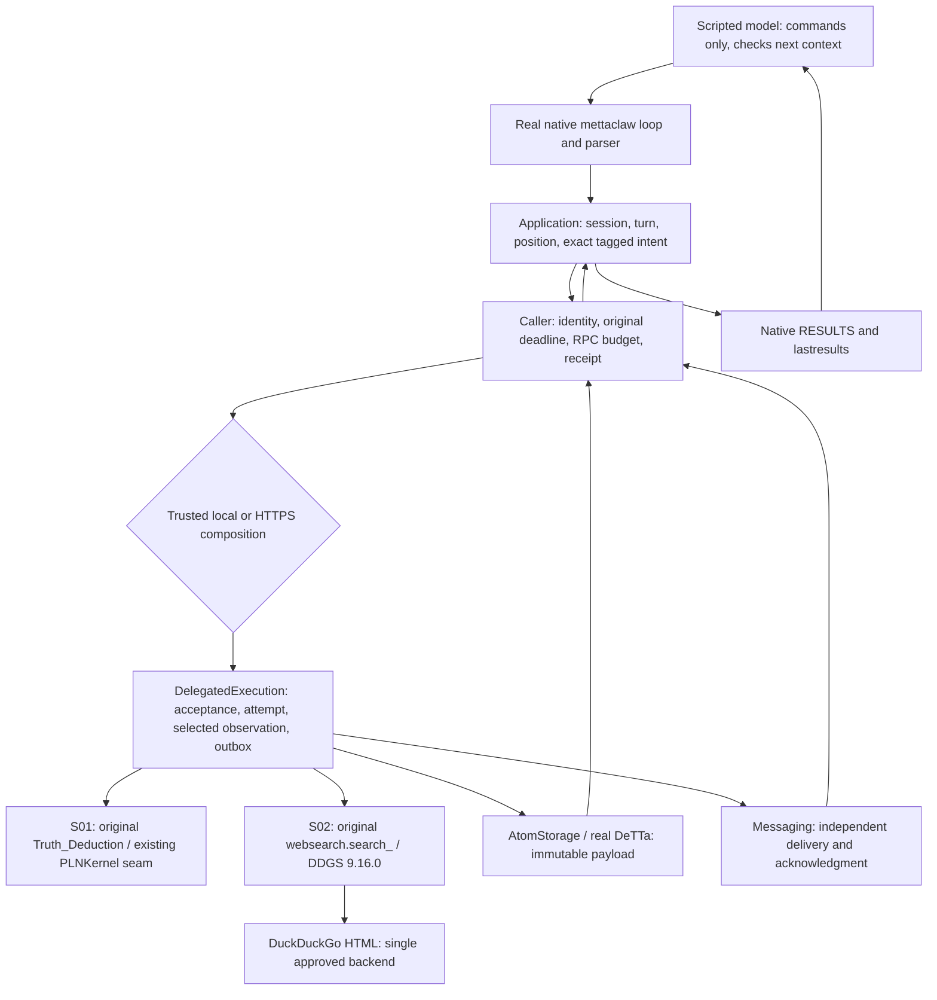

# S02 — external web search through the native loop

The existing native `search` command now uses `web_search` / `external-web-search/1`
through the same application and owner lifecycle as S01. Both operations ran in
one controlled session under local composition and authenticated, isolated,
same-host HTTPS. Both placements obtained actual external search results using
the pinned original helper and DDGS SDK. The HTTPS run killed the caller and worker
after capture, then recovered the exact observation without another SDK invocation.

This is the second adopted operation, not adoption of the Fusion Search projection,
a whole module family, or the full Omega application. There is no new cognition,
memory adoption, reasoning rule, crawler, scheduler, chain work or state migration.

[Machine-readable gates](../../../evidence/s02/verification.json) ·
[Exact source state](../../../evidence/s02/source-state.json) ·
[Contract decisions](s02-contract-decisions.md) ·
[Live local trace](../../../evidence/s02/live-local.json) ·
[Live HTTPS recovery trace](../../../evidence/s02/live-https-recovery.json)

## Sources and compatibility

Work started at exactly `58a5855ea55091c8f15e86d8293e519494bf728d` on `master`, with
only the supplied S02 brief untracked. All 159 S01.1 implementation hashes matched.
Its historical report describes a tested working tree based on `64d2d158`; those
bytes were published in `58a5855`. The historical reports and 105 mapping rows are
preserved. The new manifest identifies tested implementation bytes and their
relationship to the final commits; it does not rewrite historical provenance.

| Input | Pin used |
|---|---|
| MeTTaClaw neoclaw | `2af37c3fec18613de54ca42fde2382a9087d4524` |
| S01 PeTTa | `fea83178af3722666d2948d074591d10a3134f56` |
| S01 SWI source / runtime | `e58621a91ab7dd530e1e8185ed518f63d851c414` / 10.0.1 |
| Embedded native Python and separate SDK Python | CPython 3.12.12; binary hashes in source manifest |
| DeTTa | `272888f264dd2dde18b574cabb53c266b0dac2ec` |
| DDGS | 9.16.0; wheel SHA-256 `175d9198c958a263f51a06a54368ba0b41294942c0cd29f4aa71be03dbcd5f4a` |
| SDK dependencies | primp 2.0.1, lxml 6.1.3, click 8.5.0; hash-locked distributions and installed RECORD verification |
| Primp source inspected for retry semantics | `cf29cd94f339c1a69ec7f271f532f0f2411aa06e` (`v2.0.1`) |

The upstream helper did not pin its historical SDK. DDGS 9.16.0 is a newly selected
compatible distribution, not a reconstruction of that unknown deployment. The
SDK environment is separate from S01's embedded Python. Fusion's guarded PLN
runtime, numerical profiles and source pins remain unchanged.

`controlled-native-loop/2` selects `neoclaw-tools/2`, tagged application intents
and both descriptor sets. It requires fresh application/execution journals. The
legacy `premises` column stores tagged intents only in these explicitly bound new
journals; old rows are never reinterpreted. Version 1 remains supported under its
original binding. The shared `generated-s01` namespace label is retained as a
generated-data compatibility label, not a declaration that S02 is numerical.

## Responsibilities and executable path



Both operations use the existing bounded `/s01` HTTPS route; the explicit wire
profile and operation distinguish them. Work and flush remain operator-only.

The source-checked channels overlay replaces only
`(py-call (websearch.search $msg))` with `(py-call (loop_bridge.search $msg))`.
The original loop, parser, skill advertisement, command evaluation, result
construction and next-context path remain real. The application, caller and
execution owner use a closed two-operation binding; there is no arbitrary remote
expression, function, import, URL, path or execution interface.

Execution owns its request/attempt/observation journal. The SDK adapter owns no job
journal. AtomStorage owns payloads; Messaging owns delivery state; the caller owns
receipts and the application owns occurrences and native projections. Every commit
remains independent. Execution consults only its own job/result mapping when
checking shared-port access; it never reads another owner's database. The caller
does not read provider SQL or files. The operator inspects generated journals only
for test evidence and uses existing work/flush/readiness/shutdown entrypoints.

## S02 semantics

The native command fixes `max_results=10`; the wire profile admits integers 1–10.
Queries are exact, nonblank UTF-8 up to 2048 bytes, rejecting Unicode control,
format, surrogate and other category-C characters. The native parser's existing
command normalization precedes this contract. The complete canonical request must
also fit 4096 bytes, so escape-heavy queries can hit that additional bound. Unknown
fields and provider configuration in arguments are rejected. The supported native
application checks its trusted exact query allowlist before creating a caller
request; the provider independently checks current disclosure policy and authority.

The only approved live demonstration query is:
`Python programming language official documentation`.
No private prompt, history, episodes, identifying private hashes or Omega files are
read or exported. Credentials appear only in their transport authentication role.

Each result contains the request digest, job ID, selected provider/descriptor,
exact arguments, ordered title/URL/snippet items, SDK/backend identity, observation
and capture timestamps, and compatibility rendering. Titles/URLs/snippets are
limited to 1024/2048/8192 bytes; the whole result is limited to 32768 bytes. Excess
is rejected, not silently truncated. Metadata explicitly says `top-k-not-exhaustive`
and `truncated=false`; unknown upstream version is null. SDK engine metadata calls
DuckDuckGo's underlying provider `bing`; the actual selected backend and destination
are DuckDuckGo HTML. No upstream software version is inferred from that label.

Ordinary recorded rows match the original title/snippet string byte for byte;
URLs remain in the structured observation. Control/format characters in returned
text are escaped for display; printable quotes, parentheses and Unicode are native
string data. Results are never passed to `sread` or `eval`. The existing native
`repr`/`string-safe` context formatting still applies, so the context projection is
not a byte serialization of the structured observation. Tests pass fake commands,
quotes, newlines, controls and Unicode through the actual loop and check that no
injected action executes. This is a data-boundary test, not a claim that a live
model is immune to prompt injection. Returned links are never fetched.

Successful empty SDK rows produce an explicit `empty` observation and `()`.
Rate limiting, denial, outage, timeout, malformed output and spent ambiguous
attempts produce distinct bounded failure reasons. The original wrapper instead
caught all exceptions and returned an empty string; S02 deliberately corrects that
behavior. DDGS's ambiguous `No results found.` exception is classified as failure,
not proof of successful emptiness. Native failure status carries the typed reason
and stops before the next model context; it does not invent a result.

## Recovery, bounds and authority

Execution reserves its sole SDK attempt before invocation. The original helper's
`search_` runs unchanged with a source-checked, operator-owned DDGS binding. It
selects only DuckDuckGo, disables redirects and proxy configuration, admits exactly
one POST HTTP entry to `https://html.duckduckgo.com/html/`, and rejects the SDK's
automatic backend fallback. A supervised subprocess bounds startup, search and
collection to the smaller of 10 seconds and the original remaining deadline.
Linux parent-death signaling stops an in-flight SDK child if its worker is killed.

There are three distinct counts: durable caller RPC reservations (at most 64),
durable SDK reservations (one), and actual HTTP transmissions. Each successful live
run observed one SDK invocation and one HTTP-client entry. Primp's inspected
transport can retry protocol NACKs, conservatively bounded by two additional
transmissions; its Python API exposes no disable switch. Wire transmissions were
not measured. The SDK URL guard is not an OS firewall. TLS/DNS traffic and a request
already transmitted cannot be recalled. There is no exactly-once upstream-call,
billing or deterministic-web-content claim.

The first valid observation durably selected in execution is immutable. Its
canonical bytes, timestamps, identity and rendering are committed before payload
publication. After capture, restart uses those exact bytes without a new SDK call
or regenerated metadata. A crash after response but before capture may lose the
observation; its reservation stays spent. No deadline, reservation, budget or
occurrence is reset to manufacture success. Captured work can finish publication
after its deadline, but a new search cannot start after the deadline.

Current principal, scope, route, operation, descriptor and disclosure policy are
checked at submission, worker dispatch, release, replay and native handoff. S01
shared-port selections cannot bypass S02 result authorization. Revocation cannot
undo a transmitted query, but prevents new calls or result release. Finite replay
checks consume the existing RPC budget. Two S02 commands in one batch are supported;
mixed adopted-operation batches are refused before effects. Incomplete batches
containing unadopted local effects are never replayed. Separate S01/S02 turns use
the same application session without business configuration edits.

## Executed evidence and qualifications

Final verification passed **318 unique test methods/cases, with no skips**: 9 new
recorded-response contract methods, 13 new real controlled-loop methods covering
36 scenarios, and 296 historical cases (52 S01/S01.1, 156 core, 46 real native
provider, 42 real Hive). The 21-method combined new-suite run passed in 147.816
seconds; the subsequently added disclosure method passed separately in 3.836
seconds. That test-only addition did not change the production bytes used by either
live run. The two live sessions are additional gates, not added to the method count.
These are verification durations, not application performance benchmarks.

The gate manifest lists exact commands, method names, scenario counts, durations
and source hashes. It separates new contract tests, real controlled-loop tests
with recorded external responses, the two actual live runs, and all 296 historical
regression cases. Repeated development runs are retained separately and are not
added to the unique-method total.

Real components: native `mettaclaw` loop, parser and skills; original NAL numerical
provider; pinned original web helper; pinned SDK; actual external search in the two
live gates; DeTTa; certificate-checked HTTPS/TCP; filesystem isolation; SIGKILL and
restart. Recorded `.text` responses are fixtures, even though the original helper
and installed SDK classes execute. External model, IRC ingress and unused memory
remain declared fixtures in every controlled session.

The initial pre-admission Brave SDK compatibility probe received HTTP 429 and was
not retried. A separate DuckDuckGo probe succeeded before selecting the backend.
There were four total live SDK invocations during this task: the failed Brave
probe, the successful DuckDuckGo probe, and the local/HTTPS integration runs. No
backend changed after admission; no recovery issued another live query. Development
failures and test-harness corrections are retained in the evidence packet, including
the stale operator readiness PID and a test that initially assumed mailbox capacity
was global instead of per route.

Full default Omega startup, live hosted models, live IRC/Mattermost, genuine
multi-host deployment, chain, power loss and an empty global build cache are
`NOT_RUN`. Supported native/SDK builds were available; the new SDK target was built
fresh with warm caches and verified wheel RECORDs. This does not establish compiler
bit reproducibility or repeatability of live web contents. Existing populated
journals are not migrated. These limits remain after the required S02 gates pass.

## Reproduction

Use the existing [S01 native build recipe](s01.md) and real DeTTa adapter. Linux,
OpenSSL CLI, working bubblewrap/user namespaces, `uv` and the recorded Python build
are required. Reuse verified S01 sources; do not install the SDK into its environment.

```bash
export S01_RUNTIME="$PWD/artifacts/s01/native-02/runtime.json"
export S01_DETTA="$PWD/artifacts/m5/reproduction-01/providers/detta/target/debug/fusion-detta-adapter"
uv run --python 3.11 --locked python -m integration.neoclaw.search_build \
  artifacts/s02/reproduce \
  --helper artifacts/s01/native-02/sources/mettaclaw/channels/websearch.py
export S02_RUNTIME="$PWD/artifacts/s02/reproduce/search-runtime.json"

# Recorded external responses; real native loop, HTTPS, DeTTa and recovery.
S02_EVIDENCE="$PWD/artifacts/s02/repeated" \
  uv run --python 3.11 --locked python -m unittest -v \
  tests.test_neoclaw_search integration.neoclaw.test_search_loop
uv run --python 3.11 --locked python -m integration.neoclaw.search_run \
  --placement network --boundary recorded-response --recover-capture \
  --evidence artifacts/s02/repeated/operator.json

# Explicit live opt-in: one SDK invocation per command; do not retry to force PASS.
uv run --python 3.11 --locked python -m integration.neoclaw.search_run \
  --placement local --boundary live --evidence artifacts/s02/repeated/live-local.json
uv run --python 3.11 --locked python -m integration.neoclaw.search_run \
  --placement network --boundary live --recover-capture \
  --evidence artifacts/s02/repeated/live-https.json
```

The recipe starts bounded operator work/flush and loopback HTTPS, checks PID
readiness, and stops only its own processes. Recovery removes only the explicit
test failpoint; it does not edit operation arguments, credentials, selection,
deadlines, model commands or business configuration between calls. It refuses
public/non-loopback placement and has no local fallback. Live restrictions or
outages must be reported as failures/timeouts or missing prerequisites, not replaced
with fixture results. Reproduction of inputs does not imply identical web results.

## Changed files

| Files | Responsibility |
|---|---|
| `fusion/neoclaw_search_contracts.py`, `neoclaw_operations.py` | Closed S02 contract and explicit two-operation binding |
| `fusion/neoclaw.py`, `neoclaw_client.py`, `neoclaw_transport.py`, `neoclaw_application.py` | Existing shared lifecycle extended for captured observations, current authority, tagged intents and bounded payloads |
| `fusion/adapters/neoclaw_search.py`, `integration/neoclaw/search_worker.py` | Supervised original-helper/SDK invocation, normalization and egress guard |
| `integration/neoclaw/search_build.py`, `search-requirements.lock` | Separate reproducible SDK build and source verification |
| `integration/neoclaw/{startup_overlay,native_loop,loop_bridge,controlled_run,operator}.py` | Narrow native startup binding and reused bounded operator lifecycle |
| `integration/neoclaw/{search_composition,search_run,native_command,search_original_fixture}.py` | Trusted composition, live recipe and explicitly recorded original-native oracle |
| `tests/test_neoclaw_search.py`, `integration/neoclaw/test_search_loop.py` | New contract and real controlled-loop tests |
| Adoption packet, supplied brief, `evidence/s02/*` | Exact-operation evidence, source trace and limitations |

The mapping baseline, S01 mathematical contracts and guarded Fusion PLN source
remain intact. S02 stops here.
