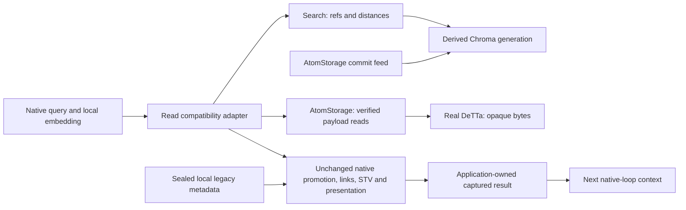

# S03: native vector memory-read boundary

This increment adopts exactly `lib_chromadb.query_with_ids_and_dists` inside the
native `query` composition. Search supplies ordered scoped refs and distances;
AtomStorage supplies verified immutable payloads. Native promotion, linked labels,
STVs, selection, rendered-record uniqueness and presentation remain local.
It is one adopted internal operation, not adoption of the entire memory command
family or additional operations for hydration and transport.

Starting checkout: **34295802e16cd3f0ab1998d2876462dff3a7978a**, `master`.
Only the supplied S03 brief was untracked. All 170 S02 implementation-manifest
hashes matched before edits. This delivery is an additive working tree on that
commit; [the source manifest](../../../evidence/s03/source-state.json) identifies
its exact implementation bytes. Historical reports and 105 mapping rows remain
unchanged. [Contract decisions](s03-contract-decisions.md) describe the new profile,
bounds, ownership and compatibility separately from observed execution.



Provider placement changes through trusted composition. The same native query,
read adapter and application code run locally and over certificate-verified,
authenticated **same-host HTTPS**. The read route has closed schemas, current
policy checks and a generated-synthetic disclosure profile. It creates no execution
job, mailbox or outbox. S01/S02 retain their existing independent owner commits.

## Exact sources and admission

| Component | Tested identity |
|---|---|
| MeTTaClaw neoclaw | `2af37c3fec18613de54ca42fde2382a9087d4524` |
| Chroma helper | `218484875d5d1bfb217a9a03d3983dc1ed9d406c`; original function SHA recorded |
| S01 PeTTa | `fea83178af3722666d2948d074591d10a3134f56` |
| S01 SWI | 10.0.1; source `e58621a91ab7dd530e1e8185ed518f63d851c414` |
| DeTTa | `272888f264dd2dde18b574cabb53c266b0dac2ec`; existing verified adapter binary |
| Chroma | 1.5.5, new tested SDK baseline; historical deployed SDK remains unknown |
| Local embedding | `intfloat/e5-large-v2@f169b11e22de13617baa190a028a32f3493550b6` |
| Numerical input | CPU float32, 1024 dimensions, native normalized encode, no added prefixes |
| Dependencies | Python 3.12.12; 100 packages, 26,871 wheel RECORD hashes verified; hashed lock and model files |

The separate guarded Fusion PLN runtime/numerical profiles are unchanged. The
memory startup loads the original query functions and native combinatorics/vector
libraries. It changes the retrieval call and instruments the original post-query
clock point for durable capture. It suppresses unrelated eager hosted/media clients.
The real E5 initializer resolves the exact offline model directory; the original
normalized encoding function executes unchanged. Query text still passes through
the native `string-safe` processing. Generated enrollment uses those same local
encoding functions, with no memory-write-adoption claim.

The new application composition is `controlled-native-loop/3`, with fresh journals.
Older /1 and /2 state is not relabelled. Read-only admission permits the named S01,
S02 and query operations sequentially; heterogeneous batches and memory mutation,
arbitrary MeTTa and shell commands are rejected. This restriction seals the generated
read session. Existing S01/S02 profiles and broader local behavior under their
older compositions remain unchanged.

## Observed execution and guarantees

The [gate manifest](../../../evidence/s03/verification.json) is the authoritative
executed/unrun accounting. [Fresh-target three-path evidence](../../../evidence/s03/reproduction-real-three-paths-final.json)
compares original native, adapted local and adapted HTTPS on identical new synthetic
identities, vectors, insertion schedule, metadata and enrichment clock. All three
use real Chroma; adapted paths use real DeTTa. Text queries use real pinned E5.
Native next-context feedback matches exactly; candidate identities match and
observed distances match within 1e-6. That tolerance checks distance representation,
not permission to hide changed ranking.

[Real-model recovery](../../../evidence/s03/real-model-recovery-final.json) kills the actual
HTTPS native caller after candidate capture, payload validation and final result
capture. Restart preserves occurrence identity, original deadline, candidate
observation and captured result. The first occurrence queries candidates once;
a later identical command has a different occurrence and its own read. The next
native context consumes the preserved output. Other executed kill cases cover
lost replies before capture and the application projection boundary.

Search discovers enrollment through M5 AtomCommitSource, never a test answer list
or foreign SQL. Enrollment validates separately committed payload/vector records;
stable mutation keys replay safely. Rebuild deletes only the derived index, reads
that same authoritative prefix through ports and publishes a new physical generation.
The logical snapshot remains equal. New or uncaptured candidate queries bound to the lost physical generation
fail explicitly; they do not silently switch. Already captured candidates can
finish authoritative hydration without ranking again, and captured native output
can replay under current authority. Changing the selected generation, corpus or
metadata seal requires a fresh application journal in this initial profile. A new unindexed source head is not
reported as an empty result. A built empty prefix does return empty hits.

Killed builds around Chroma writes, checkpoint and pointer publication preserve
previously published reads. Unpublished state is abandoned/rebuilt. The test does
not claim a transaction spanning Chroma and the publication file, or power-loss
survival. Maintenance is operator-driven and bounded; there is no scheduler.

The corpus exercises positive promotion that changes ordering, zero promotion,
multiple linked labels, varied STVs, distinct UUIDs sharing a timestamp, and duplicate
presentations. Native uniqueness collapses equal rendered records, not UUIDs.
Separate tie/near-tie observations retain SDK ordering without imposing a new tie
policy. Repeated observed order is not an ANN recall or stable-tie guarantee.
No retrieval-quality, scaling or speedup claim follows from this small corpus.

Authorization, descriptor/profile binding, malformed results/payloads, wrong scopes,
models, dimensions, metrics and generations, nonfinite vectors, revocation, bad
certificates and outage are exercised. Current authorization gates captured replay
and context release. Every read reply identifies the server-authenticated principal,
which must match the principal frozen in the application binding; substituting a
worker credential cannot release another principal's captured result. Lost replies spend the original durable attempt budget; expired
uncaptured reads fail, while already captured output can complete disclosure under
current authority. No budget refund or deadline reset occurs.

The network caller cannot see provider files, and the provider cannot see caller
metadata/journals/keys or the old private Omega worktree. This is loopback filesystem
isolation, not multi-host isolation or an OS egress firewall. A hostile metadata-only
wrapper forbids legacy candidate and payload reads. Hydration verifies scope, exact
refs, content types, digests and UUIDs and fails the whole read on a missing record.
Fake commands, quotes, control characters and Unicode remain data in native feedback;
this does not establish live-model prompt-injection immunity.

Before/after checks show unchanged local promotion bytes, linked labels and STVs,
absent local candidate documents, and unchanged authoritative source during query
and rebuild. Application receipts/projection and the native generated persistent-space
export are expected local effects. No C1/C2/C3/C4 cognitive owner is involved in
this read path; historical cognitive regressions still execute separately.

## Changed files and executed tests

| Area | Files |
|---|---|
| Contracts, enrollment and projection | `fusion/vector_contracts.py`, `vector_enrollment.py`, `vector_composition.py`, `vector_transport.py`, `adapters/chroma_vector.py` |
| Existing application ownership | `fusion/neoclaw_application.py`, new `neoclaw_memory.py` |
| Native startup and HTTPS | `integration/neoclaw/native_loop.py`, `loop_bridge.py`, `host.py`, new `memory_startup.py`, `memory_bootstrap.py` |
| Source/build and reproducible demonstrations | `integration/neoclaw/memory_build.py`, `memory_embedding.py`, `memory_oracle.py`, `memory_composition.py`, `memory_corpus.py`, `memory_run.py`, `memory_recovery_run.py`, `memory_maintenance.py`, model/hash locks |
| Tests | `tests/test_vector_contracts.py`, `integration/neoclaw/test_memory.py`, `test_memory_edges.py` |
| Reporting | S03 report/decisions, adoption ledger/coverage/readmes, `evidence/s03/` and supplied brief |

**340 unique test methods/cases passed:** 22 new (five contract/vector-fixture
methods, 17 methods using real Chroma/DeTTa and applicable native/TLS paths), plus
318 historical regressions: 74 S01/S01.1/S02, 156 core, 46 real native-provider and
42 Hive. The 74-method run had one environmental failure; that same method passed
on isolated recheck, without increasing the unique count. Parameterized phases
and additional real-model demonstrations are listed separately in the manifest.
The 13-method development run and repeat three-path rehearsals are not added to
this total. No required gate is blocked or left unrun.

## Evidence boundaries and limitations

Real providers: native MeTTaClaw/PeTTa/SWI, Chroma, DeTTa, local E5, TLS/TCP.
Fixtures: scripted external model, IRC/channel boundary, unused history and global
promoted-context, fixed enrichment clock; deterministic vector fixtures are labelled
separately. Numerical distance oracles are test code, not replacement retrieval.
S02 regressions use recorded responses; its historical live-provider evidence is
retained. No new live external-search rehearsal was needed because its SDK/egress
implementation is unchanged.

Remaining local/unadopted components include embeddings as a service, promotion
policy/SQLite, linked-episode labels, STV ownership, history, full memory writes and
all private user data. No full Omega startup, hosted LLM/channel integration, private
remote-memory placement, multi-host, migration, chain work, power-loss test or
empty-global-cache build was performed. The generated metadata snapshot is not a
global transaction across legacy and Fusion owners. No production private-memory
service or generic Chroma replacement is delivered.

Development failures are retained separately: the original driver omitted a native
library; the first projection verifier rejected NumPy scalars before explicit SDK
conversion; one S02 test hit a disappearing bubblewrap/container mount and passed
on isolated recheck; the first real-model recovery observer timed out during startup.
The recovery observer was extended without changing application deadlines, and the
same real recovery passed. These are not silently counted as initial passes.

## Reproduction

Use Linux with uv, the existing native build prerequisites, OpenSSL CLI, bubblewrap
and user namespaces. Keep the independent S01 runtime and DeTTa binary from the
[source manifest](../../../evidence/s03/source-state.json), or rebuild them using
`scripts/build_s01.py` and the existing `scripts/build_detta.py` pinned recipes.
Missing source/build dependencies are prerequisites, not permission to use a storage
fixture. The unchanged S02 SDK remains required for mixed-session regressions.

```bash
uv run --python 3.11 --locked python -m integration.neoclaw.memory_build artifacts/s03/fresh
export S01_RUNTIME="$PWD/artifacts/s01/native-02/runtime.json"
export S01_DETTA="$PWD/artifacts/m5/reproduction-01/providers/detta/target/debug/fusion-detta-adapter"
export S03_SDK="$PWD/artifacts/s03/fresh/venv"
export S03_MODEL="$PWD/artifacts/s03/fresh/model"
export S03_HELPER="$PWD/artifacts/s03/fresh/sources/petta_lib_chromadb/lib_chromadb.py"
export S03_RUNTIME="$PWD/artifacts/s03/fresh/memory-runtime.json"
export PYTHONPATH="$PWD"
export HF_HUB_OFFLINE=1
"$S03_SDK/bin/python" -m integration.neoclaw.memory_run --evidence artifacts/s03/three-paths.json
"$S03_SDK/bin/python" -m integration.neoclaw.memory_recovery_run --evidence artifacts/s03/recovery.json
"$S03_SDK/bin/python" -m unittest -v tests.test_vector_contracts integration.neoclaw.test_memory integration.neoclaw.test_memory_edges.MemoryEdges
```

The executed fresh target used `--model-cache artifacts/s03/model`: assets were
originally downloaded from the pinned public revision and hash-verified again in
the new directory. Package download caches may be warm. This is not an empty global
cache claim. Local/HTTPS composition uses the same business code; only trusted
placement and endpoint configuration differ. See the gate manifest for exact test
commands, counts, observations and source hashes.

Stop here. The next decision is about remaining local memory owners and real workload
requirements, not automatic memory-write adoption or private-data rollout.
