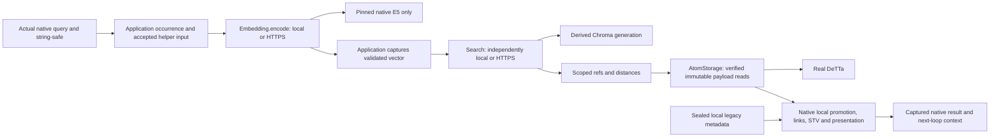

# S03.1: independently placed query embedding

This slice adopts only the query-time Local `lib_llm_ext.useLocalEmbedding` call
inside the controlled native `query`. `Embedding.encode` selects local or
authenticated same-host HTTPS placement independently of Search/AtomStorage.
Native `embed`/`string-safe`, the pinned E5 function, vector semantics, retrieval,
promotion, linked-label/STV reads, selection, uniqueness and presentation retain
their existing behavior. The HTTPS caller uses a separate environment without
`torch`, `sentence_transformers`, `transformers` or accessible E5 model assets.

The source baseline is **2bddbc3467f98ed258741a21a329230a0cd21dd9**, `master`, with
only the supplied S03.1 brief initially untracked. No descendant was substituted.
[Source reconciliation](../../../evidence/s03_1/baseline-source.json) matches all
25 recorded S03 implementation hashes, all 32 non-evidence hashes and all 40
historical evidence hashes to the published checkout. S03 remains a historical
working-tree execution on `34295802e16cd3f0ab1998d2876462dff3a7978a`; publication
does not turn that old run into a clean-commit run. Its 340 unique methods/cases,
development failures and separate real-E5 demonstrations retain their identities.

This delivery is an additive working tree on the stated baseline. Its exact bytes
and dependency identities are in [source-state.json](../../../evidence/s03_1/source-state.json).
[Gate results](../../../evidence/s03_1/verification.json) distinguish current
executions, fixtures, historical evidence and unrun work. The
[contract decisions](s03_1-contract-decisions.md) specify the new profile and bounds.



One inspection correction matters for privacy: S03's `MemoryRead.authorize` already
sends raw query text to its Search authorization endpoint. The old implementation
was not vector-only on the wire. S03.1 adds a separately authorized disclosure of
the exact **post-`string-safe` helper input** to the encoder owner. Existing Search
authorization stays unchanged. No permission to send vectors implicitly grants
permission to send text to this new dependency.

## Sources and caller dependencies

| Component | Selected identity |
|---|---|
| MeTTaClaw neoclaw | `2af37c3fec18613de54ca42fde2382a9087d4524` |
| PeTTa / S01 native runtime | `fea83178af3722666d2948d074591d10a3134f56` |
| SWI-Prolog | 10.0.1, `e58621a91ab7dd530e1e8185ed518f63d851c414` |
| Chroma helper | `218484875d5d1bfb217a9a03d3983dc1ed9d406c`; unchanged helper bytes |
| DeTTa | `272888f264dd2dde18b574cabb53c266b0dac2ec`; existing verified adapter binary |
| E5 | `intfloat/e5-large-v2@f169b11e22de13617baa190a028a32f3493550b6` |
| Numerical path | Original normalized `.encode(...).tolist()`, CPU float32, 1024 dimensions, native 512-token truncation; no added prefixes |
| Provider SDK | Existing S03 Python 3.12.12 and hashed 100-package lock; torch 2.10.0+cpu, sentence-transformers 5.2.3, transformers 5.20.1 |
| Caller SDK | Python 3.12.12, 83 pinned packages / 6,414 verified wheel RECORD files; real Chroma 1.5.5; E5 inference packages absent |

The existing Fusion guarded PLN/SWI runtime, numerical profiles, Search vector
profile and E5 loader are unchanged. Provider readiness verifies its own original
source, SDK files and model/tokenizer hashes. The caller verifies its own slim SDK,
native sources and metadata helper; it never reads provider model files to validate
a descriptor. Public model/profile identities are shared, not provider filesystem
access. No eager-import coupling required an upstream modification.

The remaining caller dependencies include PeTTa/SWI/Janus, Python, real Chroma,
NumPy, Chroma's transitive SDK dependencies, sealed local metadata and read-only
promotion SQLite. S01/S02 retain their separate runtime recipes. The caller is not
a complete thin client; unused Chroma embedding adapters may exist as source, but
there is no local E5 stack, initialized fallback model or legacy retrieval fallback.

## Contracts, commits and recovery

The new X02 extension uses interface `embedding` version `1.0.0`, profile
`neoclaw-e5-query-text/1`, and fresh application composition
`controlled-native-loop/4`. Historical `/1`, `/2`, `/3` compositions are preserved;
old populated journals cannot be silently rebound. The historical 15-family
inventory is unchanged. This is one additional internal operation boundary, not
an additional user command or adoption of all embedding modes/callers.

Each input binds principal, scope, occurrence, exact UTF-8 helper string and digest,
selected descriptor, original deadline, model, preprocessing profile and byte cap.
The port accepts one string, including empty text and control characters, up to
2048 UTF-8 bytes. Lone surrogates and oversize inputs fail. Native command admission
remains narrower. Transformations run once in native code; operator consent records
the exact raw-command/helper-input pair. Instructions embedded in strings remain data.

Replies bind the same invocation and principal and declare model, preprocessing,
float32, dimension 1024 and unit norm. Their SHA-256 covers exactly 4096 little-endian
float32 bytes. Wrong profiles, request identities, principals, dimensions, nonfinite
values, nonunit vectors or digests are rejected before Search. Validation never
renormalizes. A digest or descriptor is not cryptographic execution attestation.

| Owner / commit | Behavior |
|---|---|
| Application occurrence | Existing session/turn/position identity and deadline; identical later commands are new occurrences |
| Application encode intent | Persists exact input/model/descriptor before evaluation |
| Application attempt | Reserves before sending; three encode sends maximum, separately from S03 retrieval budgets |
| Encoder attempt | Independently reserves each attempt number once before model dispatch; duplicate sends cannot repeat that slot |
| Application vector | First validated bound vector commits before Search; replay preserves exact captured bytes |
| Existing read captures | Candidates, authoritative payloads and enrichment time retain S03 commits and frozen generation |
| Existing native result / handoff | Captured output reaches the next actual loop context under current disclosure authority |

There are at most 32 encoder-port calls per occurrence and 128 provider occurrence
records. Authorization calls are counted separately from encode attempts; retries
have no hidden transport retry or budget refund. A pre-capture crash may spend a
reservation without delivery, lose an evaluated response, or require another
bounded evaluation. There is no exactly-once inference guarantee or shared result
cache. After vector capture, native restart performs no further encode evaluation.

Provider readiness may load the resident model before an occurrence is accepted.
Each admitted evaluation is supervised for at most five seconds or its remaining
original deadline; a stalled worker is killed and does not automatically restart.
The existing sequential HTTPS host and one locked resident worker bound concurrency.
Readiness and observer timeouts do not renew application deadlines. Expiry prevents
new encode/retrieval work, while authorized captured-result disclosure can finish.

Current `embedding.encode` and `embedding.disclose` permissions are distinct. Checks
cover dispatch, response release, captured-vector/result replay and next-context
handoff. Another authorized principal's credential cannot release the accepted
principal's result. The operator separately approves the exact synthetic helper
input; no private question, history, memory, identifier or credential is exported.
Filesystem isolation and synthetic canaries demonstrate the selected local boundaries;
they are not an egress firewall or production private-model hosting.

## Executed evidence and measurements

The final verification passed **114 distinct methods: 18 new (5 contract fixtures
and 13 integration methods) plus 96 S01–S03 regressions**. All ten required gates
pass; no required prerequisite is blocked and no required gate is unrun.

The published S03 baseline passed 22 tests in 575.363 seconds before existing
runtime files were edited. New fixture contract tests are separate from real
E5/native/Chroma/DeTTa/TLS integration methods. Final counts and exact commands are
recorded in the gate manifest; repeated subsets and parameterized kill phases do
not increase the unique-method count. Historical M1–M5/Hive passes are not relabelled
as new S03.1 executions.

The same generated corpus is enrolled through its authoritative AtomStorage feed.
Original native query, adapted local encoder/retrieval, HTTPS encoder/retrieval and
both mixed placement combinations are compared for exact helper bytes, vector
representation/norm, candidate IDs/distances, final presentation and next-context
consumption. Independent evaluations allow at most 1e-7 per vector coordinate and
1e-6 distance difference; the observed comparisons additionally record exact
equality and rank order. No ranking change is excused by a numerical tolerance.
Captured replay is checked for exact bytes. S03's ANN/tie limitations remain.

Real SIGKILL cases cover reservation before delivery, provider evaluation before
reply, vector capture before Search, candidate/payload capture and final native
capture before next context. Provider restart uses the same model identity. Tests
also cover exhausted attempts, unchanged deadlines, revoked invocation/disclosure,
principal substitution, wrong certificates, outage, malformed results, binding
changes, identical later occurrences, real empty/Unicode/control input, 512-token
truncation and native quote/apostrophe transformation. A suspended real resident
process tests the evaluation timeout without replacing its mathematics.

The final same-query trace and [measurements](../../../evidence/s03_1/measurements.json)
separate process-cold caller startup, caller peak RSS, provider readiness, encode,
retrieval/hydration and end-to-end time. HTTP body bytes transferred over real TLS
are measured; TLS record/header/handshake overhead is not. These are small sequential
observations with warm filesystem/download caches, not production throughput,
quality, cost estimates or a promised speedup. The hard benefit is dependency
removal. The report records provider readiness cost separately from caller cost.

Measured on the same host (one observation per composition, warm caches):

| Composition | Caller cold startup to first context | Caller peak RSS | Total process/query/handoff |
|---|---:|---:|---:|
| S03 `/3`, caller-local E5, HTTPS retrieval | 12066.8 ms | 1708204 KiB | 13679.1 ms |
| S03.1 `/4`, local encoder/local retrieval | 13631.6 ms | 1635160 KiB | 14518.0 ms |
| S03.1 `/4`, HTTPS encoder/HTTPS retrieval | 4018.0 ms | 145264 KiB | 4904.5 ms |

The HTTPS model readiness interval was 9410.5 ms; the real encode took 190.8 ms,
and retrieval/hydration/authority/capture took 406.4 ms. The encode request and
response bodies transferred over TLS were 599 and 22161 bytes. Provider startup is
outside the accepted occurrence deadline. These measurements relocate model cost;
they do not demonstrate elimination of that cost or a production speedup.

Development failures are retained: an initial bootstrap import-order error, then
an application configuration-variable collision, and a fresh-recipe relative-path
error. All failed closed and were corrected. The last correction only resolves
operator runtime paths before native startup; the final original/four-placement
comparison exercises it with the fresh caller. The source manifest preserves the
18-test source hashes and this subsequent two-line operator-only delta. The gate manifest records any later failures
or rechecks without silently converting failed runs into passes.

## Files and reproduction

| Files | Responsibility |
|---|---|
| `fusion/embedding_contracts.py` | Closed DTOs, typed Embedding port, profile and descriptor |
| `fusion/embedding_service.py`, `embedding_composition.py`, `embedding_transport.py` | Current authority, independent provider reservations, selection and local/TLS binding |
| `fusion/adapters/native_e5.py`, `integration/neoclaw/embedding_worker.py` | Supervision and unchanged source-checked native model execution |
| `fusion/neoclaw_embedding.py`, small application/read hooks | Durable input/vector stage and existing occurrence/handoff reuse |
| `integration/neoclaw/{native_loop,memory_bootstrap,loop_bridge,host}.py` | Supported `/4` native startup and closed HTTPS route; old profiles retained |
| `integration/neoclaw/embedding_caller_build.py`, caller requirements | Independent caller SDK recipe and hash validation |
| `integration/neoclaw/{embedding_composition,embedding_run,test_embedding}.py`, contract tests | Generated composition, same-query trace, measurements and recovery/admission checks |
| Mapping packet, architecture extension, `evidence/s03_1/*` | Additive X02 adoption and exact executed evidence |

Use the existing pinned S01 native and DeTTa recipes from [S03](s03.md). The E5
provider uses the unchanged `integration.neoclaw.memory_build` recipe and its
original hashed lock/model manifest. A fresh caller needs only a pinned checkout
of `patham9/petta_lib_chromadb` at the revision above plus this repository, uv and
the existing native build. The caller build does not download or validate E5.

```bash
uv run --python 3.11 --locked python -m integration.neoclaw.embedding_caller_build \
  artifacts/s03_1/caller --helper artifacts/omega-mapping-source/petta_lib_chromadb/lib_chromadb.py
export S01_DETTA="$PWD/artifacts/m5/reproduction-01/providers/detta/target/debug/fusion-detta-adapter"
export PYTHONPATH="$PWD" HF_HUB_OFFLINE=1 PYTHONDONTWRITEBYTECODE=1
artifacts/s03/venv/bin/python -m integration.neoclaw.embedding_run \
  --prepare --evidence artifacts/s03_1/corpus.json
artifacts/s03/venv/bin/python -m integration.neoclaw.embedding_run \
  --corpus artifacts/s03_1/corpus.json --evidence artifacts/s03_1/same-query.json
artifacts/s03/venv/bin/python -m unittest -v \
  tests.test_embedding_contracts integration.neoclaw.test_embedding
```

The comparison also accepts `--caller-runtime` and `--provider-runtime` for separate
build targets. Trusted `embedding_composition.configure` emits operator/caller
configs; `python -m integration.neoclaw.native_loop APPLICATION.json` is the supported
native entrypoint. Placement is configuration, not a different query or prompt.
The HTTPS profile binds only loopback with generated credentials and a verified CA.
All demonstration processes are stopped; no public service is deployed.

Full default Omega startup, live hosted model/channel behavior, private remote
memory, other embedding modes/models, multi-host deployment, power loss, empty-global-
cache reproduction, memory writes/migration, broader cognition and chain remain
unrun and outside this slice. No whole family, whole memory system or whole Omega
completion is claimed. Stop at S03.1.
