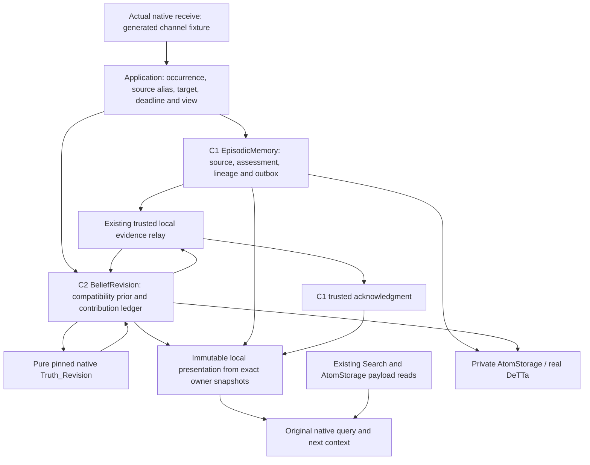

# S04 — local native episodic evidence and NAL revision

**Completed bounded local S04. All eleven required gates pass.** The executed passing union is **228 distinct methods: 21 S04, 158 adoption regressions and 49 cognitive regressions**. This includes focused rechecks after retained failures; it is not a single uninterrupted all-green run. See the machine-readable [gate results](../../../evidence/s04/verification.json).

This bounded slice adopts the actual MeTTaClaw `support` and `contradict` wrappers at their shared `tvUpdate` seam. The controlled native loop captures a generated source, records an assessment in local EpisodicMemory, obtains a committed decision from separately owned BeliefRevision using the original native `Truth_Revision`, closes delivery through the trusted relay, and exposes the selected STV/evidence labels to a subsequent native query and its next context. It uses fresh synthetic records and journals only.

It does not adopt all of memory, Relations, EpisodicMemory, BeliefRevision, NAL or Omega. C1/C2, provenance and native revision remain local. Existing HTTPS memory profiles remain supported independently; combining HTTPS memory with this new private cognitive profile is not implemented.

## Source state and baseline reconciliation

The actual starting commit is **`ecf5f48dec699a333853396e12141dc3a23720ac`**, the completed and published S03.2 tree. The S04 brief's `ba48d78…` reference is its S03.1 ancestor, not the implementation baseline. Initial status contained only the supplied S04 brief. Before editing, all **215 S03.2 tested-source hashes, 44 final non-evidence hashes and 98 evidence hashes matched**. Historical manifests, mapping classifications and the five preceding adoption records are retained. See [baseline reconciliation](../../../evidence/s04/baseline-source.json), [exact source state](../../../evidence/s04/source-state.json), [tested bytes](../../../evidence/s04/test-source.json) and [final audit](../../../evidence/s04/final-audit.json).

| Dependency | Verified source / runtime |
|---|---|
| MeTTaClaw | `2af37c3fec18613de54ca42fde2382a9087d4524` |
| Native PeTTa | `fea83178af3722666d2948d074591d10a3134f56` |
| Native SWI 10.0.1 source | `e58621a91ab7dd530e1e8185ed518f63d851c414` |
| SWI 10.0.1 executable SHA256 | `59f5ded02b1b378b41154778cff72b9a921d131ffb27f1036181a4f7f2429541` |
| Chroma helper | `218484875d5d1bfb217a9a03d3983dc1ed9d406c` |
| DeTTa | `272888f264dd2dde18b574cabb53c266b0dac2ec` |
| E5 | `intfloat/e5-large-v2@f169b11e22de13617baa190a028a32f3493550b6` |
| Fusion PLN | Separate original source/runtime pins, recorded in [build verification](../../../evidence/s04/builds.json); SWI **10.1.14**, never relabelled as NAL |

Dependency checkouts were not edited. The MeTTaClaw checkout already had an untracked `src/__pycache__`; no tracked source drift was observed. Native source and library byte checks run through the existing checked loader. Provider and E5-free caller SDK records, model files, DeTTa executable, lockfiles and build recipes were revalidated. Existing compiled environments and warm caches were reused; this is not a fresh compiler/package/model download claim. The fresh S04 corpus was regenerated through actual pinned E5. The first preparation and canonical regeneration have different JSON escaping/byte hashes but identical parsed corpus/vector values; both identities remain in [corpus reconciliation](../../../evidence/s04/corpus-generation.json).

The S03.2 22-method baseline ran while its application/startup files remained byte-identical. A separate 49-method M2/M3/M3.1 baseline exercised the previously separate cognitive owners, trusted delivery and real PLN runtime. After the owner hooks changed, those same 49 methods passed again. Shared historical owner/relay implementation bytes stayed fixed after candidate-01. Later negative tests exposed a selected S04-only cross-key occurrence replay gap; its guard now precedes receipt replay and the complete 21-method S04 suite passed against the final source manifest. Candidate-to-publication deltas and test identities are explicit in the source manifest.

## Responsibility and commit boundaries

Application `/6` reuses the existing turn/position identities, reservations, result capture and handoff. Source/target binding is frozen at command acceptance. Its base presentation is selected once at ordered execution, so two assessments in one turn compose correctly. Queries select a ready view at acceptance and retain that view thereafter.

The existing owner journals and relay are extended through explicit selected-profile hooks. Application code does not read their databases. Audit code in integration tests may inspect databases, and labels those inspections. Hostile declared-port wrappers reject private owner access. C1 remains usable without NAL, and the native arithmetic adapter runs without C1/C2.

| Observation | Durable owner / meaning |
|---|---|
| Source accepted | C1 actual payload, owner-issued occurrence, sequence and observed UTC time; alias becomes eligible only after authorized readback |
| Prior registered | C2 verified fresh creation binding and labelled `(1.0,0.5)` compatibility mass; **zero empirical events, roots or evidence coverage** |
| Assessment accepted | C1 new command occurrence, explicit source provenance, immutable input and delivery intent |
| Decision committed | C2 distinct admission/numerical outcomes and immutable snapshot, separately from C1 |
| Delivery closed | Trusted relay observes and validates the exact C2 decision; C1 acknowledges model-independent completion |
| Presentation ready | Application binds exact C1/C2 references, local metadata seal and existing Search generation |
| Native result consumed | Existing application capture and next-context handoff; success requires decision, closure and presentation |

The [symbol source trace](../../../evidence/s04/source-trace.json) pins the original definitions and selected local seams. The exact contracts, profiles, authority and bounds are specified in [S04 contract decisions](s04-contract-decisions.md). The new model is `neoclaw-nal-stv-capped-099/1`, the runtime is `neoclaw-petta-swi-10.0.1-revision/1`, and application selection is `controlled-native-loop/6`. Historical `/1`–`/5`, Fusion PLN profiles and numerical source identities remain explicit.

## Observed native behavior and intentional semantic differences

The [original native oracle](../../../evidence/s04/native-oracle-fresh.json) executes the pinned parser, loop, `remember`, `tvUpdate`, `Truth_Revision` and `query` with real E5 and Chroma. It confirms the default `(1.0,0.5)` and demonstrates that repeating the same linked source label increases confidence again. That is a legacy counterexample, not a desired deduplication property.

The [adapted native trace](../../../evidence/s04/final/native-loop.json) contains 11 controlled turns, ten commands, one actual remember, two captured inputs, four assessment occurrences and five queries. Six C1 events comprise two sources and four assessments; the prior is not a seventh event. The trace exposes occurrence → EvidenceRef → C2 decision/snapshot → retained query view → next-context feedback.

| Native command / evidence | Admission | Numerical outcome | Displayed strength, confidence |
|---|---|---|---|
| Fresh remember | No empirical admission | Compatibility display default | `1.0, 0.5` |
| Support source A | Admitted | Revised with labelled prior and authorized assumption | `1.0, 0.6666666666666666` |
| New support command citing A again | Duplicate contribution | No change | `1.0, 0.6666666666666666` |
| Contradict source A | Admitted, contrary record retained | Overlapping lineage retained as alternative | `1.0, 0.6666666666666666` |
| Contradict source B | Admitted | Revised under explicit pair-bound independence assumption | `0.6666666666666666, 0.75` |

The first positive query feedback is byte-equal to the original oracle's positive feedback. Native list/STV formatting, query selection, promotion calculation, uniqueness and rendering remain native. Revised commands return `REVISION-SUCCESS` only after closure/readiness; other completed commands return explicit `REVISION-OUTCOME` status. Ambiguous memory/source timestamps and missing sources fail, instead of selecting the first match or mutating every match.

Command occurrence is not contribution identity. Replaying one command recovers its result; a different command citing the same underlying roots/claim/assessment/policy does not add evidence. Copies preserve roots. A contrary interpretation remains visible but does not become independent. Unknown lineage remains retained without an invented numerical support. Distinct source IDs alone are not proof of independence: aggregation needs a trusted named assumption and current separate authority. These assessments are not calibrated probabilities or proof that text entails a claim.

The pure [native arithmetic evidence](../../../evidence/s04/final/pure-native.json) covers ten evaluations: the four requested reference pairs, both orders, and legal zero-weight-on-one-side cases. It preserves the native 0.99 cap. Finite strength `[0,1]`, confidence `[0,1)`, representable binary64 conversion and positive total weight define the admitted domain. Confidence 1, singular totals, injected expressions and invalid/native-multiple outputs are refused. Python supplies validation and test references, not production replacement mathematics.

All five adapted queries retain the same Search snapshot after remember. There is one maintenance publication and one memory-vector capture, attributable to remember. Belief changes update only the local owner-bound presentation. Query-time encodings still happen under their normal profile; “no re-embedding” applies to the assessed memory, not ordinary new query encoding. Old accepted/captured queries retain their previous belief views. The [repair test](../../../evidence/s04/final/view-repair.json) deletes only a derived presentation and reconstructs it from the same owner revisions, with no belief calculation, index build or old-view refresh.

## Recovery, authority and partial outcomes

Seven actual native process-kill phases cover source acceptance, assessment/outbox acceptance, formula return before C2 commit, C2 commit before relay capture, C1 acknowledgment, presentation selection, and native result capture before handoff. Recovery retains IDs, original deadlines, owner decision bytes and one logical contribution. A precommit formula kill uses a second reserved evaluation; other phases use one. Three further real evaluator-process kills exhaust the same three-evaluation work budget across restarts. There is no refund, deadline renewal or fallback. A concurrent C2 CAS race requires a new explicitly identified bounded attempt.

C1's existing capacity remains 16 pending deliveries. The owner test drains **33 assessments in the same episode**, using batches 16/16/1 across three claims, then reopens and confirms closure. Queue overflow is refused before drain. Caps are not increased and queues are not cleared. The direct-port batch gets a 300-second bound before acceptance to accommodate serial real owner work; native application invocations retain their existing maximum 30-second bound.

| Interruption/refusal | Observable state |
|---|---|
| C1 accepted, C2 unavailable/revoked | Delivery remains pending; no native success |
| Formula returned, C2 not committed | Evaluation reservation stays spent; retry is bounded |
| C2 committed, relay reply malformed/lost | C1 stays pending until a valid owner observation closes it; no fabricated acknowledgment |
| C2 committed, deadline expires before presentation | Existing decision and delivery can be observed/closed; missing presentation and native success remain unavailable |
| Contrary/overlapping/unknown source | Assessment retained with explicit alternative outcome; no unjustified confidence increase |
| Presentation file deleted | Explicit authorized derived-only repair uses exact existing owner revisions |
| Current authority or credential changes | Effect/disclosure/replay refuses; earlier acceptance is not perpetual authority |

Current grants are checked before effects and again after native evaluation at C2 commit. Tests revoke submit and assumption authority, substitute credential ownership, reject wrong scope/model/runtime/request bindings, and corrupt replies. Privacy checks reject cognitive network placement and scan generated non-cognitive provider state/configuration for source canaries and source identity markers. This is a local trusted-host test, not malicious-host protection or live-model prompt-injection immunity.

## Executed verification and classification

Final per-method counts and run statuses are recorded in [regression results](../../../evidence/s04/regression-results.json); exact invocations and interpreters are in [run specifications](../../../evidence/s04/run-specs.json). Parameterized kill phases are not extra test methods. Passing unions include rechecks and are not described as one uninterrupted all-green suite.

| Set | Purpose / effect-based selection |
|---|---|
| S03.2 baseline and post-change 22 methods | Shared application/startup/view plumbing, append identities, immutable source, local/HTTPS placement, publication and caller/provider process kills |
| S01/S01.1/S02/M5 96 methods | Same command lifecycle, source/profile guard, HTTPS/auth/retry/outbox/recovery and immutable storage/lookup dependencies; external search response boundary is recorded |
| S03/S03.1 40 methods | Native query/embedding/read handoff, independent local/HTTPS placement, caller dependency exclusion, index recovery, source freshness and authorization |
| Cognitive baseline and post-change 49 methods | M2/M3/M3.1 owners, original PLN revision/deduction, strict logical-time delivery/acknowledgment, compatibility and process recovery |
| S04 21 distinct methods | Three pure math/guard methods, eleven real-owner methods, seven actual native-loop methods; fixtures explicitly identified below |
| Focused rechecks | Historical source-lock correction plus new credential/assumption check; expanded provider-state privacy scan. Overlap is not added to the distinct-method total |

**Real:** native MeTTaClaw parser/loop/wrappers/query, pinned original NAL, real C1/C2/relay, DeTTa immutable storage, E5 CPU inference, Chroma, process SIGKILL, existing authenticated loopback HTTPS regressions, and separate original Fusion PLN native regressions.

**Fixtures:** scripted external model and generated channel, comparison creation/query clocks, unused history/global promoted context, direct-port creation attestations, hostile-port wrappers, injected malformed replies/timeout/source mismatch and clock overrides. Some historical unit suites intentionally use numerical/vector/storage fixtures; they do not substitute for the named real gates. The original legacy oracle has real Chroma storage; it does not claim DeTTa.

**Blocked prerequisites:** none for the completed bounded local scope. **Unrun/out of scope:** live models/channels, live web search this turn, optional combined HTTPS-memory/private-cognition, remote C1/C2, full Omega startup, populated-state migration, chain, multi-host and power-loss recovery. No existing private Omega store was used. Historical real web/chain results are not relabelled newly executed evidence.

Executed failures are retained. Initial inspection used system Python 2 and failed before writes; Python 3 was then explicit. The first DTO attempt needed keyword-only fields after inherited defaults. One direct-port queue test exceeded its preselected short deadline; a new test chose a longer bound before accepting new work. A hostile-wrapper test initially patched after binding, so it did not inject the intended fault; recomposition fixed the test. The first actual native hook exposed MeTTa's Python-bound `True` as string `true`; the narrow native hook now sends `1/0` and validates it, without changing upstream wrappers or arithmetic. A later run completed but its reporter parsed a raw view digest as JSON; the reporter was corrected and the session rerun. The old M5 byte-freeze guard then rejected three intentional owner/relay extensions: the guard now pins both their historical and reviewed new identities, while pure numerical sources remain unchanged and behavioral regressions exercise old defaults. An additional negative identity test then exposed S04 accepting an existing C1 receipt under a different request key; no new evidence was created, but this violated its stricter issuance contract. The S04-only override now validates issuance before both new append and receipt replay; old-profile semantics are unchanged. The full 21-method S04 suite passed against that final implementation. Failure logs are not deleted or rewritten.

## Reproduction and changed files

Use the [runbook](../../module-interfaces/runbook.md#controlled-local-sourcerevision-reproduction-s04) and the existing [S03.2 build recipe](s03_2.md#reproduction-and-measurement-limits). Required Linux native/build inputs and all hashes are in [builds.json](../../../evidence/s04/builds.json). Start only a fresh synthetic `/6` session with `integration.neoclaw.evidence_composition.configure`; the supported source-checked entrypoint remains `python -m integration.neoclaw.native_loop APPLICATION.json`. The corpus/oracle/session CLIs create disposable data. Resume with the same configuration/journals; operator edits between remember, assessment and query are zero.

Timing and memory fields in traces are single-host observations with warm assets and overlapping test loads, not calibrated performance benchmarks or production latency promises. No model download or compiler time is included. Numerical/error/recovery evidence is the acceptance criterion.

| Changed group | Files and purpose |
|---|---|
| Selected contracts/owners | `fusion/nal_memory_contracts.py`, `nal_episodes.py`, `nal_beliefs.py`, `nal_private.py`, `nal_relay.py`; local typed shapes, prior/contribution guards, authority, deadlines and evaluation reservations |
| Native math/presentation | `fusion/adapters/neoclaw_revision.py`, `neoclaw_belief_presentation.py`; pure original function and read-only derived metadata |
| Existing owner hooks | `fusion/episodes.py`, `beliefs.py`, `evidence_relay.py`; selected contracts and narrow request/origin/observation hooks with historical defaults |
| Existing application | `fusion/neoclaw_evidence.py`, `neoclaw_application.py`, `neoclaw_append.py`, `neoclaw_memory.py`; reuse occurrence/result lifecycle, view binding and disclosure checks |
| Checked native startup | `integration/neoclaw/{native_loop,memory_startup,memory_bootstrap,append_bootstrap,loop_bridge,evidence_startup}.py`; actual receive and shared tvUpdate seam |
| Generated reproduction/tests | `integration/neoclaw/evidence_{composition,corpus,oracle,run,worker}.py`, `test_nal_revision.py`, `test_evidence_owners.py`, `test_evidence_loop.py`, `tests/nal_support.py`, `tests/test_neoclaw.py` |
| Contract/adoption evidence | Supplied S04 brief, module contracts/ADR-016/architecture/runbook, this report/decisions, READMEs, adoption ledger/coverage and `evidence/s04/` |

The [final source state](../../../evidence/s04/source-state.json) enumerates exact changed paths and hashes. The publication is the Git commit containing this report; its full SHA is reported after commit/push, without editing historical test identities to pretend they ran on that later commit.

The bounded family denominator remains fifteen, historical mapping rows remain 105, and no whole family is promoted. S04 adds one adopted internal assessment seam serving two native commands. Across the packet there are six precise adoption entries and six user commands; those units are not an Omega integration percentage. Further work stops here.
