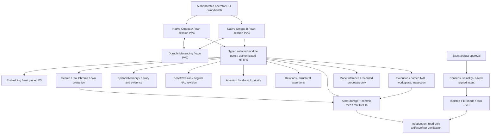

# Omega Phase 2 developer preview

**P01–P18 are delivered as a bounded single-node developer preview, with explicit limits.** This continues the completed A–N baseline `c4fb744edbddd003d09db408bed44a59d2df3823`. Twenty typed tools, reusable native sessions, two-agent cooperation, new opt-in memory/context semantics, the workbench, SDK and artifact distribution are implemented and qualified. The final runtime map is `369daf1ab470fb8fe8265fe16a3a5765670c643e7011e3d5369636a803e7e49d` across all 330 source files and four dev19 images.

Actual native Omega loops, original NAL kernels, E5, Chroma, DeTTa, authenticated pod HTTPS, durable Messaging and the isolated chain performed the work. ModelInference used **recorded command proposals** through its real lifecycle; models did not execute tools or supply retrieved answers. The two-agent combined workflow and same-artifact chain trace passed. The preserved single-agent IRC composition passed six positive/negative assertions separately. **ADDITIONAL_LIVE_GENERATIONS=0; no real generative runtime was contacted.**

Start with the [runbook](runbook.md), [current capability matrix](native-capability-matrix.md), [package ledger](../../evidence/phase2/progress.json) and detached [exact artifacts](../../evidence/phase2/artifacts.json). The latter is supplied alongside the hashed distribution, avoiding a self-referential digest. [Changed-file list](../../evidence/phase2/changed-files.json) is the exact task publication scope.

## What the preview provides

The executable capability registry drives twenty typed preview tools, independently of provider descriptors. Whole-batch authorization, explicit selected profiles, stable handles and durable input/tool identities remain separate from prompt help. Each native agent owns its session journal/PVC and credentials. Shared providers are single writers behind authenticated HTTPS.

Two independently managed agents accept sequential synthetic inputs through a reusable session API, CLI and authenticated loopback workbench. Generated deployments have two finite preselected session templates per agent, not an unlimited dynamic session allocator. The supported single-agent selection removes B through composition. Operator-controlled catalogues select minimal, memory or combined capabilities; accepted work retains its original selections.



Each owner has a distinct journal/PVC. The diagram groups typed ports for readability; it does not introduce a gateway or shared state owner. Source feed and storage ports are the only Search inputs from the storage service. The caller has no E5 inference assets or libraries.

The application owns working notes, retained context and task/result correlation. C1 owns administrative episode history and assessment provenance; C2 owns numerical revision. Attention retains the original wall-clock promotion policy under its distinct profile. Relations owns structural assertions/retractions. AtomStorage owns immutable payloads and append-only memory lineage; Search owns its derived active-view index. Bounded workspace operations have a separate effect journal. Inspection derives an artifact from an actually consumed task report and authoritative payloads; it cannot approve chain publication.

Supersession, withdrawal, structural retraction and working context are **new opt-in preview semantics**. They preserve historical records, retained query views and captured results. They neither physically erase bytes nor delete contrary assessments, transfer evidence/priority automatically to a successor, change numerical/embedding profiles, or migrate populated journals. [Storage layout](storage-layout.md) documents the fresh-state DeTTa physical partition correction without changing its public DA semantics.

Each two-agent deployment has a shared synthetic corpus and distinct private synthetic AtomStorage scopes. Current native history/cognition remains explicitly shared synthetic data; private storage isolation is not a private-cognition claim. Handles are references, never authority. See [private scopes](private-scopes.md), [capability coverage](native-capability-matrix.md) and [the runbook](runbook.md).

## Qualification and evidence

All final deployed gates use the same four dev19 image identities and chart 0.5.1. They run in separate fresh namespaces because this preview has finite owner capacity. This is an immutable-image qualification set, not a union of development-image passes. ModelInference uses its real acceptance/reservation/capture machinery with **recorded command proposals**; the fixture does not execute tools or provide retrieval answers.

| Package | Delivered behavior and principal evidence |
|---|---|
| P01–P02 | Twenty registered typed tool descriptors drive native skills, selection, whole-batch admission and current evidence. [Capability manifest](../../evidence/phase2/capabilities.json) and [operation matrix](native-capability-matrix.md). |
| P03 | Independently installable client, provider example and operator wheels; actual authenticated HTTPS compatibility endpoints. [Package qualification](../../sdk/operator-final-candidate-qualification-04.json). |
| P04–P05 | Reusable single-agent/two-agent native sessions, durable inputs, shared source views and distinct synthetic private storage scopes. [Minimal native run](../../evidence/phase2/final/single-agent.json), [28 scope/rotation cases](../../evidence/phase2/final/private-scopes-rotation.json), [two-client source](../../evidence/phase2/final/shared-source.json). |
| P06–P10 | Actual history/episode handles, link/unlink, working notes, immutable supersession, active withdrawal and bounded file tools. [Combined run](../../evidence/phase2/final/combined-native.json); independent owner/race/authorization tests remain explicitly labelled. |
| P11–P12 | Native A→B and B→A task/result exchange; combined history, evidence, priority, notes, memory and retrieval context. [Native run](../../evidence/phase2/final/combined-native.json) and [actual retained observations](../../evidence/phase2/final/combined-observations.json). |
| P13 | The same workflow's inspected artifact, exact approval, saved signed deploy, isolated node effect, matching finality and independent readback. [Chain trace](../../evidence/phase2/final/same-workflow-chain.json). |
| P14 | Same native consumer with SQLite and independent file Attention implementations; unchanged wall-clock profile and truth. [Comparison](../../evidence/phase2/final/attention-comparison.json). The independent file implementation is explicitly a fixture, not a production certification. SDK compatibility covers real HTTPS, with an independent file-storage fixture. |
| P15 | Installed authenticated loopback workbench: native pin/context/unpin/context, pause/resume/close, retained results and separate registered-chain observation. [Browser evidence](../../evidence/phase2/final/workbench.json). CLI equivalents are in the runbook. |
| P16 | Seven cross-feature pod/process recovery cases, separate captured handoff recovery, real IRC positive/negative regressions, overlapping owner CAS/path races and actual fenced restore. [Recovery](../../evidence/phase2/final/recovery.json), [handoff](../../evidence/phase2/final/handoff-recovery.json), [IRC](../../evidence/phase2/final/irc-regressions.json), [restore](../../evidence/phase2/final/restore.json). |
| P17–P18 | Artifact-only fresh deployments, source/image/wheel bindings, dependency inventory, safe CI lanes, operator walkthrough, cleanup and protected-state comparison. [Source/image record](../../evidence/phase2/final/source-images.json), [inventory](../../evidence/phase2/image-dependencies-dev19.json), [checks](../../evidence/phase2/final/checks.json), [progress](../../evidence/phase2/progress.json). |

The combined sample has **23 operator inputs plus four internal task/result inputs**, two delegation directions and four scenario records. These are not 27 independent workflows. The corpus has two logical memories, three immutable revisions and one withdrawal. Native source handles come from actual completed commands. Actual captured query results enter subsequent native context; copied reports do not create independent corroboration.

Original NAL deduction/revision and wall-clock Attention mathematics are unchanged. The new lifecycle uses immutable lineage: successor content starts with its labelled unassessed compatibility prior and zero priority. Structural retraction does not erase evidence. Administrative history does not acquire empirical roots. Search uses authorized AtomStorage/commit-feed ports and a declared active membership view; callers do not open its database or E5 assets.

Recovery preserves accepted identities, retained views, original deadlines and spent reservations. The handoff interruption captures B's real query before replacement, then consumes that same report in A's next native context without another Search query. Workspace replay reconciles the intended file effect instead of appending again. Credential/TLS tests retain other agents' authority separately. Pause/close does not retract transmitted effects. Fenced restore retains owner records while denying execution authority; it is observation-only, not failover.

## Measurements and limits

The final fast suite passed **514 methods in 61.458 seconds**. Four subsequently added owner-race methods passed separately; focused helper/contract lanes and the 26-method installed-SDK qualification overlap and are not additive. [Check receipts](../../evidence/phase2/final/checks.json) preserve exact test/log identities, including earlier failures and historical native runs.

The 23 operator inputs in the combined sample took **17.659–33.614 seconds**, median 26.679, with cached images/assets and fresh journals. The correct IRC case recorded 49.599 seconds of cold namespace setup and 68.305 seconds for its measured workflow. These are bounded observed samples, not throughput or latency guarantees. [Per-input observations](../../evidence/phase2/final/bounded-workload.json), [IRC stages](../../evidence/phase2/final/irc-regressions.json) and [resources](../../evidence/phase2/final/resources.json) retain sample conditions.

Native bridge per-method timing is **NOT_OBSERVED**: the quiesced final run has no best-effort timing files at the source-checked path. The exact historical cause is unknown; no durations were reconstructed or invented. The [read-only observer](../../evidence/phase2/final/stage-observations.json) keeps this separate from its ownership/quiescence checks. Token throughput and exact model-token usage are unmeasured; recorded proposals cannot establish real-model latency.

The AtomStorage/feed owner has an **aggregate 512-record bound**, including administrative history, vectors, task/results and chunk records—not 512 user memories. Two preselected sessions per agent, 24 inputs per session, four pending inputs, one native child per agent and original 120-second input/30-second ordinary-tool windows are ceilings. They do not guarantee that every configured session can exhaust its input allowance. An expired oldest pending input can block further progress; there is no general scheduler or automatic renewal.

A dev17 workbench run reached source capacity after the combined workflow and two successful UI inputs. Its third input remains incomplete with `OVERLOADED` before model execution; that failure was not reset. The final minimal dev19 workbench completed all four inputs on fresh state. The final combined workbench is read-only. This is bounded preview capacity evidence, not a soak/SLA or unrestricted reusable-store claim.

CPU quota enforcement remains **NOT_ESTABLISHED** on this host despite chart limits. Memory limits were observed; metrics API availability and cgroup observations are recorded separately. Application admission controls are not kernel quotas. No host cgroup or cluster-wide settings were changed.

Further limits remain explicit: fresh-state DeTTa partition layout and profile seals have no migration/automatic repair path; a partial seal fails closed. `OnRootMismatch` prevents the observed remount permission widening for matching roots, but does not repair pre-existing widened directories. A storage transport deadline bounds caller observation, not cancellation of an already accepted effect. Provider substitution selects fresh compatible state in a new session; it cannot rebind accepted work to another empty journal. Workbench state panels show the selected retained result page, not current cognitive-owner heads.

## Sources, artifacts and retained failures

The baseline is `c4fb744edbddd003d09db408bed44a59d2df3823`. The exact 330-file runtime map is `369daf1ab470fb8fe8265fe16a3a5765670c643e7011e3d5369636a803e7e49d`; it matches all four exported image packages and the checkout. The [source/image record](../../evidence/phase2/final/source-images.json) gives image manifests/configurations, chart hashes, wheel hashes and qualification-source packet identities. The publication commit contains the final reviewed files; content manifests bind tested bytes without a self-referential commit hash.

Pinned external inputs remain MeTTaClaw `2af37c3fec18613de54ca42fde2382a9087d4524`, PeTTa `fea83178af3722666d2948d074591d10a3134f56`, SWI `e58621a91ab7dd530e1e8185ed518f63d851c414`, E5 `f169b11e22de13617baa190a028a32f3493550b6`, secured spaces `272888f264dd2dde18b574cabb53c266b0dac2ec` and F1R3node `9ec1096e10774926ea8e72f0823482f0bf9213e1`. Exact binaries/assets are bound in the image-source and dependency inventories; no dependency was replaced to bypass a failing gate.

Four role images, chart 0.5.1, three 0.2.0 SDK wheels and five pinned dependency wheels form the local artifact distribution. Actual installations used an offline fresh operator environment and extracted declared source, with no developer-tree or foreign-journal runtime mount. Cached parent/model inputs are documented; an empty-cache or air-gap rebuild is not claimed. OCI archives remain local artifacts, not public-registry publications. The detached artifact record supplied with this publication binds the final packet outside its hashed contents.

The image dependency/license inventory reads actual OCI layers without starting containers. Vulnerability scanning is **NOT_RUN** where tooling is unavailable; unresolved licenses remain `NOASSERTION`. Hosted CI is defined but **NOT_OBSERVED**. Local workflow-file execution is not hosted evidence.

Earlier failed native deadlines, observer errors, missing dependency tests, DeTTa layout failures, restore-helper rejection, workspace remount failures and the attention-selection mismatch remain in [development evidence](../../evidence/phase2/development), with original identities. The final correction bound storage's catalogue to the explicitly selected Attention provider; both providers then passed. The handoff observer was corrected to compare forward native rendering of actual captured feedback. Its earlier wrong-session/escaped-text observations were not relabelled as runtime success. Final checks retain historical test hashes when a later helper/test changed.

The historical **15-family denominator, eight adopted boundaries and nine historical commands** remain unchanged. Twenty selected preview tool descriptors and X01/X02/X05 are separate accounting. No claim is made for all Omega capabilities, arbitrary shell/MeTTa, live generation, private cognition export, physical erasure, populated-state migration, multi-node/HA, public chain or production readiness.

[Cleanup](../../evidence/phase2/final/cleanup.json) confirms 27 task namespaces quiesced with 330 PVCs retained and all six disposable IRC namespaces deleted. Browser/workbench processes and loopback endpoints are stopped. The original 14-owner final deployment and 13-owner fenced clone remain stopped; private host restore scratch was removed. Retained failures and spent work were not reset.

The [protected comparison](../../evidence/phase2/final/protected-resources.json) matches all 30 original `omega-demo` objects and 63 stopped `omega-ref-live01` objects, including identities and spec/data hashes. The campaign digest remains `669dc641863968947fdea63b504f0902a1f93425032177d42294bd2312c51f47`; both slots remain unreserved and all counters zero. An initial comparison used different JSON whitespace and falsely reported hash differences; that observer failure is retained, and the final comparison uses the baseline serialization. Publication excludes credentials, keys, journals and private browser logs; [review record](../../evidence/phase2/final/publication-safety.json) describes the static scan and its limits.

```text
DEVELOPER_PREVIEW=READY_WITH_EXPLICIT_LIMITS
PACKAGES_P01_P18=DELIVERED
SINGLE_NODE_SERVICE_INTEGRATION=PASS
COMBINED_NATIVE_COGNITION=PASS_RECORDED_MODEL_REAL_TOOLS
SAME_WORKFLOW_ISOLATED_CHAIN=PASS
CPU_QUOTA_ENFORCEMENT=NOT_ESTABLISHED
NATIVE_METHOD_TIMING=NOT_OBSERVED
HOSTED_CI=NOT_OBSERVED
ADDITIONAL_LIVE_GENERATIONS=0
LIVE_PREVIEW_WORKFLOW=NOT_RUN
MULTI_NODE_AND_PRODUCTION_READINESS=NOT_CLAIMED
```
