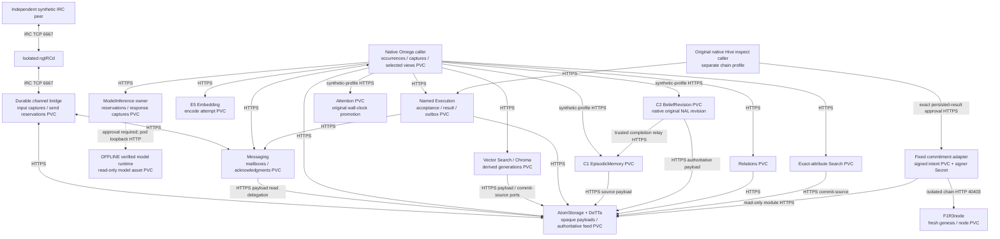

# Single-node Omega reference distribution

This distribution packages the existing bounded native integration as independent state owners. It uses one selected k3s node, ClusterIP/DNS and authenticated module HTTPS. It does not deploy a general Omega tool catalogue, a public service, a multi-node system or a production tenant boundary.

The programme ledger is [progress.json](../../evidence/reference-distribution/progress.json). The integrated report and final artifact/evidence matrix accompany it. Historical reports remain historical; failures and rechecks have separate identities. Recorded model outputs are explicit substitutions. E5, Chroma, DeTTa, native reasoning, the IRC server/peer and the isolated chain are real in their respective executed gates.



Pure numerical kernels remain with their legitimate consumers. The original native Hive chain caller is a separate supported profile; the diagram does not claim one combined cognitive/chain/model session. The chain stores a commitment to the approved result, not a validator proof of its computation. C1/C2/Attention service placement admits explicitly generated synthetic records only. Historical private-local-only profiles retain their old restrictions.

| Supported profile | Stateful roles | Executed boundary |
|---|---:|---|
| `deterministic` | 4 | Native named NAL execution, result/outbox and caller consumption |
| `memory` | 6 | Original four owners retained; E5 and vector Search added |
| `workflow` | 9 | Native retrieval-to-reply, recorded ModelInference and real isolated IRC |
| `cognitive` | 9 | Memory plus C1, C2, Attention, Relations and exact Search |
| `chain` | 6 | Native Hive inspect, exact commitment and isolated real F1R3node |
| `live` preparation | 9 defined; effect roles at zero | Fresh native corpus and offline model assets; separate approval required |

Profiles are qualified separately and run sequentially in the reference envelope. This table does not promise all roles can run concurrently within a smaller node's capacity.

## Prerequisites and ownership

Use the declared Linux/amd64 images, Python 3.12 operator dependencies, OpenSSL CLI, the pinned Helm version recorded in evidence, kubectl and an explicitly selected single-node k3s context. The supplied importer targets the existing Docker-hosted k3s container and uses its containerd socket; it is not a generic remote-cluster importer. The example uses k3s local-path PVCs. Run one heavyweight qualification at a time. Resource measurements describe this host and sample set; they are not an SLA. Model runtime availability remains **NOT_CHECKED**. The local archive set occupies about 24 GiB when its hard links are preserved (for example with `cp -a`); offline model preparation additionally copies 17.74 GB of verified assets into its own PVC. Imported image layers, retained journals and backup scratch require further disk capacity. The recorded profiles do not require that generative asset PVC.

Set an explicit task namespace beginning `omega-ref-`; `omega-demo` is rejected by operator tooling. Namespace ownership is checked using `omega.reference/owner=omega-asi-single-node-reference-1`. StatefulSets run one ordinal with retained PVCs and a process-level PVC lock. Owner seals reject wrong component/profile state. There is no horizontal scaling, schema migration or shared owner filesystem. ConfigMaps hold non-secret composition; existing per-service Secrets hold CA trust, leaf certificates and scoped credentials. Native consumers never mount the developer checkout or another owner's journals.

Uninstalling a Helm release or scaling it down retains its PVCs. Explicit namespace cleanup deletes that namespace's PVC objects and the local-path provisioner may delete the backing data. Back up first. Retained campaign namespaces are refused by ordinary cleanup.

## One command surface

Use the source archive from the distribution and the corresponding digest-bound profiles. `$PY` below is the declared Python 3.12 environment, `$DIST` the verified distribution directory, and `$KUBE` the selected kubeconfig. Do not publish kubeconfig, private Secret material, journals or backup archives.

Extract `source.tar.gz` into a new directory and run commands there. Create a Python 3.12 virtual environment and install the observed exact `deploy/single-node/operator-lock.txt` (the direct requirements are listed separately). Provider SDKs and native/model assets stay in their declared images; the operator environment is not the Omega caller. The source archive explicitly includes the pinned ngIRCd executable/licence and chain address helper required by the build and Secret recipes.

```bash
$PY -m integration.single_node.reference verify-artifacts --manifest "$DIST/distribution.json"
$PY -m integration.single_node.reference preflight --kubeconfig "$KUBE" --context default --namespace omega-ref-example
$PY -m integration.single_node.reference import --kubeconfig "$KUBE" --context default --namespace omega-ref-example --container omega-fusion-k3s --image-manifest "$DIST/images.json" --archive "$DIST/images.tar"
$PY -m integration.single_node.reference install --kubeconfig "$KUBE" --context default --namespace omega-ref-example --profile workflow --profiles "$DIST/profiles" --chart "$DIST/omega-fusion-0.4.0.tgz" --directory artifacts/example-install
$PY -m integration.single_node.reference qualify --kubeconfig "$KUBE" --context default --namespace omega-ref-qualification --profiles "$DIST/profiles" --directory artifacts/example-qualification --scenarios s01 memory recorded cognition-relations
$PY -m integration.single_node.reference diagnose --kubeconfig "$KUBE" --context default --namespace omega-ref-example
$PY -m integration.single_node.reference stop --kubeconfig "$KUBE" --context default --namespace omega-ref-example
$PY -m integration.single_node.reference cleanup --kubeconfig "$KUBE" --context default --namespace omega-ref-example --preview
```

Use the exact chart archive filename in `distribution.json`. `install` creates a fresh owned namespace and fresh synthetic credentials; `upgrade` requires existing ownership and never mints a new identity. The supported selectors are `deterministic`, `memory`, `workflow`, `cognitive`, `chain` and the independently guarded `live` preparation path. The chain profile remains disabled by default. Chain qualification verifies actual network isolation before enabling the native node; ordinary installation alone does not pass that gate.

`reference_qualification --help` lists independently selected scenarios. It delegates to existing harnesses; the operator observes and drives the peer, while native workloads execute commands. The workflow profile has setup and measured phases; the executable runner performs the application handoff without inserting a target or editing memory contents between remember/query. Wrong-but-permitted replies are evaluated independently and fail factual correctness even when delivered.

## Recovery and restore

For a compatible rollout, use `reference upgrade` with the exact selected profile and validated image/schema. It preserves PVCs, accepted profiles, identities, captures, deadlines and spent counters. It is not a migration command. Rollback is supported only for the demonstrated compatible schema; an incompatible composition refuses startup.

```bash
$PY -m integration.single_node.reference backup --kubeconfig "$KUBE" --context default --namespace omega-ref-example --directory artifacts/example-backup
$PY -m integration.single_node.reference restore --kubeconfig "$KUBE" --context default --namespace omega-ref-restored --directory artifacts/example-backup --fenced
```

Backup stops admission and all selected owners, checkpoints SQLite WALs with no writer active, and copies each owner separately. Its manifest names the quiesced consistency cut, image identities, owner seals, files, retained views and accounting. This is not an atomic distributed transaction. The original remains stopped. The bounded restore command requires that original namespace UID and its stopped workloads still be observable; validate the fenced clone before deleting the original. Recovery after lost original fencing metadata is not covered. The backup directory is private to the operator (0700; archives0600); no external upload or encryption service is assumed.

Restore writes a persistent read-only fence before extracting data into fresh PVCs. It restores no signing/TLS keys, active approval or execution authority. Install the compatible chart with fresh independently managed read credentials; the fenced host branches before any worker/native/encoder/model/bridge/node startup. Query/readback and explicit operator Search rebuild are available. Channel sends, model calls, storage mutations and chain submissions remain refused. The tested drill also removed the old projection: the old view failed rather than following latest, then a new derived generation was rebuilt from the authenticated source. Old caller views and spent accounting stayed unchanged. This is bounded observation/reconciliation, not automatic failover.

## Diagnose the owning stage

`status`, `diagnose` and `observe` execute the same bounded read-only observer in each owner's pod; they do not mount or open foreign state in a consumer. Standard output contains counts/stages, not prompt bodies, credentials, provenance or identifying hashes. Detailed synthetic debug reports are a separate restricted artifact.

| Symptom | Inspect | Interpretation / action |
|---|---|---|
| Owner unavailable | Pod readiness, owner seal, PVC and config revision | Do not reinitialize the journal or substitute another provider. |
| Stored but query not ready | Storage acceptance/feed head, Search publication, caller linked/view fields | Storage acceptance is not Search publication or native success. Observe the committed stage. |
| Search empty vs rebuilding | Retained generation and explicit source head | Missing retained view is an error; never switch an existing occurrence to latest. |
| Model disabled | `futureLive.activated=false`, zero model replicas, no approval | Expected preparation state, not an unhealthy model. |
| Model reservation without capture | Model owner reserved/captured counters and caller intent | Spent/unknown; no regeneration or allowance reset. Captured responses can be re-read under current authority. |
| Evidence pending | C1 deliveries/completions and C2 decision/capture counts | Source capture can succeed independently. Use the existing bounded trusted relay; no new observation weight. |
| Send unknown | Bridge reservation/outcome and independent peer receipt | Do not automatically resend. Socket acceptance and recipient observation are different facts. |
| Chain unavailable | Adapter signed intent plus node observation | Retain identical signed bytes. A timeout is not absence, rejection or finality. |
| Restored state refuses work | `restore_fenced=true` | Intentional effect fence; historical approval is not restored authority. |

`measure_cluster` reports per-owner process/cgroup CPU/RSS/storage and ten bounded health RTT samples per selected service. The standalone diagnostic process RSS belongs to its observer; complete owner process/cgroup samples come from `measure_cluster`. Health RTT is not accepted-operation latency; denied non-dependency edges remain recorded errors. Cold startup, native command/workflow and recovery durations are reported separately.

## Measured reference envelope

The qualified node has 8 logical CPUs and about 78 GiB RAM. Run profiles sequentially. The nine-role recorded workflow requests 2.75 CPU cores and 3.875 GiB memory in aggregate; its configured memory limits total 8.5 GiB. These are scheduler requests and ceilings, not measured simultaneous peaks. The future model's separate 20 GiB request / 28 GiB limit is offline preparation only. `preflight` reports the actual node's allocatable capacity; Kubernetes scheduling still requires enough unallocated requested resources. Leave room for the existing protected deployment and node services. Do not alter host cgroups or scale owners to evade capacity limits.

Three fresh-state sequential recorded workflows used two synthetic memories each, warm image/model-file caches and new processes. Cold native setup took 61.7–68.4 seconds; the complete workflow took 82.2–87.5 seconds. Nine E5 calls took 281–440 ms inside the native encoder, and the three query retrieval intervals took 208–223 ms. Six remember observations took 2.63–3.24 seconds through publication and local readiness. These sample sizes do not support reliability estimates or latency percentiles.

The complete per-owner CPU/RSS/storage, RPC byte counts, health RTT errors, images and sample identities are in [resources.json](../../evidence/reference-distribution/resources.json). The observed E5 process RSS sum was about 1.61 GiB; shared pages and the observer are included. Later cgroup-v1 observations recorded memory limits, but CPU quota was `-1`. CPU-limit enforcement is therefore **NOT_ESTABLISHED** on this selected substrate. The chart retains explicit limits; this programme does not certify production resource isolation.

Recompute the summary from already captured reports without running work:

```bash
$PY -m integration.single_node.reference_measurements --output artifacts/resources.json <correct-report-1.json> <correct-report-2.json> <correct-report-3.json>
```

## CI and future live execution

The GitHub workflow runs only public fast contracts on a hosted runner, with read-only repository permissions. It has no cluster credential, signing key, model cache, self-hosted privileged runner or publication permission. Trusted operator lanes are `reference_ci fast`, `chart`, `native`, `cluster`, `chain`, and `artifacts`. The native lane uses the real network/mount denial launcher and an explicit test command. Missing prerequisites fail explicitly; no lane silently selects a fixture for a real gate.

`reference prepare-corpus --profile live` uses native generated setup with the generative owner and channel effects at zero replicas. It provisions a separate read-only model asset volume and hashes every blob without running the model. `reference freeze-campaign --profile live` binds the actual retained namespace/PVC/Service/TLS/view, exact source/images/chart, static inputs and two unreserved future slots. The immutable plan, external digest, separate future approval and mutable execution ledger are distinct. Preparation starts no occurrence deadline and issues no approval.

Only `reference run-live --profile live --approval <separate-user-approval.json>` can activate the future path. It requires a new explicit user statement bound to that exact campaign/digest, both named slots, a maximum of two generations and one non-renewable window of at most one hour. It validates frozen files, full model/projector hashes, TLS, retained corpus and placement before any generative process. The provider independently repeats approval/file checks before construction, runtime startup and claim. A flag or passing test is not approval. The actual captured query projection must enter the second prompt; there is no preferred-answer injection or fixture fallback. The observer evaluates actual admitted output and independent peer traffic. No replacement session, hidden generation, response repair, budget refund or ambiguous-send retry is permitted.

No live execution is authorized by this engineering programme. The final report records the concrete retained campaign ID/digest; historical allowances remain exhausted.

The complete inactive preparation commands use the distribution's declared asset inputs:

```bash
mkdir -p artifacts/reference-campaign
cp "$DIST/profiles/generative-image.json" artifacts/reference-campaign/generative-image.json
$PY -m integration.single_node.reference prepare-corpus --kubeconfig "$KUBE" --context default --namespace omega-ref-live-new --profile live --profiles "$DIST/profiles" --directory artifacts/reference-campaign --offline-model "$DIST/asset-evidence/offline-model"
$PY -m integration.single_node.reference freeze-campaign --kubeconfig "$KUBE" --context default --namespace omega-ref-live-new --profile live --directory artifacts/reference-campaign --offline-model "$DIST/asset-evidence/offline-model" --source-package "$DIST/generative-source.json" --campaign-id <new-campaign-id>
```

Freeze uses an unpacked chart directory so every chart source file can be bound. For archive-based installation, extract the chart archive first and pass its directory consistently to preparation, freeze and future execution. The read-only generative asset volume includes an empty `models/manifests-v2` directory required by the pinned lookup implementation; `OLLAMA_NOPRUNE=true` prevents startup from deleting it. A future-only bounded asset-verification startup allowance precedes accepted work and changes no occurrence deadline.

Source-overlay rebuilding is a separate path: load `parent-images.tar`, run `reference build --directory artifacts/reference-build-new --tag reference-new`, import that build's `images.json`/`images.tar`, and use **that build's generated `profiles/` directory**. Do not combine rebuilt images with the published profile digests. Native dependency recompilation has the exact additional source/SDK prerequisites recorded in the asset recipes; prebuilt installation does not require those working trees.

For the retained campaign, the future invocation (not authorized or executed by this programme) is:

```bash
$PY -m integration.single_node.reference run-live --kubeconfig "$KUBE" --context default --namespace omega-ref-live01 --profile live --directory artifacts/reference-distribution/campaign --chart deploy/helm/omega-fusion --offline-model artifacts/reference-distribution/offline-model --approval /path/to/separate-user-approval.json
```

The separate approval file must preserve the actual user statement and contain `authority=EXPLICIT_USER_APPROVAL`, the final `campaign_id` and `manifest_sha256`, ordered slots `["https-query", "https-reply"]`, `max_generations=2`, and `not_before_ms` / `expires_ms` for one explicitly authorized window of at most one hour. Record its start when approval is received; do not predate, generate or renew approval during preparation. The user statement must authorize the pinned isolated runtime start/stop and the exact synthetic disclosure scope. No approval file is supplied by this distribution. The generated TLS certificates have seven-day validity; activation checks current validity and exact pinned bytes. Expired or replaced frozen material requires a separately reviewed freeze and approval, never automatic renewal.

`deploy/single-node/finalize_reference_bundle.py --bundle <directory>` attaches reviewed repository documentation and sanitized evidence after tests. It first requires every runtime source hash to match the tested image map. The digest-bearing `evidence/reference-distribution/artifacts.json` is an external publication sidecar, deliberately excluded from its own hashed archive; the authoritative bundle digest is `distribution.sha256`. All initial/rehearsal archive identities remain in the publication record. This finalization never executes an image or grants runtime authority.
