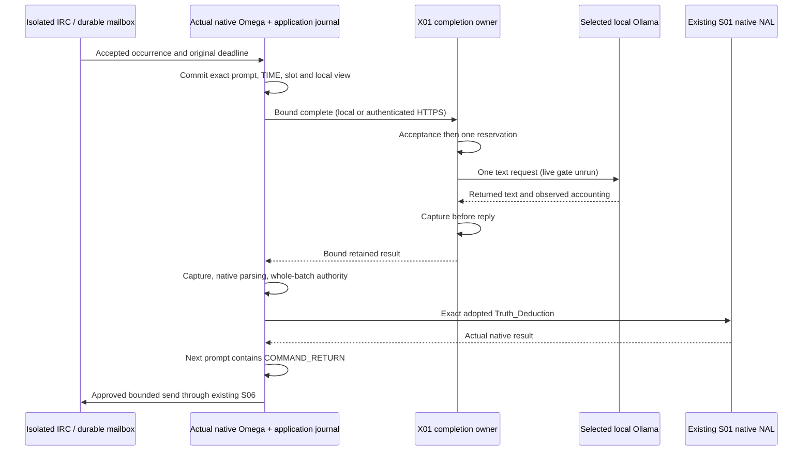

# S07 — local Ollama selection and bounded completion adoption

**Partial delivery; S07 is not complete.** The user selected local Ollama `qwen3.8:27b`. Its source/build records, installed binary and model blobs are pinned and verified. The completion owner, authenticated HTTPS placement and native `/9` startup hook are implemented. Recorded-model tests exercise native tool-result feedback, approved real IRC output and native-process recovery. **Zero real generation calls have run.** The brief's finite operator-approved test budget remains unanswered.

The pending question proposes at most twelve local generation calls, 6,000 output tokens per call, no automatic retries, and the existing 30-second accepted-input deadline; an offered narrower choice is six calls. The implemented live recipe needs six calls. Backend selection does not resolve this separate explicit budget prerequisite. There is no paid-provider selection, credential discovery, download, fallback or alternative model.

## Exact source state

Starting and current publication HEAD: `3fc1af31f2d64583fe4c873b6b656dad2d6b1275`. S07 changes remain uncommitted. Historical tested working trees are not relabelled with this publication SHA. The S06 reconciliation matched 192 tested source entries, 31 final changed-file entries and 88 public evidence entries, plus the prior source/final-audit bindings and nine repository revisions. See [baseline reconciliation](../../../evidence/s07/baseline-source.json), [final tested source](../../../evidence/s07/test-source.json), and [source state](../../../evidence/s07/source-state.json).

| Input | Exact identity |
|---|---|
| Native MeTTaClaw | `2af37c3fec18613de54ca42fde2382a9087d4524` |
| PeTTa | `fea83178af3722666d2948d074591d10a3134f56` |
| Native SWI 10.0.1 | `e58621a91ab7dd530e1e8185ed518f63d851c414` |
| DeTTa | `272888f264dd2dde18b574cabb53c266b0dac2ec` |
| Chroma helper / E5 | `218484875d5d1bfb217a9a03d3983dc1ed9d406c` / `f169b11e22de13617baa190a028a32f3493550b6` |
| ngIRCd 28 | `6ae13bf89e934d167f6ead8bb9ee39f57a0935c0` |
| Independent Fusion PLN | `4405956947c4b53c7ff01bd565aa3b114bc970a1`, unchanged |
| Ollama upstream archive | v0.40.0, `0d0720e51fb2fd9aa58781c3d720c06d720c2e7b` |
| Installed Ollama | `0.40.0+mlx.cpu.1`, SHA-256 `db8d6a16322494d762bf5394d5e5318d48f42e93f9dd44888d48d3a12099d43c` |
| `qwen3.8:27b` manifest | `9a8921f5b297f01451509b60e4a7e754674fe40d4a64dd9f89fc4a56c4fc5ee1` |
| llama.cpp runner | b11351, `631109b34da437a3c4a5ebd75091d677671392e3`; installed runner reports matching `631109b34` |
| Q4_K_M model weights / tokenizer | GGUF `f5f1dd8920d417aac2718b0bda3403da274301efdd6760b4f0f4b864ff2ad57d` |

The archive comparison matched 1,429 files and identified exactly two local MLX CPU patch files, `mlx/io.go` and `mlx/io_test.go`. Selected API, renderer and runner sources are separately hashed. All manifest-referenced blobs/configuration were hashed successfully. The installed binary matches the local build record; this task did not independently rebuild it. The root service's `/proc` executable is not readable, so metadata plus installed-binary verification is not stronger process attestation. [Selected source/runtime ledger](../../../integration/neoclaw/model-sources.json), [archive comparison](../../../evidence/s07/ollama-source-verification.json), [model files](../../../evidence/s07/ollama-model-files.json), and [32 inventoried runner/runtime files](../../../evidence/s07/ollama-runner-files.json). The actual loaded CPU/GPU variant is unobserved because no model load occurred.

## Implemented boundary

The selected `neoclaw-ollama-qwen38-text/1` profile is deliberately different from the original hosted wrappers: local model, thinking disabled, nonstreaming, no truncation or speculative drafting, one reserved request and no automatic retries. Native text transformation and successful rendering remain source checked. The two original skill descriptions are retained; explicit synthetic task instructions use the native line format. [Contract decisions](s07-contract-decisions.md) describe ownership, errors, disclosure and compatibility in detail.

Changed production files are the new `model_contracts`, `model_service`, `model_transport`, `neoclaw_model`, `neoclaw_model_disclosure`, `ollama_completion` and native-text adapter, plus narrow `/9` changes to the existing application, loop bridge, startup, memory bootstrap, channel guard and HTTPS host. New integration files provide the source oracle, synthetic corpus, selected composition, bounded live recipe and explicitly separate recorded-model test host. The final source manifest lists exact files/hashes.

## Executed evidence and gates

**Final validation: 145 distinct methods have passing results across runs: 26 new S07 methods and 119 selected historical regressions.** The frozen unit run passed 138 methods. The native command passed six loaded methods and reported one test-loader error from a wrong class name; the corrected Attention/Belief method passed separately. This is a passing union, not one uninterrupted green suite. All 251 frozen source/input entries still match.

The machine-readable [verification ledger](../../../evidence/s07/verification.json) records commands, counts and source identities. Historical source-oracle and baseline logs remain alongside the archived pre-selection packet. Development failures remain recorded separately from final rechecks.

| Gate | Result and limit |
|---|---|
| BASELINE_SOURCE | PASS: exact publication and historical manifests reconciled; old test identities retained. |
| NATIVE_REQUEST | PASS with recorded SDK responses: native request/renderer parity. Selected Ollama options are source checked; actual generation request/response observation is unrun. |
| MODEL_CONTRACT | PASS with recorded model responses: closed requests/receipts, authority, descriptor binding, one reservation, independent commits, usage validation and sealed limits. |
| PROMPT_BINDING | PASS in actual native pre-generation execution: local/HTTPS startup, real IRC source, first prompt/TIME/deadline retained across SIGKILL. Provider generation is stopped before submission. |
| REAL_MODEL | BLOCKED: finite operator budget pending. No real generated response, token count or latency measurement. |
| LOCAL_HTTPS | PARTIAL: both real startup placements and authenticated TLS contract tests pass; live model-placement comparison unrun. |
| CAPTURE_RECOVERY | PARTIAL: recorded-model provider kills and real native application-capture kill/replay pass; post-real-generation capture recovery unrun. |
| BUDGET_UNCERTAINTY | PASS with fixtures: spent unknown reservations, no refund/retry, unchanged deadlines, sealed capacity, late capture and bounded RPCs. Actual interrupted generation/cost remains unrun/unknown. |
| COMMAND_AUTHORITY | PASS with recorded output through actual parser: exact S01/send subset; malformed parser result retained; mixed unsupported batch produces no command effect. |
| CHANNEL_LOOP | PARTIAL: real IRC + actual S01 result in next input + approved native reply pass with recorded model responses. Real-generation workflow unrun. |
| PRIVACY_ISOLATION | PASS for exercised paths: new synthetic corpus, exact prompt consent, real caller masks and raw-Ollama refusal; no private cognition moves. Positive promoted set is empty. |
| COMPAT_REPRO_LEDGER | Selected regressions and reproducible fixture/preflight recipe recorded. Full historical suites, default Omega, live providers and chain are not rerun. |

The initial impact baseline passed 117 core methods and subsequently both selected native methods. One initial S06 local-placement subcase exited before peer observation; unchanged-code recheck passed both placements. The cause was not established. Development S07 fixtures exposed the wrong wrapped-command instruction, then an interaction between parser recording and first AST admission; both were corrected before the frozen final tests. A concurrent development source edit invalidated one in-flight receipt shape; its isolated recheck passed. These are executed fixture/test failures, not Ollama failures or live observation timeouts. The final native command also used `NativePromotion` instead of `NativePromotionLoop`; the corrected target passed without code changes. A system `python3` readiness attempt failed because that interpreter cannot load the repository's modern type syntax; the pinned Python 3.11 command passed.

## Limits and next gate

No live Ollama generation, model load, throughput, generation token usage, energy or monetary cost is claimed. No exactly-once upstream execution, billing, cancellation or IRC delivery is promised. Captured raw text is replayable; a reservation interrupted before capture remains unknown/spent. An unsupported/malformed result is retained or explicitly recorded as an error, never resampled into a command. S06 socket-write ambiguity and recipient observation remain distinct.

The [runbook](../../module-interfaces/runbook.md#s07-selected-local-ollama-and-explicit-live-budget) provides the bounded live command for an operator-approved budget. Until that prerequisite is answered, real generation gates remain blocked/unrun. X01 stays `adopted=false`; fifteen families, eight adoption entries and nine native user commands are unchanged. No additional operation, new cognition, migration, full-default Omega, multi-host or chain work was performed.
